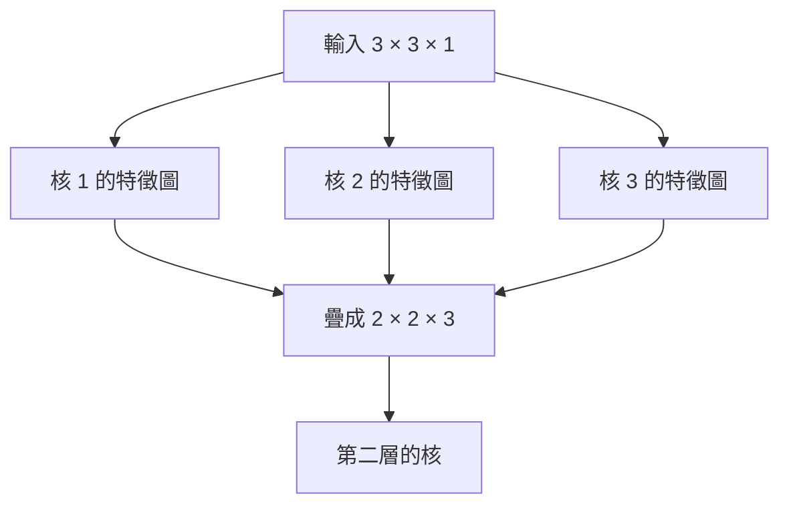
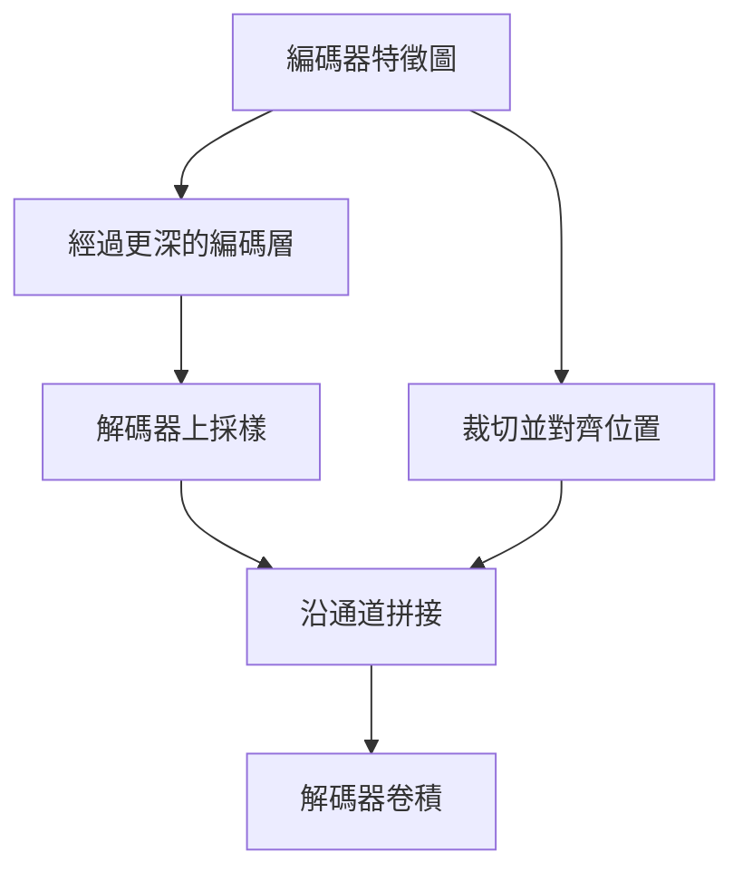

# CNN 補充講義｜從卷積核算到特徵圖、反向傳播與 U-Net

看到卷積層輸出 $2\times2\times3$ 時，這三個數字分別在數什麼？下一層會收到整張圖，還是收到一個攤平的向量？本篇用同一組數字算完兩層卷積，再回頭看每個位置接了哪些值，以及訓練時權重怎麼更新。

## 1. 通道是在同一個位置記下不同的數值

灰階圖片通常有一個輸入通道，每個像素的數值表示亮度。RGB 圖片的一個位置有紅、綠、藍三個數值，所以有三個輸入通道。卷積層輸出的通道有不同的含義。**一個輸出通道是一張特徵圖，記錄同一個卷積核在各位置的反應。** 例如，有個核對左右亮度差敏感，它的特徵圖就會保留這種反應發生在哪裡。

整篇用「高 × 寬 × 通道」描述單筆資料的形狀。以下把已知的 $3\times3$ 單通道矩陣當作第一層的輸入。它可以是一小張灰階圖，也可以是前面的運算已算好的單通道資料，本例的算式相同。

$$
X=\begin{bmatrix}
4&6&8\\
8&10&12\\
12&14&16
\end{bmatrix}.
$$

以下兩層都用 $2\times2$ 的標準卷積，步幅為 1，且不補邊。步幅是視窗每次移動的格數。不補邊表示視窗必須完全落在輸入內。手算先省略啟動函數，讓卷積結果直接交給下一層。本文的「卷積核」指產生一個輸出通道的整組權重，會包含視窗內各輸入通道的權重。實作按照深度學習框架常用的方式，直接將核和視窗的對應位置相乘。 [PyTorch Conv2d](https://docs.pytorch.org/docs/2.15/generated/torch.nn.Conv2d.html)

## 2. 第一層的三個核讀同一份輸入

第一層有三個核，各有四個權重和一個偏差。同一個核在四個位置使用相同的權重和偏差，三個核則各有自己的參數。

| 核 | 權重矩陣 | 偏差 | 這組係數會對什麼反應？ |
|---|---|---:|---|
| 1 | $\begin{bmatrix}1&1\\1&1\end{bmatrix}$ | 0 | 視窗內的值越大，總和越大。 |
| 2 | $\begin{bmatrix}-1&1\\-1&1\end{bmatrix}$ | −1 | 先算右欄總和減左欄總和，再減 1。若輸入是灰階，左暗右亮的垂直邊界會提高這個差。 |
| 3 | $\begin{bmatrix}1&1\\2&2\end{bmatrix}$ | 1 | 聚合四格的值，其中下排的權重是上排的兩倍。 |

先讓三個核都看左上視窗 $\begin{bmatrix}4&6\\8&10\end{bmatrix}$：

| 核 | 左上位置的計算 | 輸出 |
|---|---|---:|
| 1 | $4+6+8+10$ | 28 |
| 2 | $-4+6-8+10-1$ | 3 |
| 3 | $4+6+2(8)+2(10)+1$ | 47 |

左上位置因此有三個值 $[28,3,47]$，分別記在三個通道。接著，每個核都滑到剩下的三個位置。把所有運算列在一起：

| 視窗位置 | 輸入視窗，上排兩格再下排兩格 | 核 1 | 核 2 | 核 3 |
|---|---|---:|---:|---:|
| 左上 | $[4,6,8,10]$ | 28 | 3 | 47 |
| 右上 | $[6,8,10,12]$ | 36 | 3 | 59 |
| 左下 | $[8,10,12,14]$ | 44 | 3 | 71 |
| 右下 | $[10,12,14,16]$ | 52 | 3 | 83 |

每欄的四個結果按位置排回去，就得到三張 $2\times2$ 特徵圖：

$$
Y_1=\begin{bmatrix}28&36\\44&52\end{bmatrix},\quad
Y_2=\begin{bmatrix}3&3\\3&3\end{bmatrix},\quad
Y_3=\begin{bmatrix}47&59\\71&83\end{bmatrix}.
$$

**四個視窗位置決定每張圖有四格。三個核決定有三張圖。** 核 2 在四個位置恰好都算出 3，是因為這組輸入的左右亮度差固定。它在每格仍然算了一次。

### 怎麼從資料流判斷是同一層還是下一層？

如果要讓幾組權重在同一張圖上各自找不同圖樣，就在同一層設多個核。例如一組找垂直邊緣，另一組找水平邊緣。如果要讓後面的判斷同時用到前面找到的圖樣，就再接一層。後一層可以組合附近的水平和垂直邊緣，形成對轉角的反應。

## 3. 第二層到底收到什麼？需要 Flatten 嗎？

第二層收到的是上面三張特徵圖疊成的 **$2\times2\times3$ 張量**。它保留每個結果的空間位置。例如左上的 $[28,3,47]$ 是同一位置的三個特徵值。原先算這三個值時讀過的視窗 $\begin{bmatrix}4&6\\8&10\end{bmatrix}$ 已經用在第一層的計算，傳給第二層的是算好的結果及其排列。

第二層仍用 $2\times2$ 的核，這次只有**一個輸出核**。輸入有三個通道，因此這個核在三個通道各有一片 $2\times2$ 的權重，共 12 個權重，最後加一次偏差。設 12 個權重全為 1、偏差為 0，就能逐通道加總：

| 第二層從哪個通道讀入？ | 四格的加總 |
|---|---:|
| $Y_1$ | $28+36+44+52=160$ |
| $Y_2$ | $3+3+3+3=12$ |
| $Y_3$ | $47+59+71+83=260$ |

第二層的輸出是 $\hat y=160+12+260=432$。這次核剛好蓋滿 $2\times2$，只有一個可放的位置。加上一個輸出核，形狀就是 **$1\times1\times1$**。

| 看到「攤平」的地方 | 攤的是什麼？ | 算完去哪裡？ |
|---|---|---|
| 為了把卷積寫成內積 | 可以把本次讀到的局部視窗排成一個向量，同時以相同順序排好權重。第一層每次 4 個值，第二層每次 12 個。 | 每個核算出一個值，寫回對應的空間位置與輸出通道。卷積層之間直接傳特徵圖，無須加 Flatten。 |
| 特徵圖接到讀取全圖的全連接層 | 可以把整個 $2\times2\times3$ 一次攤成 12 個輸入值。 | 全連接層的每個輸出可以使用全部 12 個值。這是一種分類接法。 |

把第一層某一格寫成 $w^\top x+b$ 時，這個 $x$ 只代表那一格讀到的局部視窗。若拿同一寫法表示全連接層，$x$ 可以代表整張攤平的圖。**先確認 $x$ 指的是哪一批值，再看它的形狀。**

## 4. 哪些值會連到同一個輸出？

連線由架構決定。以本例來看，**空間上**讀核蓋到的高與寬，**通道上**讀視窗內的全部輸入通道。步幅決定下一個視窗從哪裡開始，補邊決定邊界怎麼處理。訓練則調整各條已接上的連線有多少影響。分組卷積可以另外限制哪些通道彼此相連，本例採用標準卷積。

把輸入右下角的 **16 改成 20**，保留其他值和全部權重。第一層四個視窗裡，只有右下視窗蓋到這一格，所以只會改變右下位置的結果：

| 位置 | 核 1 | 核 2 | 核 3 |
|---|---:|---:|---:|
| 左上、右上、左下 | 各自維持原值 | 各自維持原值 | 各自維持原值 |
| 右下 | $52+4(1)=56$ | $3+4(1)=7$ | $83+4(2)=91$ |

這也像在鍵盤照片上只改動右下角的一小塊影像。第一層左上的邊緣檢查讀不到那塊影像，所以輸出不變。但第二層的視窗包含第一層的右下位置，因此最後的結果仍會從 $432$ 變成 $432+4+4+8=448$。**每層只讀當下視窗，多疊一層仍能把原圖更大範圍的資訊合在一起。**

### 為什麼叫稀疏連接？和權重共享差在哪裡？

第一層有 9 個輸入值、12 個輸出值。若全連接，每個輸出都讀 9 個輸入，共 $12\times9=108$ 條可用連線。第一層實際有 $12\times4=48$ 條，因為每個輸出只讀自己的四格。這就是空間上的**局部連接**，也常用**稀疏連接**形容。即使輸入和特徵圖的每個值都大於零，連線本身仍是局部的。

這 48 條連線對應的可訓練權重只有 12 個，因為同一個核的四個權重會在四個位置重複使用，再加上三個核各自的偏差，共有 15 個可訓練參數。**局部連接決定讀哪幾格。權重共享決定移到下一格時沿用哪組參數。**

第二層剛好是特例。輸入整張才 $2\times2\times3$，唯一的輸出確實讀了全部 12 個值。若仍用同一個 $2\times2$ 核，但給它一個 $3\times3\times3$ 的輸入，每個輸出位置就只讀 27 個輸入中的 12 個。核的高與寬相同，輸入大小改變了每個輸出能讀到的範圍。

## 5. 權重怎麼開始？又怎麼往回調？

手算中的整數是為了追蹤運算而指定的。從零訓練時，常見做法是給權重小幅的隨機初值，讓同層的核從不同的數值開始。偏差每個輸出通道有一個，可以設為 0，也可以依框架設定初始化。若卷積後接 ReLU，可選用 He 常態初始化。它依每個輸出讀取的值數來設定初始尺度，標準差是 $\sqrt{2/\mathrm{fan\_in}}$。第一層讀 $2\times2\times1=4$ 個值，所以這個初始化的標準差約 $0.707$。這個數是在描述抽樣的尺度。 [PyTorch 初始化](https://docs.pytorch.org/docs/2.15/nn.init.html#torch.nn.init.kaiming_normal_)

**前向傳遞算特徵值，反向傳播沿同一張計算圖算梯度。** 用未修改的輸入重做例子，第二層預測 $\hat y=432$。假設目標是 440，用單筆平方損失 $L=\tfrac12(\hat y-440)^2$，損失是 32。損失對預測的斜率是 $432-440=-8$。

1. **算第二層的權重梯度。** 找出第二層乘上 $Y_1$ 左上角 28 的那個權重。這個權重增加一點，預測就按 28 的倍率增加，所以它的梯度是 $(-8)\times28=-224$。
2. **把梯度傳回第一層。** 第二層的權重目前都是 1，所以 $Y_1$ 四格各收到 $(-8)\times1=-8$ 的梯度。看第一層核 1 的右上權重，這個權重在四個視窗分別乘到 $6,8,10,12$。四次都用了同一個權重，所以梯度加起來是 $(-8)(6+8+10+12)=-288$。
3. **用梯度更新參數。** 例如用梯度下降、學習率 $0.00001$。第二層那個權重從 1 變成 $1-0.00001(-224)=1.00224$。第一層被追蹤的權重從 1 變成 $1-0.00001(-288)=1.00288$。先用更新前的參數把本輪梯度算完，再更新；其他權重與偏差也按各自的梯度處理。

只有前向時讀到的值可以直接在該次運算收到梯度。若同一個值影響多格輸出，從各條路徑回來的梯度會相加。這就是局部連接在反向傳播時的具體含義。模型訓練完後，用固定的權重對新圖片做推論，只執行前向計算。 [第 05 課｜反向傳播手算](units/05-statistical-models-loss.md)

## 6. U-Net 的跳接會把哪些資料送過去？

若任務是把每個像素分成「鍵帽」或「背景」，模型除了要看整塊圖形像什麼，還需要知道邊界在哪一格。U-Net 的編碼器逐步縮小特徵圖來捕捉上下文，解碼器再上採樣。原版 U-Net 把較早的編碼器特徵圖裁到對應大小，再和解碼器上採樣後的特徵圖**沿通道接在一起**。

例如對齊後，編碼器的特徵圖是 $32\times32\times16$，上採樣後的解碼器張量是 $32\times32\times32$，兩者接起來就是 $32\times32\times48$。同一個位置上，前 16 個值和後 32 個值一起交給後續卷積使用。前面的邊緣資訊與深層的區域資訊，因此能在對齊的位置一起參與分割判斷。

卷積的局部連接決定**每個輸出讀視窗中的哪些值**。U-Net 的跳接決定**哪一層的特徵圖也能走到解碼器**。沿通道拼接時，特徵圖仍保有高、寬和位置，解碼器才能按位置合用它們。 [U-Net 原論文，第 2 節與圖 1](https://arxiv.org/pdf/1505.04597)

### 為什麼有了上採樣，還需要跳接？

上採樣可以把特徵圖放大。若兩種不同的局部圖樣在下採樣時變成相同的值，單靠放大就無法從這些值判斷原來是哪一種圖樣。沿用鍵帽的例子，用一排四格來模擬邊界附近的反應。1 表示有反應，0 表示無反應。每兩格取一次最大值：

| 下採樣前的四格 | 第 1、2 格的最大值 | 第 3、4 格的最大值 | 下採樣後 |
|---|---:|---:|---|
| `[1, 1, 0, 0]` | 1 | 0 | `[1, 0]` |
| `[1, 0, 0, 0]` | 1 | 0 | `[1, 0]` |

第一排的反應延伸到第 2 格，第二排只延伸到第 1 格。兩排縮小後完全相同。即使把 `[1, 0]` 放大回四格，也只得到同一個結果，無法靠這兩個值判斷原先第 2 格有沒有反應。

跳接把下採樣前的特徵沿另一條路送到解碼器。深層表示可以幫忙判斷這一帶像不像鍵帽，較早的高解析度表示則提供邊界在第幾格的線索。兩者按位置對齊後，後續卷積就能同時參考兩份資訊。鍵帽之間的窄縫和邊緣，正是下採樣時容易變得難以區分的細節。[U-Net 原論文第 2 節與圖 1](https://arxiv.org/pdf/1505.04597)

### U-Net 和自編碼器有什麼關係？

兩者都可以包含編碼器和解碼器。判斷用途時，要看**解碼器從哪裡取得資訊，以及訓練時要它輸出什麼**。

| 用同一張鍵盤照片當輸入 | 基本自編碼器（Autoencoder） | 用於分割的 U-Net |
|---|---|---|
| 解碼器收到什麼？ | 編碼器產生的中間表示，例如一組壓縮後的向量。 | 較深的表示，以及透過跳接送來的高解析度特徵。 |
| 訓練時的答案是什麼？ | 原始鍵盤照片。模型重建的是每個位置的像素值。 | 人工標註的分割圖。模型預測的是每個位置屬於鍵帽或背景。 |
| 鍵帽中間有一條縫，要做什麼？ | 重建這條縫的亮度與外觀。 | 標出縫所在的位置屬於背景。 |

**U-Net 描述的是架構，自編碼器描述的是一種以重建為目標的學習方式。** 要用 U-Net 式架構做自編碼器，可以讓輸出層產生和輸入相同的影像通道，再用影像重建誤差訓練。如果目標是讓中間表示承擔壓縮，還要考慮跳接會提供多少細節，因為解碼器可以沿跳接直接取得部分資訊。

### U-Net 還可以學哪些任務？

U-Net 可以直接做分割。換成其他輸入與訓練答案，同一類多尺度架構也能用來學其他任務：

| 任務 | 給模型的輸入 | 訓練時的答案／模型輸出 |
|---|---|---|
| **影像分割** | 一張鍵盤照片。 | 答案是逐像素的鍵帽／背景標註，模型輸出每個位置的分類分數。[U-Net 原論文](https://arxiv.org/abs/1505.04597) |
| **擴散模型中的雜訊預測** | 加了雜訊的影像和目前的時間步。 | 以 DDPM 為例，答案是加噪時使用的雜訊。取樣時，演算法根據 U-Net 的預測反覆去噪，逐步生成影像。[DDPM 原論文，演算法 1、2 與附錄 B](https://arxiv.org/pdf/2006.11239) |
| **音源分離** | 人聲和伴奏混在一起的波形。 | 答案是分開的音源波形。Wave-U-Net 沿時間軸縮小和放大特徵，再估計各音源的波形。[Wave-U-Net 原論文](https://arxiv.org/abs/1806.03185) |

回到第 05 課的概念，**先確認答案的形式，再選模型的輸出與損失**。對鍵帽分割，答案是逐像素類別，可以在每個位置用交叉熵。對預測雜訊，答案是連續數值，DDPM 的簡化訓練目標會比較預測雜訊與實際加入的雜訊之間的平方誤差。[第 05 課講義](units/05-statistical-models-loss.md) · [DDPM 原論文，演算法 1](https://arxiv.org/pdf/2006.11239)

想把架構寫成程式，可以接著讀 [U-Net 實作講義](unet-segmentation-training.md)，沿用鍵帽／背景的例子，逐步建立配對資料、訓練、驗證與判讀分割結果。

## 自我檢核

1. 如果第一層由三個核增加到四個，其他設定照舊，輸出形狀是什麼？
2. 如果只改輸入正中央的 10，第一層哪幾個空間位置有機會改變？
3. 如果接下來只要整張圖的類別，可以如何使用特徵圖？如果要做逐像素分割，為什麼要保留高和寬？
4. 下採樣後同樣是 `[1, 0]`，跳接讓解碼器多看到什麼？同一張鍵盤照片拿去做分割和自編碼，答案各是什麼？

### 參考解答

1. $2\times2\times4$。四個核各算一張 $2\times2$ 特徵圖。
2. 本例的四個位置都會改變，因為每個視窗都蓋到中央，而且這些位置對應的權重都非零。
3. 分類可把全圖攤平後接全連接，或先對每個通道取空間平均，再送入分類層。分割要為每個位置產生對應的預測，因此要保有空間座標，才能把結果對回輸入影像。
4. 跳接提供縮小前的特徵圖，因此可參考第 2 格原本有沒有反應。分割的答案是每個像素的類別，自編碼的答案是原始照片的像素值。

讀 DLI 的 CNN 時，可以先找每層的輸入通道、輸出通道和核大小，再定位模型何時開始對整張圖做分類。 [DLI 章節與教材對照](dli-mapping.md) · [張量與統計軸](units/bridge-tensor-axes.md)
