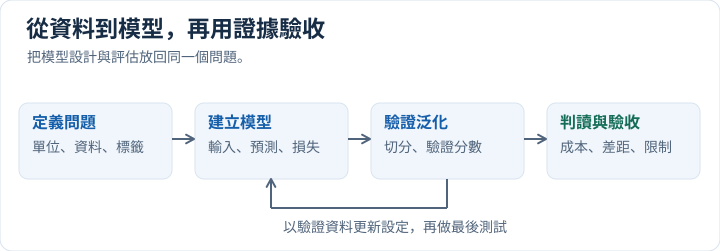
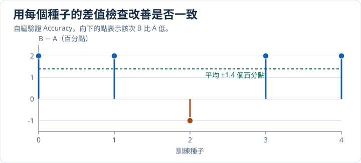

# 從統計到 AI 的模型設計

同一個影像辨識服務可以回答三種問題。這筆請求和哪筆歷史資料最相似？大約會等幾毫秒？會不會超時？我們沿用這個案例，依序看統計工具處理什麼問題、進入神經網路後在哪裡運算，以及它會改變什麼。所有服務數據與算例都是自編。

## 先選閱讀路線

第一次讀，依下表把十課串起來。以影像辨識服務為例，資料要先能代表使用情境，模型才有可學的例子。訓練後的分數需要用獨立資料驗證，最後再判斷錯誤成本和改善幅度。

| 要回答的問題 | 對應講義 | 為什麼接到下一步 |
|---|---|---|
| 界定資料與事件 | [01 資料與描述統計](units/01-data-descriptive-statistics.md) · [02 機率與分類](units/02-probability-classification.md) | 先說明一筆是什麼，再用分布描述量測，用機率描述事件。 |
| 準備公平的輸入 | [03 抽樣與資料切分](units/03-sampling-data-splits.md) · [04 尺度與標準化](units/04-scaling-normalization.md) | 用部署對象決定留出單位，再從訓練集建立可重用的座標。 |
| 讓模型學習 | [05 統計模型與損失](units/05-statistical-models-loss.md) · [06 過擬合與泛化](units/06-overfitting-generalization.md) | 定義輸出、損失與梯度，再用驗證集檢查模型的彈性是否合適。 |
| 判讀模型是否有用 | [07 分類模型評估](units/07-classification-evaluation.md) · [08 不確定性與比較](units/08-uncertainty-comparison.md) · [09 實驗設計](units/09-experimental-design.md) | 從漏判與誤報成本選指標，估計差距的變動，再用受控設計解讀原因。 |
| 把方法搬到文字 | [10 文字資料的統計](units/10-text-statistics.md) | 辨認 token 及其分布，追蹤注意力如何更新表示，以及交叉熵如何訓練下一個 token 預測。 |

接著沿用同一套影像辨識服務，從前方請求數與資料量開始，追蹤一次模型設計。精讀時先讀圖的軸、對象與單位，再自行重算一筆，最後到 Notebook 改一個條件看結果如何變。

## 1. 資料先換到可比較的尺度

假設輸入有兩個特徵，前方請求數和請求資料量（KB）。前方多一筆和多 1 KB 的意義不同。若直接用數值算距離，僅把 KB 換成 bytes 就可能改變最近鄰，即使請求實際上完全相同。

**統計的做法**是用平均數 $\mu$ 當中心，用標準差 $s$ 當尺度。$z=(x-\mu)/s$ 表示離平均數幾個標準差。這是把原始量測換成相對於參考資料的位置。直方圖的偏斜或多峰仍可能存在。

**AI 的用法**是在訓練資料上估計每欄 $\mu,s$，再把同一組參數用到驗證、測試與上線資料。這讓模型看見一致的座標。例如訓練參考資料的兩欄平均是 $(1,200)$，標準差是 $(1,100)$。對查詢 $(1,200)$，候選 A $(2,200)$ 與 B $(1,250)$ 的原始距離為 1 與 50，縮放後為 1 與 0.5。最近鄰從 A 變成 B，因此同一個距離模型可能給不同預測。有些用梯度訓練的模型也會受特徵尺度影響，因為特徵值會參與梯度運算。實務上要依模型與特徵含義驗證縮放方式。

**檢核。** 若上線的資料量比訓練時普遍大，該用今天的請求重新計算平均數嗎？若模型沒有設計線上調整，應沿用訓練參數，另外檢查分布差異對預測的影響。[第 04 課：手算與 Python 實驗](units/04-scaling-normalization.md) · [scikit-learn 特徵縮放示例](https://scikit-learn.org/stable/auto_examples/preprocessing/plot_scaling_importance.html)

把輸入放到一致的尺度後，可以用歷史紀錄預測新請求的延遲。先選容易檢查的直線，讓後續模型有一個比較基準。

## 2. 先用迴歸建立基準，再用殘差找線索

先固定請求資料量，只看前方請求數 $x$ 和實測延遲 $y$。

| 請求數 $x$ | 實測延遲 $y$（ms） | 最小平方直線的預測 $\hat y$ | 殘差 $y-\hat y$ |
|---:|---:|---:|---:|
| 0 | 5 | 3.8 | 1.2 |
| 1 | 7 | 7.3 | −0.3 |
| 2 | 9 | 10.8 | −1.8 |
| 3 | 14 | 14.3 | −0.3 |
| 4 | 19 | 17.8 | 1.2 |

**統計的做法**是先指定模型形狀 $\hat y=b+wx$，再選使殘差平方和最小的參數。本例得到 $b=3.8,w=3.5$，MSE 為 1.26 ms²。正殘差表示低估。圖上容易被漏掉的是兩端低估、中間高估的形狀。它提示我們檢查是否漏掉曲線或轉折，這組五筆資料本身不足以確認機制。

**AI 的用法**沿用同樣的訓練思想。先把預測轉成損失，再調整參數。模型可以是一條直線，也可以是能表示轉折的網路。前者提供可解釋的比較基準，後者是否值得使用，要看驗證資料是否改善。[第 05 課：斜率、殘差與 MSE 手算](units/05-statistical-models-loss.md) · [NIST 線性最小平方迴歸](https://www.itl.nist.gov/div898/handbook/pmd/section1/pmd141.htm)

直線的殘差顯示兩端同向偏離。延遲有可能在佇列變長後上升得更快，這為下一步嘗試轉折提供理由。

## 3. 把非線性放進模型，讓斜率能改變

把多個「乘權重、加偏差」的層疊起來，整體仍可寫成一次「乘權重、加偏差」。加入啟動函數才有辦法改變形狀。下面用 ReLU 示範：

$$\hat y=5+2x+3\max(0,x-2).$$

$x$ 未超過 2 時，追加項為零，斜率是 2。超過 2 時，追加項每步增加 3，整體斜率是 5。這個式子剛好能描述本例五點。實際資料有雜訊，應用留出的資料判斷模型的彈性是否有幫助。

選啟動函數時，可看**輸出範圍、負值怎麼處理、梯度會不會太小**。ReLU 正側作線性傳遞，負側清零。Leaky ReLU 在負側保留小斜率。GELU 以平滑方式加權輸入。Sigmoid 和 tanh 提供有界輸出，適合作為需要範圍限制的機率轉換或狀態，但兩端會飽和。隱藏層決定可表示的形狀，最後一層的輸出則由任務定義。[第 06 課：啟動函數比較與轉折圖](units/06-overfitting-generalization.md) · [GELU 原論文](https://arxiv.org/abs/1606.08415)

有了能表示轉折的模型，還要定義它究竟要交出毫秒或超時機率。這個選擇改變輸出形式，以及怎麼算損失。

## 4. 把預測目標轉成輸出和損失

若要回答「會等幾毫秒」，沿用實數標籤。若要回答「會不會超過 12 ms」，把五筆資料的標籤改成 $[0,0,0,1,1]$。這樣即使使用相同的隱藏層，輸出和學習訊號也會跟著改變。

| 問題 | 輸出 | 損失與訓練影響 |
|---|---|---|
| 延遲是多少？ | 一個實數 $\hat y$ | MSE 加重較大的殘差，MAE 對每增加一單位的絕對誤差給相同增量，Huber 可分段處理小偏差和大偏差 |
| 會不會超時？ | 一個 logit，經 sigmoid 解讀為正類機率 | 二元交叉熵隨實際答案的機率降低而增加 |
| 請求只屬於哪一種狀態？ | 每種狀態一個 logit，softmax 後形成一個分布 | 多類別交叉熵讓互斥類別在同一分布裡競爭 |
| 請求可能同時有哪些問題？ | 每個標籤一個 logit，各自轉成機率分數 | 逐標籤計算二元交叉熵 |
| 下一個 token 是什麼？ | 當前位置對詞彙表的 logits | 交叉熵衡量模型給參考 token 的機率 |

### Sigmoid、BCE 與多類別交叉熵怎麼接起來？

**Sigmoid 把 logit 轉成機率，交叉熵再依真實答案算損失。** 在二元問題，Sigmoid 提供 $(p,1-p)$。把真實分布 $(y,1-y)$ 與這組預測機率代入交叉熵通式 $-\sum_k q_k\ln p_k$，就是 BCE。若有多個互斥的答案，通常用 Softmax 提供一個多類別分布。若標籤可同時成立，每個標籤可各自使用 Sigmoid 並各算一項 BCE。

舉例來說，兩筆請求的真實答案分到 0.8 和 0.2 的機率。在給定輸入後條件獨立的假設下，概似是 $0.8\times0.2$。取負對數後，$-\ln(0.8\times0.2)=-\ln(0.8)-\ln(0.2)$，模型便能用逐筆相加的損失來最大化概似。BCE 和多類別交叉熵都用這個原理。若真實答案只分到 1% 機率，該筆損失約為 4.605。

PyTorch 的 BCEWithLogitsLoss 與 CrossEntropyLoss 都直接接 logits。推論需要解讀機率時，再依任務使用 Sigmoid 或 Softmax。二元警報的閾值可依漏報和誤報成本另行選定。[第 02 課：分數與機率](units/02-probability-classification.md) · [第 05 課：通式、BCE 與取對數的推導](units/05-statistical-models-loss.md) · [PyTorch 二元交叉熵](https://docs.pytorch.org/docs/2.15/generated/torch.nn.BCEWithLogitsLoss.html) · [PyTorch 多類別交叉熵](https://docs.pytorch.org/docs/2.15/generated/torch.nn.CrossEntropyLoss.html)

損失把好壞定義為同一個分數。要讓參數自動調整，還需要知道每個參數往哪邊改會讓分數降低。

## 5. 反向傳播把最後的損失傳回各層

模型先預測，再算損失。反向傳播用鏈鎖律回頭算「每個參數改一點，損失會變多少」。以第 2 節的迴歸為例，單筆平方損失 $L=(y-\hat y)^2$ 對 $\hat y$ 的導數是 $-2r$，$\hat y=b+wx$ 對 $w$ 的導數是 $x$。相乘得到權重梯度 $-2rx$，最佳化器再據此調整權重。

深層網路須乘更多局部導數。Sigmoid 的導數至多為 0.25，兩端飽和時更小。假設六段的局部導數都為 0.25，梯度縮成 $0.25^6\approx0.000244$ 倍。隱藏層收到的梯度越小，參數越難獲得有效的更新訊號。這是選擇隱藏層啟動函數與設計殘差旁路時要考慮的問題。

在二元分類的**輸出端**，Sigmoid 提供機率。與未加權的二元交叉熵合用時，對 logit 的導數是 $p-y$，所以預測 0.000335 而答案為 1 時，梯度約 −0.9997。這說明輸出梯度必須把啟動函數和損失一起考慮。多層隱藏路徑的梯度仍要另行檢查。[第 05 課：反向傳播手算](units/05-statistical-models-loss.md) · [第 06 課：Sigmoid 與梯度實驗](units/06-overfitting-generalization.md) · [Glorot 與 Bengio 的研究](https://proceedings.mlr.press/v9/glorot10a.html) · [PyTorch BCEWithLogitsLoss](https://docs.pytorch.org/docs/2.15/generated/torch.nn.BCEWithLogitsLoss.html)

沿著各層追蹤梯度後，再回頭看各層接到的數值。不同尺度會影響啟動函數所在的範圍，也就可能影響往前傳的梯度。

## 6. 尺度問題也會出現在網路中間

第一節處理的是「資料要用哪把尺」。在網路中，前一層的輸出會成為下一層的輸入，而這些值會跟著權重更新而改變。將正規化放進模型，可以調整中間表示的尺度。效果取決於哪一組值用來估計統計量，以及該估計何時更新。

| 方法 | 統計量從哪裡來 | 學生可觀察的影響 |
|---|---|---|
| 輸入 Z-score | 用訓練樣本估計每個輸入特徵的平均與標準差 | 所有集合沿用相同參考尺度 |
| BatchNorm2d | 訓練時針對每個通道，跨批次與空間位置計算。預設評估時使用累積統計量 | 同一張影像放入不同訓練批次，中間的正規化結果可能改變 |
| LayerNorm(D) | 對 $[B,T,D]$ 的每個 token 沿最後的 $D$ 維計算 | 同一 token 的輸入向量固定時，該次正規化可獨立於其他 token 和樣本計算 |
| PowerNorm | 原論文放寬零均值要求，使用跨批次累積的平方大小來縮放，並設計相應的近似反向傳播 | 作者在其 Transformer 實驗中用它平滑批次統計的波動，效果應依實驗設定解讀 |

以本教材的 $[2,4]$ 為例，平均為 3，除以 $n$ 的變異數為 1，均方值為 10，RMS 是 $\sqrt{10}$。差異來自 $E[X^2]=\mathrm{Var}(X)+(E[X])^2$。這裡的 $E$ 可讀作對這兩個值等權平均。變異數量的是離中心的平方大小，均方量的是離零的平方大小。算例說明 PN 為什麼需要二次動差的背景，完整更新規則見原論文。[第 04 課：資料標準化和模型內正規化](units/04-scaling-normalization.md) · [PyTorch BatchNorm2d](https://docs.pytorch.org/docs/2.15/generated/torch.nn.BatchNorm2d.html) · [PyTorch LayerNorm](https://docs.pytorch.org/docs/2.15/generated/torch.nn.LayerNorm.html) · [PowerNorm 論文](https://proceedings.mlr.press/v119/shen20e.html)

知道正規化在哪些數值上計算後，可以沿著 Transformer 的一個 token 追蹤它何時接收上下文、何時加回原表示，以及何時做正規化。

## 7. Transformer 把表示寫成「基準加更新」

### 統計迴歸的殘差與 Transformer 的殘差是同一個概念嗎？

兩者共用「基準＋差量」的寫法。**迴歸的殘差衡量預測偏差，Transformer 的殘差分支則產生內部表示的更新。**

| | 統計迴歸 | Transformer 的殘差相加 |
|---|---|---|
| 基準 | 預測值 $\hat y$ | 子層的輸入向量 $h$ |
| 差量從哪裡來 | 觀測到 $y$ 後，計算 $r=y-\hat y$ | 注意力或前饋子層以當前輸入算出 $F(h)$ |
| 相加代表什麼 | $\hat y+r=y$，還原實測值 | $h+F(h)$，得到相加點的表示 |

例如預測延遲 **7 ms**，實測 **9 ms**，迴歸殘差是 **+2 ms**，表示低估了 2 ms。在實測值還沒到手時，這個殘差也還無法計算。Transformer 的一個 token 向量若為 $[2,1,-1]$，子層算出更新 $[0.3,-0.2,0.1]$，相加得到 $[2.3,0.8,-0.9]$。推論時有當前的輸入和已訓練的參數，就能算出這個更新。

把相加點的映射記作 $H(h)=h+F(h)$，便可重排成 $F(h)=H(h)-h$。這解釋了為何稱作「殘差學習」。這裡的 $H(h)$ 是模型在相加點實現的映射，訓練資料通常只給最終任務的答案。子層透過整體損失的反向傳播來學會怎麼更新表示。

### 殘差相加如何影響梯度？

相加本身提供直接的梯度路徑，以純量為例，普通層回傳時要乘 $F'(h)$，殘差相加在該處則乘 $1+F'(h)$。多出來的 1 是直接路徑。若 $F'(h)=0.01$，兩者為 0.01 和 1.01。實際梯度還取決於子層、正規化與其所在的位置。

原始 Transformer 在前饋層使用 ReLU，將子層輸出加回後才做 LayerNorm，也就是 Post-LN。Pre-LN 把 LayerNorm 移到子層入口。輸出的 token 交叉熵是另一個步驟，用於比較模型預測與資料標籤。學生可依序在架構圖圈出「前饋非線性 → 加回表示 → 正規化 → 最後的預測損失」。這個順序描述原論文的前饋子層和輸出端。[第 10 課：殘差連接手算](units/10-text-statistics.md) · [ResNet 原論文](https://arxiv.org/abs/1512.03385) · [Transformer 原論文 §3](https://arxiv.org/html/1706.03762v7#S3) · [Pre-LN 與 Post-LN 的研究](https://proceedings.mlr.press/v119/xiong20b.html)

## 8. 用驗證與實驗把模型結果變成可解讀的證據

若服務要攔截超時，從混淆矩陣開始，先讀漏判和誤報各幾筆，再依現場代價選指標。同一份測試資料可逐筆比較兩個模型，並估計抽樣造成的差異。若要把改善歸因到某項訓練改動，還需要固定資料切分、訓練預算與評估規則，記錄多次結果。

例如五次驗證的平均提升是 1.4 個百分點，但其中一次下降。平均說明這組嘗試的整體方向，每次差值則顯示改善是否一致。這兩項證據會影響你如何安排下一輪比較。可接著讀 [分類指標](units/07-classification-evaluation.md) · [抽樣不確定性](units/08-uncertainty-comparison.md) · [受控實驗](units/09-experimental-design.md)

## 用同一案例做一次完整判斷

1. **從資料開始。** 說明輸入、量測單位與切分方式。比較原始距離和標準化後的最近鄰。
2. **建立基準。** 用線性迴歸畫殘差，指出哪個區間常低估或高估，再比較加入 ReLU 轉折的結果。
3. **重寫目標。** 以「是否超過 12 ms」定義二元標籤，用同一個 logit 分別說明機率、交叉熵及閾值各在回答什麼。
4. **閱讀模型。** 在 Transformer 圖或程式裡找出加回點、正規化、啟動函數及最後的損失。說明各步驟在訓練和推論時需要哪些資料。
5. **檢查結論。** 報告中附上手算與程式輸出，標明自編假設與原始來源。若不同模型共用同一批測試資料，先配對再比較。若切分、訓練預算或評估方式改了，須在解讀中說明這些條件。

[Notebook 目錄與 Colab 入口](../notebooks/README.md) · [八篇論文閱讀導引](paper-reading-guide.md)
