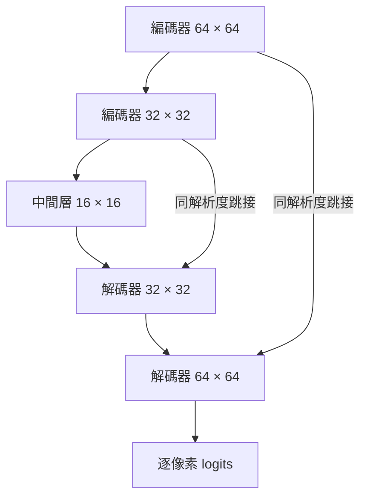

# U-Net 實作講義｜從鍵帽遮罩到模型訓練

給模型一張鍵盤照片，要它標出每個像素是鍵帽還是背景。這個任務叫**二元影像分割**。本篇先追蹤 U-Net 的每層資料形狀，再用小型 PyTorch 程式跑過資料生成、訓練、驗證與結果判讀。可把四段程式依序貼到同一個 Colab 筆記本，執行環境需要 PyTorch 和 Matplotlib。

[先讀 CNN 特徵圖與跳接](cnn-convolution-feature-maps.md) · [第 05 課｜logits 與交叉熵](units/05-statistical-models-loss.md)

## 1. 一筆訓練資料長什麼樣？

每筆資料有一張影像和一張對齊的**遮罩（mask）**。例如影像在第 18 列、第 22 欄有一個亮度值，遮罩在同一位置則標記它是鍵帽（1）還是背景（0）。一張 $64\times64$ 影像因此有 $4{,}096$ 個像素答案。這些標籤保留空間位置，解碼器的目標也是逐像素輸出。

| 資料 | PyTorch 形狀 | 每個位置代表什麼？ |
|---|---|---|
| 灰階輸入 | $B\times1\times64\times64$ | 亮度，這裡縮放到 0～1。 |
| 正確遮罩 | $B\times1\times64\times64$ | 0 或 1，以浮點數儲存供 BCE 使用。 |
| 模型輸出 | $B\times1\times64\times64$ | 鍵帽的原始分數（logit）。 |

$B$ 是一批有幾張圖。實驗用帶雜訊的合成矩形代表鍵帽。原始 U-Net 論文以影像和分割標註訓練，本例用一個輸出通道示範二元分割。[U-Net 原論文，第 2、3 節](https://arxiv.org/pdf/1505.04597)

## 2. 編碼器、解碼器和跳接在程式裡長什麼樣？

卷積區塊使用兩次 $3\times3$ 卷積，每次補一格以保留高與寬。最大池化把高寬各減半，解碼器用步幅為 2 的轉置卷積把高寬各加倍。跳接在兩張圖高寬相同時**沿通道拼接**。



以下省略批次軸，依「通道 × 高 × 寬」列出實際形狀：

| 步驟 | 輸出形狀 | 用途 |
|---|---:|---|
| 第一個編碼區塊 e1 | $16\times64\times64$ | 取得高解析度特徵並留作跳接。 |
| 池化後進入 e2 | $32\times32\times32$ | 組合較大範圍的特徵，再留一份給跳接。 |
| 第二次池化後的中間層 | $64\times16\times16$ | 整合跨區域資訊。 |
| 第一次上採樣、拼接與卷積 | $32\times32\times32$ | 上採樣先產生 32 個通道，接上 e2 的 32 個通道，再用卷積整合成 32 個。 |
| 第二次上採樣、拼接與卷積 | $16\times64\times64$ | 上採樣先產生 16 個通道，接上 e1 的 16 個通道，再用卷積整合成 16 個。 |
| $1\times1$ 輸出層 | $1\times64\times64$ | 每個位置將 16 個特徵值組合成一個 logit。 |

程式中的 `torch.cat(..., dim=1)` 就是沿通道拼接。以第一次跳接為例，上採樣結果和 e2 都是 $32\times32$，所以同一位置可以把兩邊各 32 個值合成 64 個值。接下來的卷積再學如何利用這些特徵。這個教學版以 $64\times64$ 輸入為例，兩次池化與上採樣的尺寸正好對齊。[U-Net 原論文，圖 1](https://arxiv.org/pdf/1505.04597) · [PyTorch 轉置卷積](https://docs.pytorch.org/docs/2.15/generated/torch.nn.ConvTranspose2d.html)

```python
import torch
from torch import nn

def conv_block(in_channels, out_channels):
    return nn.Sequential(
        nn.Conv2d(in_channels, out_channels, kernel_size=3, padding=1),
        nn.ReLU(),
        nn.Conv2d(out_channels, out_channels, kernel_size=3, padding=1),
        nn.ReLU(),
    )

class SmallUNet(nn.Module):
    def __init__(self):
        super().__init__()
        self.enc1 = conv_block(1, 16)
        self.enc2 = conv_block(16, 32)
        self.pool = nn.MaxPool2d(2)
        self.middle = conv_block(32, 64)

        self.up2 = nn.ConvTranspose2d(64, 32, kernel_size=2, stride=2)
        self.dec2 = conv_block(64, 32)
        self.up1 = nn.ConvTranspose2d(32, 16, kernel_size=2, stride=2)
        self.dec1 = conv_block(32, 16)
        self.head = nn.Conv2d(16, 1, kernel_size=1)

    def forward(self, images):
        e1 = self.enc1(images)
        e2 = self.enc2(self.pool(e1))
        middle = self.middle(self.pool(e2))

        d2 = self.dec2(torch.cat([self.up2(middle), e2], dim=1))
        d1 = self.dec1(torch.cat([self.up1(d2), e1], dim=1))
        return self.head(d1)

torch.manual_seed(7)
model = SmallUNet()
with torch.no_grad():
    assert model(torch.zeros(2, 1, 64, 64)).shape == (2, 1, 64, 64)
```

## 3. 做出影像與遮罩的配對

先在遮罩中隨機畫一個矩形。再根據遮罩把矩形區域設得較亮、背景設得較暗，兩者都加入雜訊。這樣每張影像都有已知的正解。用三個種子產生各自獨立的訓練、驗證和測試樣本。

```python
from torch.utils.data import DataLoader, TensorDataset

def make_examples(count, seed):
    rng = torch.Generator().manual_seed(seed)
    masks = torch.zeros(count, 1, 64, 64)

    for i in range(count):
        row, col = torch.randint(4, 37, (2,), generator=rng).tolist()
        height, width = torch.randint(12, 25, (2,), generator=rng).tolist()
        masks[i, 0, row:row + height, col:col + width] = 1

    noise = 0.15 * torch.randn(masks.shape, generator=rng)
    images = (0.25 + 0.50 * masks + noise).clamp(0, 1)
    return images, masks

train_set = TensorDataset(*make_examples(128, seed=1))
train_loader = DataLoader(train_set, batch_size=8, shuffle=True)
val_images, val_masks = make_examples(32, seed=2)
test_images, test_masks = make_examples(32, seed=3)
```

## 4. 用逐像素 BCE 訓練，最後才用測試集

某像素的標註是 1，而模型只分給它 $p=0.2$ 的鍵帽機率。這一格的二元交叉熵就是 $-\ln(0.2)\approx1.609$。若標註是 0，這一格則用背景機率 $1-p$ 來算。`BCEWithLogitsLoss` 直接收模型的原始 logits 和同形狀的標註圖，由損失函數完成相應的機率計算。程式每批算平均損失，反向傳播後用 Adam 更新參數。[PyTorch BCEWithLogitsLoss](https://docs.pytorch.org/docs/2.15/generated/torch.nn.BCEWithLogitsLoss.html)

驗證時可另外把機率以 $0.5$ 為門檻轉成預測遮罩，再算 **Dice**。假設預測有 6 格屬於鍵帽，實際有 5 格，其中 4 格重疊，則 Dice 為 $2(4)/(6+5)\approx0.727$。程式將同一集合的前景像素合計後計算。當預測與標註的區域更吻合，Dice 就更接近 1。

這裡用**驗證 BCE 最低**的一輪選權重。保留該輪權重後，才對測試資料報告 BCE 和 Dice。$0.5$ 是本例設定的判定門檻。實務上如要調門檻，也用驗證集選，最後再固定到測試集。

```python
from copy import deepcopy

criterion = nn.BCEWithLogitsLoss()
optimizer = torch.optim.Adam(model.parameters(), lr=0.001)

@torch.inference_mode()
def evaluate(images, masks):
    model.eval()
    logits = model(images)
    loss = criterion(logits, masks).item()

    probability = logits.sigmoid()
    predicted = probability >= 0.5
    actual = masks.bool()
    overlap = (predicted & actual).sum()
    foreground = predicted.sum() + actual.sum()
    dice = (2 * overlap / foreground.clamp_min(1)).item()
    return loss, dice

best_loss = float("inf")
best_weights = None

for epoch in range(1, 6):
    model.train()
    total_loss = 0.0

    for images, masks in train_loader:
        optimizer.zero_grad()
        logits = model(images)
        loss = criterion(logits, masks)
        loss.backward()
        optimizer.step()
        total_loss += loss.item() * images.size(0)

    train_bce = total_loss / len(train_set)
    val_bce, val_dice = evaluate(val_images, val_masks)
    if val_bce < best_loss:
        best_loss = val_bce
        best_weights = deepcopy(model.state_dict())

    print(
        f"Epoch {epoch}: train BCE={train_bce:.3f}, "
        f"val BCE={val_bce:.3f}, val Dice={val_dice:.3f}"
    )

model.load_state_dict(best_weights)
test_bce, test_dice = evaluate(test_images, test_masks)
print(f"Test BCE={test_bce:.3f}, test Dice={test_dice:.3f}")
```

## 5. 看一張圖，確認模型錯在哪裡

從同一張測試影像並排顯示原圖、正確遮罩、模型機率和最終預測。假設某處機率約 0.48，遮罩會把它判作背景。保留機率圖有助於區分邊界上的低把握判斷與整片都判錯的情況。

```python
import matplotlib.pyplot as plt

model.eval()
with torch.inference_mode():
    probability = model(test_images[:1]).sigmoid()[0, 0]
    predicted = probability >= 0.5

fig, axes = plt.subplots(1, 4, figsize=(10, 3), layout="constrained")
panels = [
    ("Input", test_images[0, 0]),
    ("Ground truth", test_masks[0, 0]),
    ("Foreground probability", probability),
    ("Predicted mask", predicted),
]

for ax, (title, image) in zip(axes, panels):
    ax.imshow(image.cpu().numpy(), cmap="gray", vmin=0, vmax=1)
    ax.set_title(title)
    ax.axis("off")

plt.show()
```

### 換成真的鍵盤照片

- **保持影像和遮罩對齊。** 調整尺寸時可對照片做雙線性插值，對遮罩用最近鄰插值，保留 0／1 的類別。旋轉或翻轉時對兩者套用相同的空間變換。
- **依部署對象切分。** 想看新鍵盤的結果，就依實體鍵盤分組切分。同一把鍵盤的相近照片都進同一個集合，再用不同鍵盤作測試。[第 03 課｜資料切分](units/03-sampling-data-splits.md)
- **先看錯在哪裡，再改設定。** 把容易漏掉的細縫、細邊界和小鍵帽標出。若要檢驗跳接的作用，固定資料、損失和訓練步數，從同一版程式拿掉拼接，並把對應解碼區塊的輸入通道由 64、32 改為 32、16。這樣也改變了參數量，解讀結果時要把這項差異一起列出。
