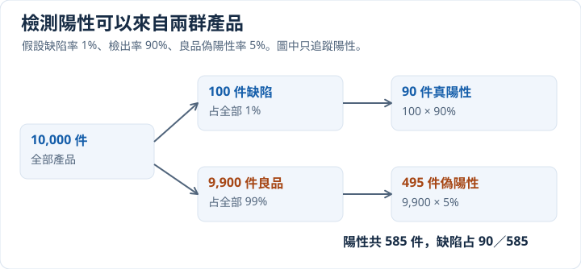

# 機率與分類

[在 Colab 執行](https://colab.research.google.com/github/Samuel-ncu/AI-Stastic/blob/main/notebooks/02_probability_classification.ipynb) · [GitHub Notebook](../../notebooks/02_probability_classification.ipynb)

[背景導讀：從統計到 AI 的模型設計](../statistics-to-ai.md)

## 學習目標與先備知識

檢測設備能找出 90% 的缺陷，收到警報時還需要問另一個問題：警報對應的產品有多少真的壞了？兩個問題用到同一個真陽性數，分母卻來自兩群產品。

先複習比例與百分比。學完能區分「有缺陷時驗出陽性」與「驗出陽性時有缺陷」，並理解分類分數為何需要驗證。

## 1. 從人數開始理解機率

**來源摘要 [O4](https://openstax.org/books/introductory-statistics-2e/pages/3-1-terminology)：**事件是可能結果的集合。機率位於 0 到 1；以等可能的有限結果計算時，可用符合事件的結果數除以全部結果數。

**本教材自編例子：**盒內有 80 個良品、20 個缺陷品，等機率抽一個。令 D 表示「抽到缺陷品」，則 P(D)=20/100=0.2。0.2 是 20%，不是每連抽五個就保證有一個缺陷品。

| 寫法 | 意思 |
|---|---|
| $P(D)$ | 缺陷事件的機率 |
| $\neg D$ | 非缺陷 |
| $D\cap+$ | 有缺陷，而且被判陽性 |
| $P(D\mid+)$ | 已知被判陽性後，有缺陷的機率 |

全體中的缺陷比例提供起點。收到警報後，手上的資訊已經改變，觀察範圍要縮到警報響的那些產品。

### 從機率算期望值與伯努利變數

知道缺陷率 20% 後，可以把每件產品記成 $X=1$（缺陷）或 $X=0$（良品）。只有兩種結果，且 $P(X=1)=p$、$P(X=0)=1-p$，這叫**伯努利變數**。對離散結果，期望值是每個可能值乘上其機率，再全部相加：

$$E[X]=\sum_x xP(X=x)=1\cdot p+0\cdot(1-p)=p.$$

本例得到 0.2。這是大量同類產品的平均缺陷比例；一件產品仍只有 0 或 1。若每件缺陷損失 500 元、良品損失 0 元，平均損失就是 $500\times0.2+0\times0.8=100$ 元。機率相同，**把結果從 0／1 換成成本，期望就跟著換單位**。

同樣的 0／1 隨機變數也能當第 06 課的 Dropout 遮罩。1 表示保留，0 表示遮掉。先算遮罩的平均，再理解為何要除以保留機率。[第 06 課：Dropout](06-overfitting-generalization.md)

## 2. 條件機率：分母到底換成哪一群？

**來源摘要 [O5](https://openstax.org/books/introductory-statistics-2e/pages/3-3-two-basic-rules-of-probability)：**$P(A\mid B)=P(A\cap B)/P(B)$，前提是 $P(B)>0$。條件機率把觀察範圍限制在 B 發生的情況。

看清楚直線右邊的條件：P(+|D) 的分母只看缺陷品；P(D|+) 的分母只看陽性判定。兩者問不同問題，不能交換。

把分母換成陽性件數後，還需要知道其中有多少來自缺陷品、多少來自良品。下一張圖把這兩條路徑拆開。

## 3. 用 10,000 件產品推導貝氏計算

先沿箭頭乘出每條路徑的人數，再合併陽性件數作分母。$P(+\mid D)$ 用 100 當分母，$P(D\mid+)$ 用 585 當分母。

以下為本教材自編、機制已知的假想檢測，不是真實醫療或產品數據。假設缺陷率 1%，對缺陷品的檢出率 90%，對良品的偽陽性率 5%。

| 真實狀態 | 判陽性 | 判陰性 | 合計 |
|---|---:|---:|---:|
| 缺陷 | 90 | 10 | 100 |
| 良品 | 495 | 9,405 | 9,900 |
| 合計 | 585 | 9,415 | 10,000 |

先不背公式，只看表：陽性有 585 件，其中 90 件真的缺陷。因此 P(D|+)=90/585≈15.38%。90% 的檢出率沒有變，但良品太多，仍產生不少偽陽性。

將同一計算用機率表示，就是：

$$P(D\mid+)=\frac{P(+\mid D)P(D)}
{P(+\mid D)P(D)+P(+\mid\neg D)P(\neg D)}$$

分子是「真缺陷且判陽性」；分母是「所有判陽性的可能途徑」。此式由條件機率與把陽性事件分解為缺陷／非缺陷兩部分得到。

前面的機率由假設的產品件數得到。若檢測結果改由神經網路產生，還需先把每類分數轉成同一組可加總的機率，再用實際結果檢查可靠度。

## 4. 從模型分數到機率

神經網路可先輸出未正規化分數 $z_k$，再經 softmax：

$$p_k=\frac{e^{z_k}}{\sum_j e^{z_j}}$$

$k$ 是類別，分母加總所有類別，因此輸出加總為 1。下方程式減去最大的 z 是數值穩定技巧，不改變數學上的比例。

指數把任意實數分數變成正數，再除以同一個總和。例子 $z=[0,\ln 3]$ 先變成 $[1,3]$，除以 4 得 $[0.25,0.75]$。兩個分數同時加一個常數，分子分母會同乘一個因子，機率不變。

**來源摘要 [S7](https://scikit-learn.org/stable/modules/calibration.html)：**校準關心預測機率與實際發生比例是否一致。例如正類機率約為 0.8 的一群樣本，若模型校準良好，其中約 80% 應為正類。

這是「一群樣本」的可靠性，不是替單張影像提供保證。DLI 手語模型即使最高分 0.99，也可能遇到不在訓練分布的手勢。Accuracy 高與機率校準良好，也不是同一件事。

### 補充｜機率如何連到訓練損失？

用「是否超時」為例，模型先輸出一個 logit，Sigmoid 再把它轉成超時機率 $p$。未超時的機率是 $1-p$。**二元交叉熵（BCE）取實際答案對應機率的負自然對數。**

| 實際答案 | 若模型預測超時機率為 0.8，真實答案分到多少？ | 單筆損失 |
|---|---:|---:|
| 超時 | $p=0.8$ | $-\ln(0.8)\approx0.223$ |
| 未超時 | $1-p=0.2$ | $-\ln(0.2)\approx1.609$ |

如果任務改成在「正常、超時、失敗」中單選，Softmax 把各類分數轉成總和為 1 的機率，再用多類別交叉熵。如果一筆請求可能同時超時與辨識錯誤，則針對每個標籤各用一個 Sigmoid 和一項 BCE。兩種交叉熵都使用對數。把同一批樣本的逐筆損失相加，是從概似推導訓練目標的做法。

若實際超時，兩個模型分別給 0.8 和 0.6，也都可能在閾值 0.5 下答對，但交叉熵分別約為 0.223 和 0.511。至於分數有沒有校準，還需看一批獨立資料中「預測約 0.8」的請求實際有多少比例超時。

[第 05 課：交叉熵通式、BCE 推導與取對數的手算](05-statistical-models-loss.md) · [來源：PyTorch 交叉熵](https://docs.pytorch.org/docs/2.15/generated/torch.nn.CrossEntropyLoss.html) · [scikit-learn 機率校準](https://scikit-learn.org/stable/modules/calibration.html)

模型分數與預測門檻一起決定誰被列為陽性。固定檢出率和誤報率時，改變缺陷率也會改變陽性結果的組成，接著用程式重算。

## 5. 程式前先做預測

把缺陷率由 1% 改成 10%，保持其他檢測機制不變。真陽性與偽陽性各會怎樣變？先畫表，再執行下方程式。

## 自我檢核

1. P(+|D)=0.9 能否直接寫成 P(D|+)=0.9？
2. 缺陷率 10%、檢出率 90%、偽陽性率 5% 時，陽性後缺陷機率是多少？
3. softmax 加總為 1，是否已證明分數校準？

### 參考解答

1. 不能，條件不同。
2. $0.09/(0.09+0.045)=2/3$，約 66.67%。
3. 沒有；仍需獨立資料檢查機率與觀察比例。

## 實作與延伸作業

請開啟上方 Notebook，逐格執行程式，對照手算與輸出。完成 Notebook 末尾的修改練習，繳交結果圖表、解讀、至少一項限制及 AI 使用驗證紀錄。

**帶到下一課。** 校準和分類表現都要在適合的資料上檢查。若訓練和測試裡都是同一批拍攝者，分數可能只回答「能否辨識熟悉的人」。[第 03 課：抽樣與資料切分](03-sampling-data-splits.md)

## 出處與閱讀建議

- **O4**：[OpenStax，§3.1 Terminology](https://openstax.org/books/introductory-statistics-2e/pages/3-1-terminology)。
- **O5**：[OpenStax，§3.3 Two Basic Rules of Probability](https://openstax.org/books/introductory-statistics-2e/pages/3-3-two-basic-rules-of-probability)。
- **S7**：[scikit-learn，Probability calibration](https://scikit-learn.org/stable/modules/calibration.html)。

本課以所列來源的概念作繁體中文摘要，並加入自行編寫的情境、手算、程式及練習；不是原網站的逐段翻譯。標為「來源摘要」者為改寫，標為「自編」者為本教材教學設計；短引文另以引號及「中譯」標明。來源連結可供對照原文，查閱日期：2026-11-17。
