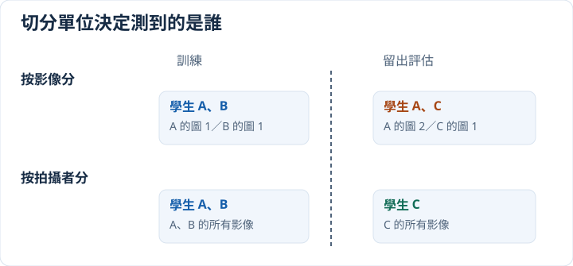

# 抽樣與資料切分

[在 Colab 執行](https://colab.research.google.com/github/Samuel-ncu/AI-Stastic/blob/main/notebooks/03_sampling_data_splits.ipynb) · [GitHub Notebook](../../notebooks/03_sampling_data_splits.ipynb)

## 學習目標與先備知識

**先想上線後會遇到什麼新資料，再決定留出哪一整組。** 辨識新學生的手語，要留出整位學生。辨識固定學生下次拍的新影像，要留出整個拍攝場次。測試分數各自回答不同的問題。

先讀第一課的母體、樣本與類別概念。本課要能提出合理的資料切分方案，並指出何時漂亮分數可能來自資料重複或洩漏。

## 1. 蒐集樣本與切分資料是兩個步驟

**來源摘要 [O6](https://openstax.org/books/introductory-statistics-2e/pages/1-2-data-sampling-and-variation-in-data-and-sampling)：**抽樣方式會影響樣本能否反映研究母體。分層抽樣將母體分組後，從各層抽取樣本；便利抽樣則受取得資料的方便程度影響。

**本教材自編情境：**只在教室明亮環境拍攝五位學生手語，再隨機切分出測試集，測試結果仍只反映這批資料。切分再正確，也不能補回沒有蒐集到的昏暗環境或不同使用者。

要先寫「打算部署給誰、什麼環境」，再決定拍誰、拍幾次。資料量大與代表性好不同。

蒐集範圍決定將來能代表誰。資料拿到後，還要把學習、選設定及驗收所用的資料分開，才能解讀後面的分數。

## 2. 三個集合分別做什麼？

**來源摘要 [S3](https://scikit-learn.org/stable/modules/cross_validation.html)：**模型需要與訓練不同的資料評估。調整超參數會間接利用評估資訊，因此選設定與最後測試應分開。

| 集合 | 可以做什麼 | 自編類比 |
|---|---|---|
| 訓練 training | 擬合模型參數 | 平常做練習題 |
| 驗證 validation | 選模型、閾值及超參數 | 看模擬考後修正讀書策略 |
| 測試 test | 設定固定後評估 | 最後一次驗收 |

自編分配例：1,000 張影像可先規劃 600/200/200，但比例沒有普遍最佳值。若每類資料很少、群組大小不同或有時間順序，應優先滿足評估目標，而非硬套比例。

確定三個集合的角色後，要選擇以影像、拍攝者還是時間來分配。這一步比先決定切成幾成更重要。

## 3. 三種常見切分各解決不同問題

先看圖中的分隔線。左邊的影像用來訓練，右邊的影像留到評估時使用。圖中的「拍攝者」指照片中做手語的學生。

- **上排｜按影像分。** 把所有學生的照片放在一起，一張一張分配。例如先打亂照片順序，再取一部分訓練、其餘留出評估。圖中 A 的圖 1 用來訓練，A 的圖 2 留出評估。這是兩張不同的照片，但照片裡都是 A。因此其中一題是在考模型能否認出 A 在另一張照片裡做的手語。上排也有學生 C 的照片，所以整體分數混合了見過與未見過的學生。
- **下排｜按學生分組。** 先把同一位學生的照片放成一組，再以整組為單位分配。圖中用 A、B 的全部照片訓練，把 C 的全部照片留出。模型訓練時沒接觸過 C 的照片，所以這次評估衡量模型能否辨識新學生 C 做的手語。

### 部署對象決定怎麼切

| 上線後會遇到什麼？ | 怎麼切？ | 測試分數回答什麼？ |
|---|---|---|
| **新學生**第一次使用手語辨識 | **按學生切。** 同一學生的全部影像只進一個集合。依圖中例子，用 A、B 的影像訓練，留出 C 做測試。 | 能否辨識訓練時未見過的學生做的手語？ |
| **固定學生**下次再來拍攝 | **按場次切。** 例如同樣是 A，週一的場次用來訓練，週三用來驗證，週五留作測試。同一場次的影像一起分配。 | 能否辨識熟悉的學生在下一次拍攝時做的手語？ |
| 每張影像代表一個可獨立分配的樣本 | **可按影像切。** 例如同一條產線上每件產品只拍一張，且各件可視為獨立，便可把每張影像分到一個集合。 | 能否辨識同樣條件下另一件新產品的狀態？ |

### 為什麼逐張切可能讓測試分數偏高？

假設 A 做一次手語，你從同一段影片擷取兩張連續畫面。若第一張用於訓練、第二張用於測試，兩張的手勢、背景、角度幾乎一樣，模型可能因為測試畫面和訓練畫面太相似而答對。**同一段影片的畫面要留在同一個集合。** 若要測固定學生下次拍攝的表現，就把該場次的所有影片與照片一起留出。

即使兩張照片差異較大，模型也可能熟悉某些學生的手勢習慣。假設同一模型在見過的學生新照片中答對 **9／10（90%）**，在未見過的學生照片中答對 **6／10（60%）**。合起來是 **15／20（75%）**。若上線後服務的是新學生，應看未見學生的結果。只報 75% 會看不出這組示例中對新學生只有 60%。

### 隨機、分層與分組各管什麼？

| 方法 | 在本教材手語案例的用途 | 仍需注意 |
|---|---|---|
| 按影像隨機切分 | 打亂後以每張影像為單位分配 | 同一學生的不同照片可能分到兩邊 |
| 分層切分 | 盡量保留每類比例 | 不會自動隔離拍攝者 |
| 分組切分 | 同一學生的全部影像只分到一個集合 | 各集合的類別比例可能不同 |

**分組決定哪些資料要一起分配，分層則盡量保留各類的比例。** 例如要測新學生的手語，先以學生為單位切分，再檢查每個集合的手語類別是否齊全。同一學生拍 100 張，仍然只代表一位學生。

Notebook 用 20 位模擬學生、每人 10 筆影像，分別按影像和按學生切分，再印出訓練與測試兩邊共有幾位學生。這項實作檢查誰跨了集合，搭配上面的情境解讀分數代表的問題。

在時間序列情境，還要避免用未來資訊預測過去；不能因為隨機切分容易操作就直接使用。

選好切分單位後，還要檢查同一原圖的衍生版本、前處理統計量和選模型的過程是否跨了集合。

## 4. 資料洩漏不只是答案被抄走

**來源摘要 [S1](https://scikit-learn.org/stable/common_pitfalls.html)：**建模使用了預測當時不可取得的資訊，會造成資料洩漏。先切分，再只用訓練集擬合前處理，是避免洩漏的基本流程。

本教材的檢查清單：

- 原始影像及它的旋轉版本是否跨集合？
- 是否先用全部資料計算標準化參數或挑特徵？
- 是否用測試結果一再選擇「最佳」模型？
- 是否把標籤直接或間接寫進輸入欄位，例如檔名？

資料增強通常放在切分之後，且僅對訓練樣本使用。驗證／測試可做預先定義的確定性轉換，不能混入與訓練原圖對應的衍生樣本。

切分可交付的證據包含數量與重疊檢查。等別人能核對這些項目，測試分數才有清楚的適用對象。

## 5. 對應 DLI 的作業要求

不只交出切分比例，還要交：樣本單位、群組定義、每組各類數量，以及原圖／群組是否重疊。這樣才知道測試分數回答了哪個問題。

## 自我檢核

1. 先把每張原圖轉成十個版本，再隨機分兩組，有何問題？
2. stratify=y 是否保證同一拍攝者不跨集合？
3. 學生看測試分數五十次後選最佳版本，還能當作未受影響的最後測試嗎？

### 參考解答

1. 同一原圖的近似版本可能同時出現在訓練與測試，結果偏樂觀。
2. 否。分層處理類別，分組處理群組身份。
3. 不能；測試資訊已參與選擇，需要另有未使用的資料或合適評估設計。

## 實作與延伸作業

請開啟上方 Notebook，逐格執行程式，對照手算與輸出。完成 Notebook 末尾的修改練習，繳交結果圖表、解讀、至少一項限制及 AI 使用驗證紀錄。

**帶到下一課。** 切分之後，訓練集還負責建立尺度。下一課用平均數和標準差手算一次，檢查為什麼同一測試值要沿用訓練座標。[第 04 課：尺度與標準化](04-scaling-normalization.md)

## 出處與閱讀建議

- **O6**：[OpenStax，§1.2 Data, Sampling, and Variation](https://openstax.org/books/introductory-statistics-2e/pages/1-2-data-sampling-and-variation-in-data-and-sampling)。
- **S1**：[scikit-learn，Common pitfalls and recommended practices](https://scikit-learn.org/stable/common_pitfalls.html)。
- **S3**：[scikit-learn，Cross-validation: evaluating estimator performance](https://scikit-learn.org/stable/modules/cross_validation.html)。

本課以所列來源的概念作繁體中文摘要，並加入自行編寫的情境、手算、程式及練習；不是原網站的逐段翻譯。標為「來源摘要」者為改寫，標為「自編」者為本教材教學設計；短引文另以引號及「中譯」標明。來源連結可供對照原文，查閱日期：2026-11-17。
