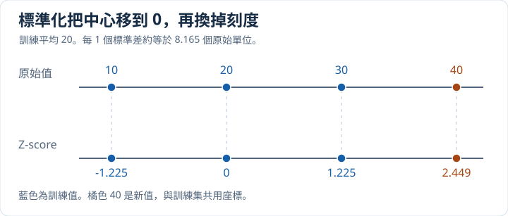

# 尺度與標準化

[在 Colab 執行](https://colab.research.google.com/github/Samuel-ncu/AI-Stastic/blob/main/notebooks/04_scaling_normalization.ipynb) · [GitHub Notebook](../../notebooks/04_scaling_normalization.ipynb)

## 學習目標與先備知識

兩筆請求一筆多排一個工作，另一筆多 50 KB。若想用距離找相似案例，必須先讓「差一單位」有可比較的意義。標準化提供一種參考，再由驗證資料檢查這種尺度是否合適。

先會算平均數與標準差。學完能手算 Z-score、區分三種常見縮放，並說明為什麼測試資料沿用訓練參數。

## 1. 為什麼同一個現象換單位會影響模型？

**來源摘要 [S2](https://scikit-learn.org/stable/modules/preprocessing.html)：**一些模型的目標函數、距離或正則化會受特徵尺度影響。StandardScaler 將特徵中心化並依其標準差縮放；此運算不會自動使分布成為常態。

**本教材自編例子：**兩個測量點的溫差是 2 °C、位置差是 1 m。把位置改記成 mm，位置差變 1,000。若直接用未處理的平方距離，位置項由 1 變成 1,000,000；現象沒變，計算卻被單位支配。

這不表示所有模型都需要完全相同的處理。樹模型通常較不受正的線性縮放影響；需要依模型與特徵意義判斷。

### 補充｜標準化實際改變了哪一個決策？

統計的 Z-score 把「差幾個原始單位」改成「離參考平均幾個標準差」。延續本課的延遲服務，假設輸入有兩欄，分別是前方請求數和資料量（KB）。模型用最近鄰找相似的歷史請求。訓練資料得到兩欄的平均 $(1,200)$ 和標準差 $(1,100)$。新請求 $Q=(1,200)$，兩個候選請求為 $A=(2,200)$ 與 $B=(1,250)$。

| 比較 | 用原值 | 兩欄都除以 255 | 各欄做 Z-score |
|---|---:|---:|---:|
| Q 到 A 的距離 | 1 | $1/255\approx0.0039$ | $1/1=1$ |
| Q 到 B 的距離 | 50 | $50/255\approx0.1961$ | $50/100=0.5$ |
| 最近鄰 | A | A | B |

兩欄同除以 255 時，每一段歐氏距離都變成原來的 $1/255$，所以距離的排序保持相同。各欄做 Z-score 時，人數欄除以 1，資料量欄除以 100，兩欄在距離中的相對影響就會改變。計算兩筆資料的距離時，同欄都減去相同平均，平均會在相減時抵銷。這個例子裡，改變最近鄰的是各欄分別除以自己的尺度。

原始距離把不同單位的差值直接放進同一公式。標準化後，請求數多一筆相當於該欄的一個標準差，而資料量多 50 KB 只相當於半個標準差，最近鄰因此改變。以標準差為尺度是建模選擇。若任務需要讓資料量特別重要，應設計權重並在驗證集比較。標準化也不會把偏斜的資料變成常態分布。

線性模型用梯度法訓練時也可能受尺度影響。單筆平方損失對係數 $w_j$ 的梯度是 $-2r x_j$，其中 $r=y-\hat y$。同一筆資料的各欄數值若差幾個數量級，梯度也可能差很多。適當縮放可改善部分問題的數值條件，實際影響取決於模型、特徵與訓練方法。

**從統計連到模型內部。** 輸入標準化以訓練集的特徵統計量定義參考座標。BN 和 LN 把類似的中心化及縮放搬進網路，但處理的是中間的特徵。同一個公式首先要問「哪一組數值參與統計」。CNN 的 BatchNorm2d 針對每個通道跨批次及空間位置計算，預設在評估時取訓練中累積的統計量。對 $[B,T,D]$ 使用 LayerNorm(D)，則每個 token 沿自己的最後一維算，訓練和推論都用當前輸入。PowerNorm 的論文改用跨批次累積的平方大小作為尺度，並設計近似反向傳播。完整脈絡與二次動差手算見 [背景導讀](../statistics-to-ai.md)。

[來源：scikit-learn 的特徵縮放示例](https://scikit-learn.org/stable/auto_examples/preprocessing/plot_scaling_importance.html) · [PyTorch BatchNorm2d](https://docs.pytorch.org/docs/2.15/generated/torch.nn.BatchNorm2d.html) · [PyTorch LayerNorm](https://docs.pytorch.org/docs/2.15/generated/torch.nn.LayerNorm.html) · [PowerNorm 原論文](https://proceedings.mlr.press/v119/shen20e.html)

上面的距離改變，來自重新定義每欄的尺度。下一節比較三種做法各把什麼當原點和單位。

## 2. 三種變換不要混在一起

三種方法都屬於**特徵縮放（feature scaling）**。本課用**標準化（standardization）**指 Z-score。選擇時先問：你要讓數字落入某個範圍，還是要用資料的分散程度來比較？

| 方法 | 用什麼當基準？ | 怎麼讀轉換值？ | 適合什麼情境？ |
|---|---|---|---|
| 固定尺度，例 $x'=x/255$ | 事先已知 8-bit 像素的範圍是 0～255 | 轉成 0～1，255 對應 1 | 輸入都有已知的編碼範圍。從頭訓練灰階 CNN 時，可以這樣起步 |
| Min-Max，$x'=(x-a)/(b-a)$ | 用訓練資料估計最小值 $a$、最大值 $b$ | 訓練最小值對應 0，最大值對應 1。新資料可落在這個範圍外 | 想讓各欄的訓練值對齊到同樣的 0～1 範圍 |
| Z-score，$z=(x-m)/s_0$ | 用訓練資料估計平均 $m$、標準差 $s_0$ | 0 是訓練平均，+1 是高於訓練平均一個標準差 | 用 KNN 等距離模型比較不同單位的欄位，希望以各欄自身的波動當尺度 |

例如 8-bit 的訓練像素在小樣本中只有 10、20、30。同一個像素值 30，除以 255 約得到 **0.118**，表示它占編碼上限的比例。用 Min-Max 得到 **1**，表示它是訓練樣本中最亮的值。用 Z-score 約得到 **+1.225**，表示它比訓練平均高 1.225 個標準差。若新像素是 40，Min-Max 得到 $(40-10)/(30-10)=1.5$，因為 40 已超過這批訓練資料的最大值。

也有可以**直接用原值**的情境。決策樹通常依各欄的排序尋找切分點，正向縮放保留這個排序，所以一般無須先縮放。若使用預訓練模型，則先確認它原本要求的前處理。例如模型規格若指定先除以 255，再依各通道的平均和標準差轉換，就沿用該流程。

下一節用 10、20、30 手算 Z-score，看看減平均如何改變原點，除以標準差如何改變刻度。

## 3. 逐步手算

減去訓練平均 $m$，把 20 搬到原點。再除以訓練標準差 $s_0$，把「距離均值 10 個原始單位」改寫為「距離均值約 1.225 個標準差」。正負號和排序仍保留。

本教材自編訓練值是 10、20、30。平均 m=20。若用除以 n 的描述性變異數：

$$s_0=\sqrt{\frac{(10-20)^2+(20-20)^2+(30-20)^2}{3}}
=\sqrt{\frac{200}{3}}\approx8.165$$

三個 Z-score 約為 −1.225、0、1.225。新測試值 40 仍使用 m=20 與 $s_0=8.165$，得到約 2.449。**測試結果的平均不必是 0。**

StandardScaler 的縮放標準差使用 ddof=0。這與第一課估計母體變異數使用 n−1 的目的不同；不要因為名稱都叫標準差，就把兩個數值當成同一個。

新值 40 能放在同一條數線上，是因為沿用前面算出的中心與尺度。這兩個動作分別就是擬合和轉換。

## 4. 讀懂 fit 與 transform

延續上一節。訓練資料是 10、20、30，之後又收到一筆 **30**。如果模型在訓練時把 30 看成「比平均高」，上線時看到同一個 30，也應該用同一個平均來判斷。

可以把標準化想成做一把尺。這把尺的 **0 刻在訓練平均 20**，相鄰整數刻度相隔約 **8.165 個原始單位**。因此讀數 30 在這把尺上約是 $+1.225$。

1. **`fit` 是做尺。** 用訓練資料算出平均 $m=20$ 和標準差 $s_0\approx8.165$，存起來。
2. **`transform` 是用尺。** 把一筆讀數代入 $(x-m)/s_0$。給它 30，就算 $(30-20)/8.165\approx+1.225$。給它 40，就算 $(40-20)/8.165\approx+2.449$。
3. **`fit_transform` 是先做尺、再用這把尺量同一批資料。** 用在訓練集，就得到 −1.225、0、+1.225，這些是接著交給模型訓練的數值。

### 為什麼測試集沿用訓練的尺？

假設測試集是 30、40、50。再看同一筆原始值 **30**：

| 做法 | 用哪個平均當 0？ | 30 轉換後 | 模型收到的意思 |
|---|---:|---:|---|
| 沿用訓練集的尺，對測試集做 `transform` | 20 | 約 +1.225 | 高於訓練平均 |
| 對測試集重新 `fit` 再轉換 | 40 | 約 −1.225 | 低於測試平均 |

兩組資料的間距相同，所以標準差都是約 8.165。**光是把 0 從 20 移到 40，同一筆 30 就從正值變成負值。** 假設模型學到「標準化後大於 1 就發警報」，沿用訓練的尺會發警報，換成測試的尺就不會。這就是「模型看到不同座標」會帶來的具體影響。

實際流程先切分資料。在訓練集用 `fit_transform`，在驗證集、測試集用同一個已擬合的轉換器做 `transform`。**上線時把這個轉換器和模型一起保存與使用。** 收到新的一筆 30，先用已保存的平均和標準差轉成 +1.225，再交給模型。下一節接著看影像資料也需要沿用訓練時約定的輸入轉換。

## 5. 常見誤解與 DLI 連結

除以 255 對 8-bit 像素有明確意義，但不是所有影像、感測器或預訓練模型都用這個規則。DLI 遷移學習應依所選預訓練模型的輸入規格，確保訓練與推論流程一致。

常數特徵標準差為 0，手寫公式會除以 0，需另外處理。離群值也會拉動平均與標準差；先確認來源，而非為了好看就直接刪除。

## 自我檢核

1. 用上面的訓練參數，測試值 20 的 Z-score 是多少？
2. 原本偏斜的分布做 Z-score 後，一定會變成鐘形嗎？
3. 訓練最小值 10、最大值 30，測試值 40 的 Min-Max 值是多少？
4. 最近鄰例子中，如果把兩欄都除以 255，最近鄰會改變嗎？

### 參考解答

1. 0。
2. 不會；平移與正的等比例縮放不消除偏斜。
3. (40−10)/(30−10)=1.5，表示 40 高於訓練最大值。
4. 最近鄰仍是 A。兩段距離同比例縮小，排序保持相同。

## 實作與延伸作業

請開啟上方 Notebook，逐格執行程式，對照手算與輸出。完成 Notebook 末尾的修改練習，繳交結果圖表、解讀、至少一項限制及 AI 使用驗證紀錄。

**帶到下一課。** 尺度定義了模型看到的輸入。開始訓練前，還要定義輸出是毫秒、機率或類別，並用損失函數說明怎樣算預測得好。[第 05 課：統計模型與損失函數](05-statistical-models-loss.md)

## 出處與閱讀建議

- **S2**：[scikit-learn，Preprocessing data](https://scikit-learn.org/stable/modules/preprocessing.html)。

本課以所列來源的概念作繁體中文摘要，並加入自行編寫的情境、手算、程式及練習；不是原網站的逐段翻譯。標為「來源摘要」者為改寫，標為「自編」者為本教材教學設計；短引文另以引號及「中譯」標明。來源連結可供對照原文，查閱日期：2026-11-17。
