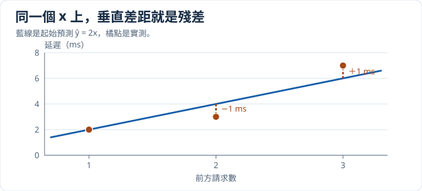
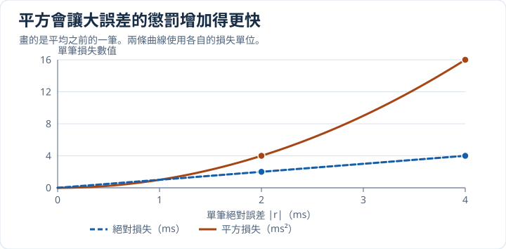

# 統計模型與損失函數

[在 Colab 執行](https://colab.research.google.com/github/Samuel-ncu/AI-Stastic/blob/main/notebooks/05_statistical_models_loss.ipynb) · [GitHub Notebook](../../notebooks/05_statistical_models_loss.ipynb)

[背景導讀：從統計到 AI 的模型設計](../statistics-to-ai.md)

## 學習目標與先備知識

沿用延遲服務。先用直線預測毫秒，再把預測誤差變成可以比較的損失。當問題改為「會不會超時」時，標籤與輸出跟著改變，損失也要改成衡量實際答案分到多少機率。

先讀條件機率與標準化。需要理解函數是「輸入數值得到輸出」；本課補充指數與對數，不要求先學最佳化推導。

## 補充｜ 從一條直線開始預測延遲

假設你要預測一套影像辨識服務的處理時間。輸入 $x$ 是排在前面的請求數，輸出 $y$ 是量到的延遲（毫秒）。本章的資料、數字與練習都是教學示例。

把一條直線當作第一個模型：

$$\hat y=b+wx$$

$\hat y$ 是模型的預測，$b$ 是截距，代表 $x=0$ 時模型的預測。$w$ 是斜率，描述模型預測裡，每多一個請求，延遲改變幾毫秒。這個斜率來自資料的擬合，若要解讀為因果效果，還需要合適的實驗或辨識條件。

### 殘差是圖上哪一段？

在 $x=2$ 處，預測是 4 ms，實測點落在線下 1 ms，所以殘差為 −1 ms。把圖中橘色垂直線段的距離取平方或絕對值，便得到下面兩種損失的單筆貢獻。

在相同的 $x_i$，從直線上的預測值走到實際資料點，垂直距離帶正負號就是殘差 $r_i=y_i-\hat y_i$。正值代表低估，負值代表高估。這是用已觀測的答案與已擬合模型算出的差，理論模型中的隨機誤差則是相對於未知的真實條件平均。

| 前方請求數 $x$ | 實測 $y$（ms） | 起始直線 $\hat y=2x$ | 殘差 $r$（ms） | 殘差平方（ms²） |
|---:|---:|---:|---:|---:|
| 1 | 2 | 2 | 0 | 0 |
| 2 | 3 | 4 | −1 | 1 |
| 3 | 7 | 6 | 1 | 1 |

這三個殘差的總和是 0，但只有第一筆預測準確。若直接加總，低估和高估會抵銷。平方後再平均，得到 $MSE=(0+1+1)/3\approx0.667$ ms²。MSE 把大偏差加重。例如 4 ms 的偏差是 2 ms 的兩倍，平方懲罰卻是四倍。

### 迴歸怎麼選出直線？

普通最小平方法（OLS）選擇 $b,w$，使 $\sum_i(y_i-b-wx_i)^2$ 最小。同一批資料上，除以固定的筆數只會改變數值尺度，因此使 SSE 最小的直線也會使 MSE 最小。這個例子的最小平方直線是 $\hat y=-1+2.5x$，預測為 $[1.5,4,6.5]$，殘差為 $[0.5,-1,0.5]$，MSE 為 0.5 ms²。截距為負也提醒我們，模型在觀察範圍外的預測需要另外驗證。

**進一步手算。** $\bar x=2$，$\bar y=4$。斜率是 $\sum_i(x_i-\bar x)(y_i-\bar y)/\sum_i(x_i-\bar x)^2=5/2$，截距是 $\bar y-w\bar x=4-5=-1$。對新資料能否預測得好，要看留出的資料與殘差圖。若殘差在某個區間總是偏正，先檢查模型是否漏掉轉折或重要變數，再考慮改模型。[來源：NIST 線性最小平方迴歸](https://www.itl.nist.gov/div898/handbook/pmd/section1/pmd141.htm)

**自我檢核。** 若預測 9 ms，實測 12 ms，殘差為 $+3$ ms，代表低估。重新擬合後，各點的殘差都可能改變。接著可看 [第 06 課的 ReLU 轉折](06-overfitting-generalization.md) 與 [第 10 課的兩種殘差比較](10-text-statistics.md)。

直線回答連續數值。如果改用 12 ms 作為門檻，資料的答案便成為 0 或 1。接下來把線性分數轉為可解讀的二元機率。

## 1. 從猜一個數字到猜一個類別

**來源摘要 [S5](https://scikit-learn.org/stable/modules/linear_model.html#logistic-regression)：**線性模型結合特徵與係數；邏輯斯迴歸用於分類，可以產生類別機率。名稱中雖有「迴歸」，用途仍可為分類。

本教材自編例子：用影像亮度 x 預測某一類手勢。先算分數 $z=b+wx$，w 決定輸入變化的影響，b 是截距。若直接把 z 當機率，可能得到負數或超過 1；因此二元分類可用 sigmoid：

$$p=\frac{1}{1+e^{-z}}$$

z=0 時 p=0.5；z 很大時 p 接近 1，z 很負時 p 接近 0。e 約為 2.718，是自然指數的底數。

得到模型輸出後，仍要定義怎麼比較兩個模型。先用實數目標看為什麼正負殘差要轉成可加總的損失。

## 2. 真實答案、預測與誤差

| 記號 | 意思 |
|---|---|
| $x_i$ | 第 i 筆輸入特徵 |
| $y_i$ | 真實答案 |
| $\hat{y}_i$ | 預測值或預測類別，需交代定義 |
| $p_i$ | 第 i 筆屬於正類的預測機率 |
| $L$ | 損失，衡量預測和答案的不一致 |

若預測的是連續數值，可用平均平方誤差：

$$MSE=\frac1n\sum_i(y_i-\hat y_i)^2$$

**自編手算：**真實延遲 [10,20]，預測 [12,16]，誤差 [−2,4]，平方 [4,16]，平均為 10 ms²。損失是 10，不是「準確率 10%」。

### MAE 怎麼算？

平均絕對誤差（Mean Absolute Error，MAE）是每一筆誤差的絕對值取平均。令 $n$ 為資料筆數，$y_i$ 為第 $i$ 筆實際值，$\hat y_i$ 為預測值。

$$\mathrm{MAE}=\frac{1}{n}\sum_{i=1}^{n}|y_i-\hat y_i|.$$

**自編手算。** 三筆請求的實際延遲為 8、10、12 ms，模型都預測 10 ms。殘差依序為 −2、0、2 ms。取絕對值後，高估與低估的誤差都會計入。

$$\mathrm{MAE}=\frac{|8-10|+|10-10|+|12-10|}{3}=\frac{4}{3}\approx 1.33\ \mathrm{ms}.$$

平均每筆預測與實際值相差約 **1.33 ms**。MAE 的單位與預測目標相同。若某一筆的絕對誤差加倍，這一筆對 MAE 的貢獻也加倍，對 MSE 的貢獻則變成四倍。

同一條曲線內比較增幅：誤差 2 到 4 ms，絕對損失由 2 到 4 ms，平方損失由 4 到 16 ms²。把各筆的貢獻加起來，再除以 $n$，就是對應的平均損失。

分類時我們有一個實際類別，下一步改用模型分配給它的機率評價預測。

## 3. 為什麼分類會用交叉熵？

### 先用通式回答「模型給答案多少機率」

對有 $K$ 個可能結果的問題，令 $q_k$ 為真實分布，$p_k$ 為模型分配給第 $k$ 個結果的機率。交叉熵（cross-entropy）的通式是

$$H(q,p)=-\sum_{k=1}^K q_k\ln p_k.$$

若一筆資料只有一個正確類別 $c$，則 $q_c=1$，其他項為 0，式子簡化為 $-\ln p_c$。例如服務的狀態只能在「正常、超時、失敗」中選一種，模型給這三類的機率為 $[0.1,0.8,0.1]$。實際狀態為超時時，損失為 $-\ln(0.8)\approx0.223$。其他類別仍會透過 Softmax 的分母影響分給超時的機率。

這個通式在 $q=p$ 時會化成模型預測分布的**香農熵（Shannon entropy）** $H(p,p)=-\sum_k p_k\ln p_k$，用來量化機率有多集中。用實際標籤形成 $q$ 時，交叉熵則由模型分給實際類別的機率決定。語言模型沿用同一個損失，將類別換成詞彙表中的 token，並根據前文建立預測分布。[第 10 課：輸出熵與交叉熵](10-text-statistics.md#輸出熵與交叉熵)

### BCE 如何由通式得到？Sigmoid 在哪一步？

BCE 是 binary cross-entropy（二元交叉熵）。把問題改成「是否超過 12 ms」後，令 $y=1$ 表示超時，$y=0$ 表示未超時。模型先算原始分數 $z$（logit），再用 Sigmoid 轉成超時機率：

$$p=\sigma(z)=\frac{1}{1+e^{-z}}.$$

以「超時、未超時」為排列順序，真實分布是 $(y,1-y)$，預測分布是 $(p,1-p)$。把這兩組值代入交叉熵通式，就得到

$$L_{\mathrm{BCE}}=-[y\ln p+(1-y)\ln(1-p)].$$

假設 $p=0.8$。若確實超時，BCE 取 $-\ln(0.8)\approx0.223$；若沒有超時，BCE 取 $-\ln(0.2)\approx1.609$。**Sigmoid 提供機率，BCE 根據真實答案評估機率。**

兩個類別互斥時，可以用一個 logit 搭配 Sigmoid＋BCE，也可以用兩個 logits 搭配 Softmax＋交叉熵。若 Softmax 的兩個分數分別為 $z_{\text{超時}}$ 和 $z_{\text{未超時}}$，超時機率等於 $\sigma(z_{\text{超時}}-z_{\text{未超時}})$。若同一筆請求**可以同時超時和發生辨識錯誤**，則每個標籤各有一個「是／否」分布，各算一次 BCE，再依設定加總或平均。

### 為什麼取對數？

BCE 和多類別交叉熵都取對數。本課使用自然對數，寫作 $\ln$；有些來源寫 $\log$，讀公式時先確認底數。

假設第一筆請求實際超時，第二筆實際未超時，而模型對兩筆都預測超時機率 0.8。模型分給兩個真實答案的機率分別是 0.8 和 0.2。若給定各筆輸入後，標籤在模型中可視為條件獨立，這批已觀測答案的概似就是 $0.8\times0.2=0.16$。取負對數後：

$$-\ln(0.8\times0.2)=-\ln(0.8)-\ln(0.2)\approx1.833.$$

**對數把相乘變成相加，負號把最大化概似變成最小化損失。** 固定同一批資料時，取平均也與取總和有相同的最小值位置。算對且把機率集中在真實答案上會降低損失。當真實答案只分到 1% 機率，單筆損失約為 4.605。若真實答案的機率趨近 0，負對數損失會持續增大。

**自我檢核。** 若模型給超時機率 0.8，但實際沒有超時，公式要用哪個機率？答案是 $1-0.8=0.2$，因為這筆實際觀測到的答案是「未超時」。

[來源：scikit-learn 的 log loss 說明](https://scikit-learn.org/stable/modules/model_evaluation.html#log-loss) · [PyTorch BCEWithLogitsLoss](https://docs.pytorch.org/docs/2.15/generated/torch.nn.BCEWithLogitsLoss.html) · [PyTorch CrossEntropyLoss](https://docs.pytorch.org/docs/2.15/generated/torch.nn.CrossEntropyLoss.html)

### 補充｜先定義要預測的答案，再選輸出和損失

對同一套辨識服務，預測「延遲幾毫秒」與判斷「延遲是否超過 12 ms」是兩個不同的任務。前者的標籤是 5、7、9、14、19 ms，後者把同一批觀測改標成 0、0、0、1、1。**標籤的意義決定輸出的格式，損失則把任務在意的錯誤換成可最佳化的數值。**這個決定可以與隱藏層的啟動函數分開考慮。

| 任務與標籤 | 輸出如何解讀 | 常用損失與理由 |
|---|---|---|
| 預測實數延遲，例如 14 ms | 一個實數，迴歸常從恆等輸出開始，有硬性範圍時可另外設計 | MSE 加重大偏差，等變異數的獨立高斯誤差假設可導出最小平方。[MAE](#mae-怎麼算) 對偏差的懲罰是線性的，適合把條件中位數當目標。Huber 在小誤差下採平方，大誤差下近似線性，可依有意義的誤差尺度設定轉折點 |
| 是否超時，標籤為 0 或 1 | 一個 logit $z$，推論時以 sigmoid 解讀為正類分數 | BCE 對應二元結果的負對數概似。PyTorch 用 BCEWithLogitsLoss 直接接 logit |
| 一筆請求只屬於一種狀態 | $K$ 個 logits，softmax 後的機率總和為 1 | CrossEntropyLoss 直接接 logits。一般類別索引格式每筆只給一個整數類別 |
| 可能同時超時又發生辨識錯誤 | 每個標籤有一個 logit，各自轉成 sigmoid 分數 | BCEWithLogitsLoss 逐標籤計算。各分數不必加總為 1 |
| 給定前文，預測下一個 token | 每個位置輸出一組詞彙表 logits | token 級交叉熵，通常在需要監督的位置取平均 |

PyTorch 的 BCEWithLogitsLoss 已包含 sigmoid 的對應計算，CrossEntropyLoss 也直接處理 logits。訓練時把原始分數傳給這兩個 API，推論需要閱讀機率時才另外轉換。這是 API 的輸入契約。選擇警報閾值時，還要用驗證集檢查漏報與誤報的成本。若服務有少數真實的高延遲事件，應把那些事件的表現另外列出，避免單看一個平均損失。可接著閱讀 [機率與分類](02-probability-classification.md) 與 [分類模型評估](07-classification-evaluation.md)。

[來源：PyTorch BCEWithLogitsLoss](https://docs.pytorch.org/docs/2.15/generated/torch.nn.BCEWithLogitsLoss.html) · [PyTorch CrossEntropyLoss](https://docs.pytorch.org/docs/2.15/generated/torch.nn.CrossEntropyLoss.html) · [Transformer 原論文 §3.4](https://arxiv.org/html/1706.03762v7#S3.SS4)

交叉熵使用整組機率中的真實類別分數。固定分類閾值之後，兩組分數即使做出同樣的決定，也可能得到不同的損失。

## 4. 相同 Accuracy，損失可能差很多

本教材程式的真實類別是 [0,1]；兩組正類機率分別為 [0.6,0.6] 與 [0.99,0.99]。以 0.5 為閾值，兩者都預測 [1,1]，所以 Accuracy 都是 50%。

第一組平均交叉熵約 0.714；第二組約 2.308。第二組對第一筆錯誤更自信，受到較大懲罰。請把手算結果對照 log_loss 輸出。

Accuracy 可以報告決定是否答對。可微的訓練損失還能回答權重往哪裡調，所以下一步追蹤損失如何回到參數。

## 5. 模型怎麼學？怎麼連到 DLI？

模型學習是調整參數使訓練損失下降。梯度可先理解成「損失對某參數變動的局部敏感度」；以學習率控制每次調整幅度。下降的訓練損失不保證未見資料表現提升，仍要看驗證集。

下方使用 scikit-learn 的 8×8 digits 建立輕量基準，**不是 MNIST**。連到 DLI 時，請比較輸入形狀、輸出類別數與損失函數，避免把本例的分數當作 DLI 模型結果。

### 補充｜模型怎麼從損失知道每個權重該往哪裡改？

想像用 $\hat y=b+wx$ 預測延遲。若 $x=2$、$w=3$、$b=1$，模型預測 7 ms，實測 9 ms。殘差 $r=y-\hat y=2$ ms，單筆平方損失 $L=r^2=4$ ms²。

前向運算從 $x$ 算到 $\hat y$，再從 $\hat y$ 和答案算出 $L$。反向傳播（backpropagation）沿這條計算路徑反向套用鏈鎖律，算出損失對各參數的偏導數。此例中，$w$ 每變動一點，預測的變動率為 $x=2$。損失對預測的變動率為 $-2r=-4$。相乘得到：

$$\frac{\partial L}{\partial w}
=\frac{\partial L}{\partial \hat y}\frac{\partial\hat y}{\partial w}
=(-4)(2)=-8.$$

負梯度表示在目前這個點，小幅增加 $w$ 會使損失下降。若暫時固定 $b$，用梯度下降與學習率 0.1，權重更新為 $3-0.1(-8)=3.8$。新預測為 8.6 ms，單筆損失為約 0.16 ms²。**反向傳播負責算斜率，最佳化器根據斜率及其更新規則調整參數。** 在 PyTorch 中，常見的兩步是先呼叫 loss.backward()，再呼叫 optimizer.step()。

多層模型也遵循同一個原理。每向前回到一層，就再乘上該層的局部導數。下一課會說明多次相乘時，梯度為什麼可能變得很小。[第 06 課：Sigmoid 與梯度消失](06-overfitting-generalization.md) · [PyTorch 自動微分教學](https://docs.pytorch.org/tutorials/beginner/blitz/autograd_tutorial.html)

## 自我檢核

1. y=0，正類機率 p=0.9 時，應代入 −ln(0.9) 還是 −ln(0.1)？
2. Accuracy 不變時，交叉熵為何仍可能改善？
3. 訓練損失降低是否足以證明模型更適合部署？

### 參考解答

1. −ln(0.1)，因真實類別是負類。
2. 分類是否跨過閾值沒有改變，但給真實類別的機率可能更合適。
3. 否。還需驗證泛化、資料代表性及部署需求。

## 實作與延伸作業

請開啟上方 Notebook，逐格執行程式，對照手算與輸出。完成 Notebook 末尾的修改練習，繳交結果圖表、解讀、至少一項限制及 AI 使用驗證紀錄。

**帶到下一課。** 訓練會讓模型更符合已知例子。是否也能預測新資料，還要同時觀察訓練與驗證誤差，以及模型是否因為太有彈性而跟著雜訊走。[第 06 課：過擬合與泛化](06-overfitting-generalization.md)

## 出處與閱讀建議

- **S5**：[scikit-learn，Logistic regression](https://scikit-learn.org/stable/modules/linear_model.html#logistic-regression)。
- **S6**：[scikit-learn，Metrics and scoring（Log loss、Precision、Recall）](https://scikit-learn.org/stable/modules/model_evaluation.html)。

本課以所列來源的概念作繁體中文摘要，並加入自行編寫的情境、手算、程式及練習；不是原網站的逐段翻譯。標為「來源摘要」者為改寫，標為「自編」者為本教材教學設計；短引文另以引號及「中譯」標明。來源連結可供對照原文，查閱日期：2026-11-17。
