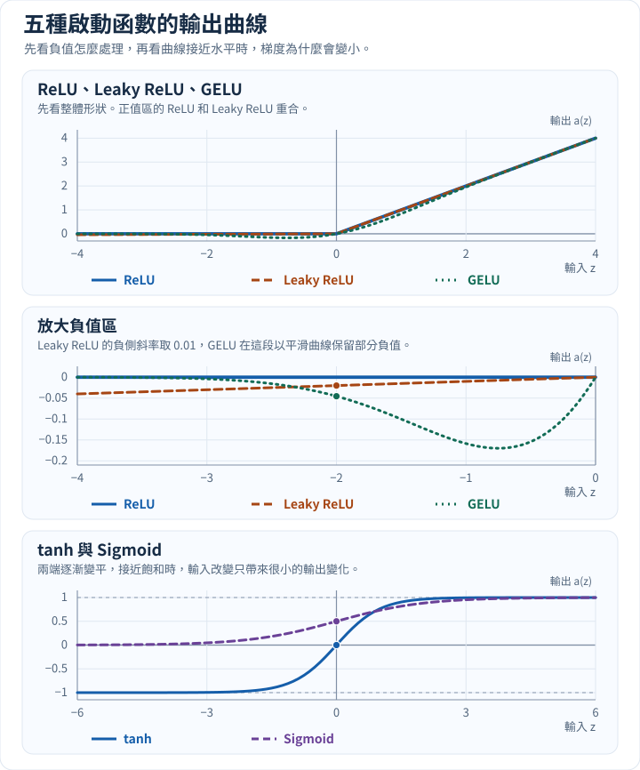

# 過擬合與泛化

[在 Colab 執行](https://colab.research.google.com/github/Samuel-ncu/AI-Stastic/blob/main/notebooks/06_overfitting_generalization.ipynb) · [GitHub Notebook](../../notebooks/06_overfitting_generalization.ipynb)

[背景導讀：從統計到 AI 的模型設計](../statistics-to-ai.md)

## 學習目標與先備知識

跟著延遲資料的彎折調整模型，可以降低訓練誤差。若模型還跟著每次量測的偶然波動彎曲，換一批資料的誤差可能上升。本課循序看模型如何取得彈性、如何辨識多餘的彈性，以及怎麼用驗證集調整。

先理解訓練／驗證切分與 MSE。學完能從訓練及驗證結果提出診斷假設，且不把「模型較大」直接等同「模型較好」。

## 1. 背答案與學規律有什麼不同？

**來源摘要 [S4](https://scikit-learn.org/stable/modules/learning_curve.html)：**偏差描述估計方法的系統性誤差，變異描述對訓練資料改變的敏感程度。訓練與驗證曲線可協助觀察模型複雜度是否合適，但不能取代獨立測試。

**本教材自編比喻：**學生把題目及答案一字不漏背下來，原題能全對；只要換題就失敗。這類比過擬合，但不能用這個比喻取代實際資料評估。

要分辨「學到規律」與「記住樣本」，先把每次觀測想成可預測的部分與這個模型解釋不到的變動。

## 2. 資料可以想成規律加雜訊

$$y=f(x)+\epsilon$$

f(x) 是希望學到的規律，$\epsilon$ 表示未由輸入完整說明的變動。本課自編資料使用 sin(3x) 加上常態雜訊；這是已知生成機制，真實專案通常不知道 f。

| 狀態 | 本課曲線的可能表現 | 該查什麼 |
|---|---|---|
| 欠擬合 | 訓練與驗證誤差都偏高 | 特徵是否足夠、模型是否過於受限 |
| 過擬合 | 訓練誤差低、驗證誤差高 | 資料量、雜訊、複雜度與正則化 |
| 較合理的擬合 | 訓練與驗證結果符合需求 | 仍需測試資料與部署檢查 |

這是診斷線索，不是只看一張圖就能定論。訓練不足、資料前處理錯誤及分布差異，也會影響曲線。

## 補充｜從迴歸的轉折理解啟動函數

延續延遲問題。假設服務在佇列不長時每多一筆只增加 2 ms，超過兩筆後額外增加 3 ms。原來一條直線只有一個斜率，畫不出轉折。

從網路的運算看也一樣。將 $h=W_1x+b_1$ 代入第二層 $W_2h+b_2$，可以合併成一個仿射變換 $W_2W_1x+(W_2b_1+b_2)$。光增加這類層數，模型仍畫不出轉折。把非線性函數放在兩層中間，就能改變模型可表示的形狀。

例如加入 ReLU $a(z)=\max(0,z)$：

$$\hat y=5+2x+3\,\mathrm{ReLU}(x-2).$$

當 $x=1$，追加項為 0，預測是 7 ms。當 $x=4$，追加項是 $3(4-2)=6$，預測是 19 ms。這是刻意設定的轉折例。實際網路由資料與損失共同決定權重及偏差，轉折位置通常也可隨參數學習。

### 看輸出範圍、斜率與用途

從 $z=0$ 往右看，ReLU 每往右 1，輸出就增 1。Sigmoid 和 tanh 到右側逐漸變平，同一段輸入變化只帶來很小輸出變化。表格另外比較 Leaky ReLU、GELU 與恆等輸出。

| 函數 | 形狀與梯度 | 選擇情境 |
|---|---|---|
| ReLU $\max(0,z)$ | 正側斜率為 1，負側為 0 | 一般 CNN 或 MLP 隱藏層的簡單起點。若單元對資料長期落在負側，該路徑梯度可能一直為零 |
| Leaky ReLU | 負側保留小斜率，例如 0.01 | 想保留負側的梯度時，可與 ReLU 做對照 |
| GELU $z\Phi(z)$ | $\Phi$ 為標準常態分布的累積機率。它對輸入做平滑加權 | 現成模型指定 GELU 時依架構使用。自建網路可和 ReLU 在相同條件下比較 |
| tanh | 將輸入壓到 $(-1,1)$，兩端斜率接近 0 | 需要有界、帶正負號的狀態時可考慮，例如部分循環網路 |
| Sigmoid | 將輸入壓到 $(0,1)$，兩端斜率接近 0 | 二元機率輸出或需要介於 0 和 1 的閘門。用在深層隱藏層時要留意飽和 |
| 線性輸出（恆等） | 原樣傳遞輸入 | 實數迴歸常用。若目標有明確的範圍，還要考慮輸出參數化 |

隱藏層的選擇要回答「中間表示需要什麼形狀」。輸出層要回答「預測代表什麼」。同一個網路可以在隱藏層用 ReLU，最後輸出實數、二元 logit 或多類別 logits。比較隱藏層時，固定切分、模型寬度、訓練預算和評估方式，再觀察損失曲線與驗證表現。GELU 用到常態分布的累積函數來定義曲線，輸入資料本身可有其他分布。[來源：GELU 原論文](https://arxiv.org/abs/1606.08415)

**自我檢核。** 在 $x=2$ 前後各多加一筆請求，模型的預測分別多 2 和 5 ms。試把 ReLU 轉折點改為 1，再畫殘差並用留出的資料評估。延遲例子的起點見 [第 05 課迴歸與損失](05-statistical-models-loss.md)，前饋層如何用啟動函數見 [第 10 課 Transformer](10-text-statistics.md)。

DLI 的 ASL CNN 使用 ReLU，原始 Transformer 的前饋層也使用 ReLU。閱讀其他架構時請查其實作。[來源：DLI ASL CNN](https://github.com/NVDLI/fundamentals-of-deep-learning-zh/blob/main/course_content/tutorials/03_asl_cnn.ipynb) · [Transformer 原論文 §3.3](https://arxiv.org/html/1706.03762v7#S3.SS3)

### 補充｜Sigmoid、反向傳播與梯度消失

#### 反向傳播是什麼？

訓練時，模型先做預測，再用實際答案算出損失 $L$。接下來要回答的是：**如果某個權重稍微改一點，損失會增加還是減少，變化有多快？** 這個變化率就是損失對該權重的梯度。**反向傳播（backpropagation）是從損失出發，沿著前向計算的路徑往回，用鏈鎖律算出各權重梯度的方法。** 最佳化器接著用這些梯度更新權重。

先沿用第 05 課的延遲例子。預測直線是 $\hat y=b+wx$。**$w$ 是這條預測直線的斜率，也是模型要學的權重。** $b$ 是截距。若固定 $w=3$、$b=1$，前方請求數 $x$ 每增加一筆，預測延遲就增加 3 ms。

接下來只看 $x=2$、實際延遲 $y=9$ ms 這一筆資料。訓練要調的是預測直線的斜率 $w$，所以這次固定 $x$ 和 $b$，看 $w$ 改變時預測與損失怎麼變。

| 步驟 | 這一筆資料怎麼算？ |
|---|---|
| **前向計算** | 先得到預測 $\hat y=1+3\times2=7$ ms，再算平方損失 $L=(9-7)^2=4$ ms² |
| **損失對預測的斜率** | 預測 $\hat y$ 往上微調時，會更接近 9 ms，所以損失下降。此時損失對預測的斜率是 $-2(9-7)=-4$ |
| **預測對權重 $w$ 的斜率** | 固定 $x=2$ 時，$w$ 每增加 1，預測延遲就增加 2 ms，所以 $\partial\hat y/\partial w=2$。兩段斜率相乘，損失對 $w$ 的梯度是 $(-4)\times2=-8$ |

鏈鎖律就是把這兩段變化率接起來。用符號寫，$\partial L/\partial w$ 讀作「損失 $L$ 對權重 $w$ 的變化率」：

$$\frac{\partial L}{\partial w}=\frac{\partial L}{\partial\hat y}\frac{\partial\hat y}{\partial w}=(-4)\times2=-8.$$

負梯度表示此時把 $w$ 調大一點，損失會下降。例如先固定 $b$，用學習率 0.1 做一次梯度下降，$w$ 變成 $3-0.1(-8)=3.8$。重新做前向計算，預測變成 8.6 ms，損失降到 0.16 ms²。這一輪可以分成三個動作：**前向算損失，反向算梯度，最佳化器更新權重。** [第 05 課：反向傳播手算](05-statistical-models-loss.md#補充模型怎麼從損失知道每個權重該往哪裡改)

#### 反向傳播如何連到 Sigmoid？

先把後面會用到的三個量放回預測流程。分類輸出層先把特徵加權，得到實數分數 $z$，稱為 **logit**。Sigmoid 把它換成超時機率 $p$。實際是否超時由標籤 $y$ 表示，BCE 用 $p$ 和 $y$ 算出損失 $L$。例如 $z=0$ 對應 $p=0.5$，$z=-8$ 則令 $p$ 幾乎為 0。[第 05 課：Logit、勝算與機率](05-statistical-models-loss.md#logit-是什麼)

延遲例子經過「權重影響預測、預測影響損失」兩段。分類例子先倒著走「BCE → 機率 → 分數」，算出調整 $z$ 時損失會怎麼變，再從 $z$ 繼續回到前面各層的權重。路徑越長，就要把更多段的局部導數依鏈鎖律相乘。先把每層簡化成一個數字。在實際網路中，特徵向量的梯度傳遞還涉及權重矩陣與各層導數。

$$\frac{\partial L}{\partial h_0}
=\frac{\partial L}{\partial h_m}
\frac{\partial h_m}{\partial h_{m-1}}\cdots\frac{\partial h_1}{\partial h_0}.$$

式中 $h_0$ 是要往回追蹤的早期表示，$h_m$ 是所考察路徑的末端。若取 $h_m=z$，最左邊的因子 $\partial L/\partial h_m$ 就是下面要算的 $\partial L/\partial z$。

**梯度消失**是這些乘積讓較早層收到的梯度很小，最佳化器能用來更新那些層的訊號變弱。若每段局部導數都是 0.25，經過六段只剩 $0.25^6=1/4096\approx0.000244$ 倍。這個數值描述簡化例的衰減，實際網路還取決於權重、深度、初始化與資料。

#### 為什麼特別討論 Sigmoid？

看隱藏層時，這裡也用 $z$ 表示進入啟動函數前的數值。Sigmoid 把它壓到 0 和 1 之間。令 $p=\sigma(z)$，其導數為 $p(1-p)$。在 $z=0$ 時斜率最大，為 0.25。當 $z$ 很正或很負，輸出接近 1 或 0，曲線在兩端變平，這稱為飽和。例如 $z=-8$ 時，導數約 0.000335。若許多隱藏層串接這種小斜率，早期層就可能難以學習。tanh 同樣有兩端飽和。ReLU 的正側斜率是 1，有助於保留該路徑的梯度，但負側是 0。Leaky ReLU 為負側留小斜率，GELU 則用平滑曲線。這些選擇各有梯度行為，結果仍須用相同訓練條件比較。[Glorot 與 Bengio 的研究](https://proceedings.mlr.press/v9/glorot10a.html) · [GELU 原論文](https://arxiv.org/abs/1606.08415)

#### 二元分類最後一層為什麼仍用 Sigmoid？

繼續用 $z=-8$。模型給超時的機率是 $p=\sigma(-8)\approx0.000335$，也就是 **0.0335%**。這筆請求實際超時，所以 $y=1$。BCE 取 $-\ln p$，約為 8.000。機率本身對 $z$ 的斜率雖然小，BCE 在 $p$ 接近 0 時對 $p$ 的斜率卻很大。

用鏈鎖律可以把兩段放在同一式。對硬標籤 $y\in\{0,1\}$、未加權的單筆 BCE：

$$
\frac{dL}{dz}
=\frac{dL}{dp}\frac{dp}{dz}
=\left(-\frac{y}{p}+\frac{1-y}{1-p}\right)p(1-p)
=p-y.
$$

當 $y=1$，上式就是 $(-1/p)\times p(1-p)=-(1-p)$。代入本例約為 **−0.9997**。負號代表把 $z$ 往上調一點會讓損失下降，因為模型會提高實際答案「超時」的機率。

若保留同一筆資料和同一個 Sigmoid，改用平方損失 $(p-y)^2$，前半段的斜率改為 $2(p-y)$，因此對 $z$ 的梯度是 $2(p-y)p(1-p)\approx-0.000670$。兩個訓練訊號的差別來自損失怎麼跟機率一起微分。這兩個數字都在**分類輸出這一層**，梯度要繼續傳到較早的層，會再經過那些層的局部導數。實務上把 logits 直接傳給 PyTorch BCEWithLogitsLoss，可得到數值較穩定的計算。[PyTorch BCEWithLogitsLoss](https://docs.pytorch.org/docs/2.15/generated/torch.nn.BCEWithLogitsLoss.html)

**自我檢核。** 早期層梯度很小，增加學習率能否只修好早期層？全域學習率會同時影響不同層。先檢查每層梯度、初始化及模型結構，再決定如何調整。第 10 課會用 $h+F(h)$ 說明殘差連接如何改變相乘的因子。[第 10 課：殘差旁路與梯度](10-text-statistics.md)

啟動函數提供改變曲線的能力，反向傳播決定參數能收到多大的調整訊號。接下來把模型好壞落到相同切分上的兩個可比較數字。

## 3. 手算理解「差距」

先比較橘色驗證柱的高度，再用同一模型兩根柱的差提出診斷。A 和 B 的差同為 1，但 B 的驗證 MSE 是 4，明顯低於 A 的 13。

本教材自編三個模型：

| 模型 | 訓練 MSE | 驗證 MSE |
|---|---:|---:|
| A | 12 | 13 |
| B | 3 | 4 |
| C | 0.2 | 9 |

若任務與切分相同，B 在這次驗證比較較好。C 的訓練／驗證差距為 8.8，大於 B 的 1；但只報差距也不夠，A 的差距同樣只有 1，絕對誤差仍較高。

模型 C 的訓練誤差遠低於驗證誤差，因此值得測試限制模型彈性是否有幫助。正則化就是其中一種做法。

## 4. 正則化是在做什麼？

可把學習目標想成：

$$\text{訓練資料損失}+\lambda\times\text{模型複雜度懲罰}$$

把兩項分開讀：資料損失衡量擬合程度，懲罰項量化係數大小。$\lambda$ 是取捨的權重。若兩個模型訓練損失一樣，增加 $\lambda$ 會讓係數平方和較大的模型更不占優勢。會不會改善驗證結果，要在固定的驗證資料上比較。

本課 Ridge 的懲罰與係數平方和有關。較大的懲罰會限制模型自由度，但太大也可能欠擬合。這不是「把分數作弊扣掉」，而是學習目標本身改變。

自編練習依序嘗試多項式次數 1、3、15；固定相同資料後再改懲罰，才能看出各因素的作用。此一維曲線不能直接證明 CNN 的所有行為。

要找出調整是否有效，作圖前要先選定正在改動的因素。模型容量、資料筆數和訓練時間會回答三個不同問題。

## 5. 不同橫軸代表不同問題

- 模型複雜度：改深度或多項式次數，問容量是否合適。
- 訓練資料量：逐步加資料，問更多資料是否有幫助。
- Epoch：看訓練過程，問是否訓練不足或開始過擬合。

DLI 常畫的是 Epoch 曲線；不要把它與「訓練樣本數」曲線當成同一種實驗。Early stopping 可依驗證表現選停止點，之後仍用獨立測試評估。

## 自我檢核

1. 訓練 Accuracy 100%，驗證 60%，應先宣布成功嗎？
2. 訓練及驗證都差時，增加資料一定有用嗎？
3. 用驗證集挑出最佳模型後，還需要測試集嗎？

### 參考解答

1. 不應。先查洩漏、資料差異、過擬合及流程問題。
2. 不一定；特徵不足、模型受限或實作錯誤也可能是原因。
3. 需要；驗證集已參與選擇，不能當作完全未受選擇影響的最後評估。

## 實作與延伸作業

請開啟上方 Notebook，逐格執行程式，對照手算與輸出。完成 Notebook 末尾的修改練習，繳交結果圖表、解讀、至少一項限制及 AI 使用驗證紀錄。

**帶到下一課。** 驗證損失適合追蹤學習表現，但若模型上線要攔下缺陷品，還要問漏了多少、誤報多少。下一課從分數走到具體決策。[第 07 課：分類模型評估](07-classification-evaluation.md)

## 出處與閱讀建議

- **S4**：[scikit-learn，Validation curves](https://scikit-learn.org/stable/modules/learning_curve.html)。

本課以所列來源的概念作繁體中文摘要，並加入自行編寫的情境、手算、程式及練習；不是原網站的逐段翻譯。標為「來源摘要」者為改寫，標為「自編」者為本教材教學設計；短引文另以引號及「中譯」標明。來源連結可供對照原文，查閱日期：2026-11-17。
