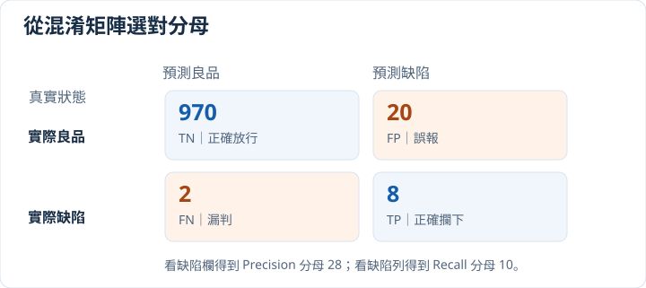

# 分類模型評估

[在 Colab 執行](https://colab.research.google.com/github/Samuel-ncu/AI-Stastic/blob/main/notebooks/07_classification_evaluation.ipynb) · [GitHub Notebook](../../notebooks/07_classification_evaluation.ipynb)

## 學習目標與先備知識

這一課使用同一批 1,000 件產品，練習從現場需求定義判定方式，再選擇合適的評估指標。

### 先定用途，再設計閾值、規則和評估方式

**閾值是依任務需求設計的。** 先決定系統要採取什麼行動、有哪些限制，再思考怎麼用模型輸出。常見做法如下：

| 從哪裡著手？ | 怎麼用？ | 例子 |
|---|---|---|
| **從單筆分數定門檻** | 分數達到門檻就採取行動。門檻也可以來自現成規格。 | 瑕疵機率 42%，用 50% 門檻就放行，用 30% 就送複檢。若模型輸出的是延遲毫秒數，服務可依 12 ms 的規格決定何時警報。 |
| **從任務設判定規則** | 依最高分、類別或額外條件決定單筆要做什麼。 | DLI 04b 直接選最高分的手語字母。DLI 05a 先選最高分的 ImageNet 類別，再依該類別是否屬犬種決定開門。 |
| **用整批驗證選規則** | 試幾個候選門檻或規則，比較整批結果，再選符合現場目標的一個。 | 第 4 節的工廠每 1,000 件最多可複檢 30 件。在兩個候選門檻中，0.5 會送 28 件，符合容量；0.3 則會送 49 件。 |

**整批要看什麼，也由任務決定。** 管理複檢量時直接數警報件數。有標註答案且重視漏判時，可以看 Recall 或漏判件數；在意送去複檢有多少是真的，可看 Precision；希望同時衡量這兩項，可看 F1。若任務主要看整體答對比例，就看 Accuracy。能估計漏判、誤報各自的代價時，也可以直接比較總成本。

[DLI 04b 手語 Notebook](https://github.com/NVDLI/fundamentals-of-deep-learning-zh/blob/main/course_content/tutorials/04b_asl_predictions.ipynb) · [DLI 05a 狗門 Notebook](https://github.com/NVDLI/fundamentals-of-deep-learning-zh/blob/main/course_content/tutorials/05a_doggy_door.ipynb)

先讀第二課的條件機率。學完能自行列出混淆矩陣、手算指標，並依漏判及誤報成本選擇要關注的結果。

### 最高分、閾值與評估指標各在哪一步？

1. **模型給分數。** 例如 DLI 手語模型會為每個字母給一個分數。
2. **規則做出一筆判定。** 手語模型用最高分（argmax）選字母；寵物門也可以根據閾值決定開不開。
3. **用標註答案評估整批判定。** 把每筆預測和實際答案比對，填出混淆矩陣，再按任務選擇要看的指標。

以 DLI 05b 為例，某張圖觸發開門規則後，還要知道照片裡實際是誰。若真的是 Penny，這次開門就是正確放行；若是其他動物，就是誤開門。**開門規則回答這一次做什麼，指標回答這套規則用在很多張圖上表現如何。** [DLI 04b 手語 Notebook](https://github.com/NVDLI/fundamentals-of-deep-learning-zh/blob/main/course_content/tutorials/04b_asl_predictions.ipynb) · [DLI 05b 寵物門 Notebook](https://github.com/NVDLI/fundamentals-of-deep-learning-zh/blob/main/course_content/tutorials/05b_corgi_door.ipynb)

在第 4 節，同一模型的閾值從 0.5 降到 0.3 後，Recall 提高，Accuracy、Precision 和 F1 卻下降。現場可以用驗證集的指標比較兩種決策，再依漏判與誤報的成本選規則。

## 1. 先定義正類，再計算

**來源摘要 [S6](https://scikit-learn.org/stable/modules/model_evaluation.html)：**Precision 與 Recall 分別以「預測正類」和「實際正類」作為分母；F1 以調和平均彙整兩者。多類別的平均方式會改變整體指標的意義。

正類不代表「好的事」。在本教材自編檢測案例中，1=缺陷，0=良品。先寫清楚這件事，才能知道什麼是漏判。

| 實際＼預測 | 預測良品 0 | 預測缺陷 1 |
|---|---|---|
| 實際良品 0 | TN：正確放行 | FP：誤報、可能多做檢查 |
| 實際缺陷 1 | FN：漏判、可能流出 | TP：正確攔下 |

本課矩陣採列為真實、欄為預測。閱讀不同網站圖表時先看軸標籤，不能只靠位置記憶 TP。

四個格子定義了錯誤的種類。把件數填進去後，就能按決策者的問題選分母。

## 2. 用同一張表逐步手算

兩個指標的分子都是正確攔下的 8 件。Precision 沿欄合計，回答複檢有多少是真的。Recall 沿列合計，回答所有真缺陷中成功攔下多少比例。

本教材自編 1,000 件產品，990 件良品、10 件缺陷。候選模型攔下 8 件真缺陷（TP），漏掉 2 件（FN），誤報 20 件良品（FP），正確放行 970 件（TN）。

| 指標 | 回答的問題 | 本例怎麼解讀 |
|---|---|---|
| **Accuracy（準確率）** | 全部產品裡，有多少被判對？ | 1,000 件中判對 978 件，為 **97.8%**。其中 970 件是正確放行的良品。 |
| **Precision（精確率）** | 系統叫我複檢的產品，有多少真的有缺陷？ | 28 件被判缺陷，其中 8 件是真的，為 **28.57%**。它反映警報有多準。 |
| **Recall（召回率）** | 全部真缺陷裡，有多少被成功攔下？ | 10 件真缺陷中攔下 8 件，為 **80%**。剩下 2 件漏判。 |
| **F1（F1 分數）** | 把「抓得準」和「抓得全」合起來看，整體表現如何？ | Precision 約 28.57%、Recall 為 80%，合起來是 **42.11%**。低 Precision 拉低了分數。 |

**從分母理解前三個指標。** Accuracy 看全部產品，所以分母是總件數 $N$。Precision 只看「被判缺陷」的那一欄，Recall 只看「實際缺陷」的那一列。兩者分子都是成功攔下的 8 件，分母分別是 28 與 10，回答的問題也就不同。

$$\mathrm{Accuracy}=\frac{TP+TN}{N}=\frac{978}{1000}=97.8\%$$

$$\mathrm{Precision}=\frac{TP}{TP+FP}=\frac{8}{28}\approx28.57\%$$

$$\mathrm{Recall}=\frac{TP}{TP+FN}=\frac{8}{10}=80\%$$

**F1 為什麼會被較低的一項拉下來？** 設 $P$ 為 Precision，$R$ 為 Recall，F1 是兩者的**調和平均**。在 $P$、$R$ 都大於 0 時，可寫成 $2/(1/P+1/R)$。任一項偏低，它的倒數就變大，整體分數也會降低。

$$F_1=\frac{2PR}{P+R}=\frac{2TP}{2TP+FP+FN}=\frac{16}{38}\approx42.11\%$$

對這個模型而言，80% 的 Recall 表示多數缺陷已被攔下，但 28.57% 的 Precision 表示複檢清單裡的誤報比真缺陷多。F1 把兩者合成一個分數。現場若更在意缺陷流出，仍要看 Recall 和漏判件數。若複檢人力有限，則要看 Precision 與警報總數。

現在已有這個模型的答對率與漏判數。要判斷它有沒有幫忙，接著和一條不需模型就能執行的規則比較。

## 3. 為什麼 99% 可能比較沒用？

永遠猜良品的基準能得到 990/1000=99% Accuracy，但 Recall=0。它漏掉全部缺陷。本例候選模型 Accuracy 較低，卻抓到 8 件缺陷。

若假設每個 FN 成本 100、FP 成本 1，基準成本為 10×100=1,000；候選成本為 2×100+20=220。這些成本是教學假設，真實專案需向利害關係人確認。

漏判和誤報的代價可能差很多，但模型輸出分數後仍有選擇空間。下一節看如何用閾值在兩種代價間取捨。

## 4. 閾值如何連到決策？

### 閾值是什麼？

**閾值（threshold）是把模型分數轉成行動的分界點。** 令 $p$ 為模型給這件產品的缺陷機率，$t$ 為現場選定的閾值。本例的規則是 $p\geq t$ 就發警報、送複檢，$p<t$ 就放行。等於閾值時，本例也發警報。

例如，同一件產品的缺陷機率是 **0.42**。設定 $t=0.5$ 時，它會放行；改用 $t=0.3$ 時，它就會送複檢。**分數仍是 0.42，改變的是採取行動的條件。** 有了這個條件，才能把判定和實際標籤一起填進第 2 節的混淆矩陣。

延續前面的 1,000 件產品。假設第 2 節的結果來自閾值 0.5。在這組自編例子裡，把閾值降到 0.3，剛好會多警示 1 件缺陷和 20 件良品。

| 評估量 | 閾值 0.5 | 閾值 0.3 |
|---|---:|---:|
| 成功攔下的缺陷（TP） | 8 | 9 |
| 漏判（FN） | 2 | 1 |
| 誤報（FP） | 20 | 40 |
| 正常放行（TN） | 970 | 950 |
| 需複檢（TP＋FP） | 28 | 49 |
| Accuracy | $(8+970)/1000=97.8\%$ | $(9+950)/1000=95.9\%$ |
| Recall | $8/10=80\%$ | $9/10=90\%$ |
| Precision | $8/28\approx28.57\%$ | $9/49\approx18.37\%$ |
| F1 | $16/38\approx42.11\%$ | $18/59\approx30.51\%$ |
| 依第 3 節假設計算的成本 | $2\times100+20=220$ | $1\times100+40=140$ |

### 怎麼選閾值？

先把現場的目標寫成**可以檢查的條件**，再從驗證結果挑門檻。同一個模型，目標不同就可能選不同閾值。

| 現場的選擇標準 | 這兩個候選值怎麼選？ |
|---|---|
| **Recall 至少 90%**，也就是 10 件缺陷最多漏 1 件 | 0.3 達到 90%，0.5 只有 80%。先保留 0.3。 |
| **每 1,000 件最多複檢 30 件** | 0.5 需要 28 件複檢，符合容量；0.3 需要 49 件。 |
| **讓總誤判成本最低**，每件漏判成本 100、誤報成本 1 | 在這兩個候選值中，0.3 的成本 140 低於 0.5 的 220。 |
| **以 F1 兼顧 Precision 和 Recall** | 在這兩個候選值中，0.5 的 F1 較高。若漏判代價很大，可改用成本或 Recall 下限來選。 |

**設定流程。** 先定義標準，在驗證集保留模型的原始分數，試幾個閾值並逐一重算混淆矩陣。先篩掉違反硬性要求的候選，再用成本或指標選出最合適的值。若同時要求 Recall 至少 90% 和複檢不超過 30 件，上表兩個候選都無法同時達標，可以檢查驗證分數上的其他分界點。確定閾值後固定它，再到測試集評估。

0.5 可以當比較起點。若模型機率有良好校準、漏判和誤報成本相同，又沒有容量或 Recall 限制，以期望誤判成本最小為目標時，0.5 就有明確的依據。本例的漏判和誤報成本差很多，因此應用表中的條件來選。

**註解｜訓練與分類決策。** BCE 依模型給實際類別的機率算損失。同一件真缺陷品的分數從 20% 升到 40%，BCE 會降低，雖然在 0.5 閾值下仍算漏判。到產生類別判定時，才套用閾值並計算混淆矩陣。[第 06 課：硬閾值與反向傳播](06-overfitting-generalization.md#註解遇到不可微的運算還能反向傳播嗎)

**對照 DLI 05b 的預測與開門。** Notebook 將 Penny 標為 0，開門時直接檢查 logit $z<0$，相當於 $P(\mathrm{Penny})>50\%$。例如 $z=-0.4$ 時，Penny 的機率約為 59.9%，原規則會開門。若部署時另要求 Penny 的機率至少 80% 才開門，這筆就會保持關門。80% 是本課的延伸條件，應用有標註的驗證影像比較誤開門與拒絕 Penny 的次數；若要用 80% 解讀實際發生比例，還需要檢查校準。[DLI 05b：查看預測與 Penny 的寵物門](https://github.com/NVDLI/fundamentals-of-deep-learning-zh/blob/main/course_content/tutorials/05b_corgi_door.ipynb)

這個流程也適用於手語辨識。先把分數轉成一個預測類別，再與真實類別比對。差別在於：缺陷檢測要決定「要不要警報」，手語辨識通常要決定「是哪一類」。

## 5. 延伸到 DLI 多類別手語

### 從閾值判定換成選最高分

假設每張手語影像只屬於一類，模型給 A、B、C 的機率為 40%、35%、25%。若任務要求每張都選一類，可以用**最高分規則（argmax）**判成 A。若應用允許請使用者重比，就可以另訂信心門檻。例如最高分未達 50% 時，系統要求重比。要評估這種系統，還要記錄有多少張被接受、多少張被要求重比。

DLI 04b 的程式直接對模型輸出取最高分。對互斥類別而言，先用 Softmax 轉成機率也會選到同一類。前面的 50% 重比門檻是部署時可加上的規則。[DLI 04b：手語辨識](https://github.com/NVDLI/fundamentals-of-deep-learning-zh/blob/main/course_content/tutorials/04b_asl_predictions.ipynb)若任務改成一張圖可以同時有多個標籤，就會改為每個標籤各用一個 Sigmoid，再各自套用閾值。[第 05 課：Sigmoid 與 Softmax 怎麼選？](05-statistical-models-loss.md#sigmoid-與-softmax-怎麼選)

### 從二元混淆矩陣讀到逐類指標

先用「每張都選最高分」的規則示範。假設下表是 30 張自編手語影像的結果，仍沿用「列是真實、欄是預測」：

| 實際＼預測 | A | B | C |
|---|---:|---:|---:|
| A | 8 | 2 | 0 |
| B | 1 | 4 | 0 |
| C | 0 | 1 | 14 |

整體 Accuracy 從對角線計算，$(8+4+14)/30\approx86.67\%$。若要知道 **B 這一類辨識得如何**，就把 B 當成正類，A 和 C 合看成其他類：

- **B 的 Precision 看 B 欄。** 系統判成 B 的 7 張中，有 4 張真的是 B，所以 $Precision_B=4/7\approx57.14\%$。
- **B 的 Recall 看 B 列。** 實際是 B 的 5 張中，有 4 張被認出，所以 $Recall_B=4/5=80\%$。
- **B 的 F1 合併這兩項。** 這裡 $TP=4$、$FP=3$、$FN=1$，所以 $F_{1,B}=8/(8+3+1)\approx66.67\%$。

這和第 2 節的算法一樣。做完 B，再輪流把 A、C 當正類，就能看出哪些類常被漏掉，哪些預測常混進其他類。若要報一個分數，**Macro-F1** 讓三類各占三分之一，**Weighted-F1** 則依實際張數 10、5、15 加權。本例 C 有 15 張且 F1 較高，所以 Weighted-F1 約為 87.46%，高於 Macro-F1 的約 82.48%。若課程目標是每個手語類別都要認得，同時查看 Macro-F1 和每類結果，才能看出整體 Accuracy 遮住的弱點。

如果模型完全沒預測某一類，該類 Precision 的分母為 0。程式可用 `zero_division=0` 把該情形回報為 0，解讀報表時要知道這是事先選定的回報規則。

## 6. 從分類延伸到語音與檢索

前五節的指標以「一件產品或一張影像、一次類別判定」為單位。換成語音轉錄或 RAG 時，要先說清楚**要量的是整段文字的編輯錯誤、檢索排序，還是最後的回答**。

| 任務 | 指標與分母 | 例子 |
|---|---|---|
| 語音轉錄 | **WER** 把替換、刪除、插入的詞數加起來，除以參考詞數 | 參考有 4 詞，發生 1 次替換和 1 次刪除，WER 為 $2/4=50\%$ |
| 檢索相關文件 | **Recall@k** 用前 $k$ 名命中的相關文件數，除以全部標註相關文件數 | 總共 2 份相關文件，前 2 名找到 1 份，所以 Recall@2 是 $1/2=0.5$ |
| 檢索排序 | **MRR** 先算第一個相關結果名次的倒數，再對查詢取平均 | 兩題的首個命中名次分別是第 2 和第 1，MRR 為 $(1/2+1)/2=0.75$ |

第 2 節的 Recall 和 Recall@k 都問「真正要找的對象，有多少被找回」，前者以真缺陷為分母，後者以標註相關文件為分母。WER 則允許一段文字累積多次錯誤。接著在 E2 練習按群組報 WER，在 E3 看排名，在 E4 把檢索命中與回答正確分開量。[E2 語音評估](e2-weak-supervision-wer.md) · [E3 檢索排序](e3-retrieval-probability.md) · [E4 RAG 消融](e4-rag-ablation.md)

## 自我檢核

1. TP=6、FP=4、FN=2 時，Precision 與 Recall 各是多少？
2. 多數類占 99%，永遠猜多數類是否證明模型學會有用規律？
3. F1 高是否保證誤判總成本最低？
4. 多類別手語例子中，一張實際是 B 的影像被判成 A。它對 B 和 A 各算哪一種錯誤？

### 參考解答

1. Precision=6/10=60%；Recall=6/8=75%。
2. 沒有；應與其他基準及每類結果比較。
3. 不保證。F1 沒有直接表達所有成本，也不包含 TN。
4. 對 B 是 FN，因為漏掉一張 B。對 A 是 FP，因為多判了一張 A。

## 實作與延伸作業

請開啟上方 Notebook，逐格執行程式，對照手算與輸出。完成 Notebook 末尾的修改練習，繳交結果圖表、解讀、至少一項限制及 AI 使用驗證紀錄。

**帶到下一課。** 使用同一測試集比出兩個模型的分數後，還要判斷差距換一批資料是否可能消失。下一課用抽樣和配對比較回答。[第 08 課：不確定性與模型比較](08-uncertainty-comparison.md)

## 出處與閱讀建議

- **S6**：[scikit-learn，Metrics and scoring（Log loss、Precision、Recall）](https://scikit-learn.org/stable/modules/model_evaluation.html)。

本課以所列來源的概念作繁體中文摘要，並加入自行編寫的情境、手算、程式及練習；不是原網站的逐段翻譯。標為「來源摘要」者為改寫，標為「自編」者為本教材教學設計；短引文另以引號及「中譯」標明。來源連結可供對照原文，查閱日期：2026-11-17。
