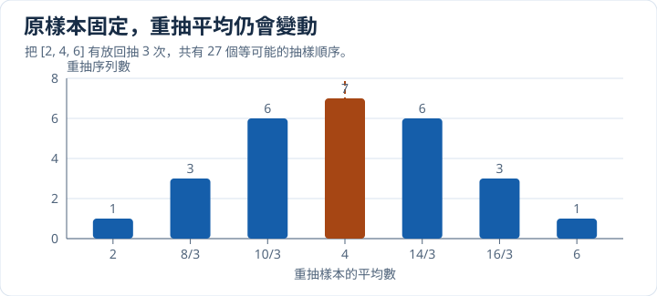

# 不確定性與模型比較

[在 Colab 執行](https://colab.research.google.com/github/Samuel-ncu/AI-Stastic/blob/main/notebooks/08_uncertainty_comparison.ipynb) · [GitHub Notebook](../../notebooks/08_uncertainty_comparison.ipynb)

## 學習目標與先備知識

兩個模型都用同一組測試影像。即使訓練結果固定，選到哪幾張影像仍會改變分數。這一課用重抽樣估計這個變動，並保留同一張圖在兩個模型之間的配對。

先理解平均數、標準差與樣本。本課要區分「資料本身分散」與「估計值不穩定」，再理解 Bootstrap 能回答的問題與限制。

## 1. 測到 90%，就代表真實表現剛好是 90% 嗎？

**來源摘要 [O7](https://openstax.org/books/introductory-statistics-2e/pages/7-1-the-central-limit-theorem-for-sample-means-averages)：**重複抽取固定大小的樣本，每次計算平均數，這些平均數形成抽樣分布。在適當的獨立同分布、有限變異數等條件下，樣本數增加時可用中央極限定理理解其近似分布；平均數的標準誤為 $\sigma/\sqrt n$。

本教材自編情境：固定同一模型，第一次抽 100 張測試影像答對 90 張，第二次換一批可能答對 87 張。模型沒重訓，分數仍會變，因為測試樣本換了。

| 名稱 | 描述的變動 |
|---|---|
| 標準差 SD | 單筆觀測值的分散程度 |
| 標準誤 SE | 重複抽樣時，統計量的分散程度 |
| 訓練種子變異 | 重訓模型的不同初始化等因素所造成的變動 |

用 $\sigma$ 表示單筆觀測的母體標準差。在 $n$ 筆獨立觀測的平均裡，變異數相加成 $n\sigma^2$，平均要再除以 $n^2$，因此平均的變異數是 $\sigma^2/n$。取平方根才得到標準誤 $\sigma/\sqrt n$。例如從 100 張獨立影像增加到 400 張，若單筆變異程度相同，估計平均的標準誤約減半。

增加獨立樣本通常能降低估計的不確定性；同一影像複製十次不等於多了十個獨立觀察。中央極限定理也不是說原始影像像素會變成常態分布。

知道換樣本會改變估計值後，下一步要把這個變動表達成可解讀的範圍。先說清楚信賴區間在重複抽樣下承諾的是什麼。

## 2. 信賴區間不是什麼？

**來源摘要 [O8](https://openstax.org/books/introductory-statistics-2e/pages/8-1-a-single-population-mean-using-the-normal-distribution)：**信賴水準描述一種區間建構程序在重複抽樣下覆蓋母體參數的比例，而不是已算出的一個固定區間內，固定參數正在隨機移動。

本教材自編說法：想像同一抽樣程序反覆做很多次，每次畫出區間；理想的 95% 方法約有 95% 的區間覆蓋目標參數。不是「95% 的影像正確率都在此區間」，也不是「模型有 95% 機率正確」。

實際覆蓋率還受假設、樣本數及方法影響。不能只把任何第 2.5、97.5 百分位夾起來，就宣稱對所有情況精確有效。

前一節假想能反覆取得新樣本。實際往往只有目前這批資料，因此接下來用有放回重抽近似統計量的變動。

## 3. Bootstrap 的直覺與步驟

原樣本平均為 4。三次都抽到 2 的順序只有一種，平均為 2。平均為 4 的有七種順序，因此該柱較高。正式 Bootstrap 通常用電腦抽很多次近似這個過程，再從統計量分布讀所需的分位數。

**來源摘要 [SC1](https://docs.scipy.org/doc/scipy/reference/generated/scipy.stats.bootstrap.html)：**Bootstrap 從觀察到的樣本有放回重抽，對每批重抽樣計算統計量。Percentile 方法用重抽統計量的分位數建構區間；BCa 等方法另作修正。

本教材自編三筆資料 [2,4,6]，一批重抽樣可能是 [2,2,6]，平均 10/3；也可能 [6,4,6]，平均 16/3。有放回表示抽到的觀察可再次抽到。這不是蒐集新的真實樣本，而是在觀察資料下近似估計抽樣變動。

本課用容易理解的 percentile 方法作入門。正式分析需檢查資料相依、小樣本、退化分布及方法適用性，不能把 Bootstrap 當成補救所有偏誤的方法。

重抽的對象取決於要估計的量。比較同一張影像上的兩個模型時，兩組答案必須一起抽，才能保留影像對兩邊難度的共同影響。

## 4. 比較模型為何要配對？

**自編手算：**四張相同測試影像，A 的答對紀錄為 [1,1,0,0]，B 為 [1,0,1,1]。

| 影像 | A 是否答對 | B 是否答對 | B−A |
|---|---:|---:|---:|
| 1 | 1 | 1 | 0 |
| 2 | 1 | 0 | −1 |
| 3 | 0 | 1 | 1 |
| 4 | 0 | 1 | 1 |

B−A 的平均是 0.25，代表本小樣本 Accuracy 高 25 個百分點；不是相對提升 25%。若重抽索引 [2,2,4,1]，A、B 都要用這組索引，保留同一影像的配對關係，不能各抽各的。

下方程式將差值重抽 2,000 次。它衡量的是**固定兩個模型、此抽樣單位下的測試不確定性**；沒有把重訓模型、部署分布改變等全部因素都納入。

有了差值分布後，報告要交代重抽單位、區間算法與可推論的範圍，讀者才能判斷這個差距是否值得採用。

## 5. 對應 DLI 的報告方式

寫「同一封存測試集上，Accuracy 差為多少個百分點，使用什麼重抽單位、方法及區間」。若每位學生提供多張影像，考慮以人為群組重抽。差異是否有實務價值，也要一起報告；小而穩定的提升未必值得額外成本。

## 自我檢核

1. 測試樣本不變，只更換訓練種子，是測試抽樣不確定性嗎？
2. 固定模型由 80% 進步到 82%，差多少百分點？相對提升多少？
3. 同一人有 50 張照片，逐張獨立重抽可能忽略什麼？

### 參考解答

1. 不是；主要觀察訓練隨機性。
2. 2 個百分點；相對提升 (82−80)/80=2.5%。
3. 同一人的影像可能相關；需依問題考慮群組重抽。

## 實作與延伸作業

請開啟上方 Notebook，逐格執行程式，對照手算與輸出。完成 Notebook 末尾的修改練習，繳交結果圖表、解讀、至少一項限制及 AI 使用驗證紀錄。

**帶到下一課。** 本課固定兩個模型，只讓測試樣本變動。若要問資料增強或模型深度是不是真的造成差異，還需要設計一個能隔離因素的比較。[第 09 課：實驗設計與重現](09-experimental-design.md)

## 出處與閱讀建議

- **O7**：[OpenStax，§7.1 The Central Limit Theorem for Sample Means](https://openstax.org/books/introductory-statistics-2e/pages/7-1-the-central-limit-theorem-for-sample-means-averages)。
- **O8**：[OpenStax，§8.1 A Single Population Mean using the Normal Distribution](https://openstax.org/books/introductory-statistics-2e/pages/8-1-a-single-population-mean-using-the-normal-distribution)。
- **SC1**：[SciPy，scipy.stats.bootstrap](https://docs.scipy.org/doc/scipy/reference/generated/scipy.stats.bootstrap.html)。

本課以所列來源的概念作繁體中文摘要，並加入自行編寫的情境、手算、程式及練習；不是原網站的逐段翻譯。標為「來源摘要」者為改寫，標為「自編」者為本教材教學設計；短引文另以引號及「中譯」標明。來源連結可供對照原文，查閱日期：2026-11-17。
