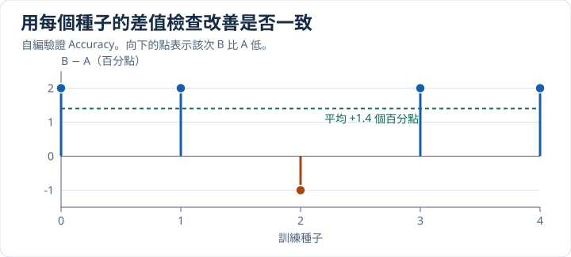

# 實驗設計與重現

[在 Colab 執行](https://colab.research.google.com/github/Samuel-ncu/AI-Stastic/blob/main/notebooks/09_experimental_design.ipynb) · [GitHub Notebook](../../notebooks/09_experimental_design.ipynb)

## 學習目標與先備知識

第 08 課問固定模型的分數會隨哪些測試樣本波動。這一課換成訓練前的問題：若 B 得分較高，怎麼判定是哪項改動造成差異？從可測的假設開始，再安排對照、記錄及最後驗收。

先讀資料切分及模型評估。學完能用表格寫出「改了什麼、固定什麼、量什麼」，並區分重跑一次與可重現的比較。

**搭配 DLI。** 先用 02 手語分類建立基準。到 04a 比較有無資料增強，到 05b 比較凍結基礎模型和解凍微調。每次比較前，先寫出「改了什麼、固定什麼、量什麼」。[DLI 對照表與原始 Notebook](../dli-mapping.md)

## 1. 問題要先寫成可檢驗的假設

**來源摘要 [O9](https://openstax.org/books/introductory-statistics-2e/pages/1-4-experimental-design-and-ethics)：**實驗設計區分解釋變數與反應變數，並考慮其他變數的干擾。觀察到一起變動，不足以直接判定因果。

以下全部為本教材自行設計的 AI 實驗延伸，不是來源的原例題。

問題「CNN 好不好？」太廣。可改成：「在相同 ASL 切分、相同訓練預算下，加入預先定義的資料增強，是否改善未見拍攝者的 Macro-F1？」

| 設計項目 | 本例內容 |
|---|---|
| 操作因素 | 是否使用指定資料增強 |
| 反應指標 | Macro-F1、每類 Recall、耗時 |
| 固定條件 | 資料切分、模型架構、訓練預算、種子集合 |
| 可能干擾 | 不同調參次數、不同資料版本或前處理 |
| 適用範圍 | 本資料、設備與拍攝者設定 |

有了可測的指標後，要安排兩組模型怎麼比較。若一次更換多個條件，就只能比較整套方案的效果。

## 2. 為什麼一次改一件事？

A 用小模型、少資料、無增強；B 用大模型、多資料、有增強。若 B 較好，只能說整套方案在本次評估較好，不能把提升全部歸給增強。

入門可先固定其他條件，一次改一個因素。若想知道因素之間是否有交互作用，還需更完整的多因素設計；一次改一件事不是所有研究的唯一方法。

固定其他條件之後，初始化等訓練隨機性仍會帶來波動。用相同的種子集合配對，讓每一列都能對照同一組設定。

## 3. 相同種子集合的配對比較

圖中的每一點是先把同一列 B 減 A，再乘 100 換成百分點。這組圖演示如何配對 Accuracy。若採用本課開頭的 ASL 假設，則應逐種子記錄 Macro-F1，再用同樣方式比較。

本教材自編五次驗證 Accuracy：

| 種子 | A | B | B−A |
|---:|---:|---:|---:|
| 0 | 0.80 | 0.82 | 0.02 |
| 1 | 0.82 | 0.84 | 0.02 |
| 2 | 0.81 | 0.80 | −0.01 |
| 3 | 0.83 | 0.85 | 0.02 |
| 4 | 0.79 | 0.81 | 0.02 |

A 平均 0.810，B 平均 0.824，差 0.014，即 1.4 個百分點。第三次 B 反而下降，所以不能只挑 B 最好的那一次報告。

樣本標準差可描述這五次結果的分散，但不是自動得到母體效果的信賴區間。相同種子是控制隨機條件的一種方式，不保證不同演算法內部使用完全相同的隨機過程。

算出每次差值後，還需要使別人知道重跑的條件。如果只保留平均分數，就無從辨認是切分、程式或設定造成差異。

## 4. 可重現需要記錄什麼？

| 類別 | 至少記錄 |
|---|---|
| 資料 | 來源、版本、前處理、切分索引或群組 |
| 環境 | Python、套件、硬體及必要設定 |
| 訓練 | 架構、超參數、種子、停止規則 |
| 評估 | 正類定義、指標、閾值、各次結果 |
| 選擇 | 試過幾個方案、用什麼資料選最好者 |

同一種子在不同平台、版本或非決定性 GPU 運算下，未必逐位元相同。因此報告需保留版本與合理的數值容忍度。

記錄都齊備，才適合封存最後的測試。先以驗證結果選定方案，再用測試回答它對新資料的表現。

## 5. 把測試留到最後

本課程式固定資料切分，使用五個種子比較 RandomForest 的兩種深度，只讀取驗證分數。X_test、y_test 已封存，尚未拿來挑設定。

若後續用驗證結果選定深度，就先固定選擇流程，再最後測一次。大量嘗試仍可能過度適應驗證集，需考慮另設資料或巢狀評估。本練習沒有自動完成所有研究設計問題。

## 自我檢核

1. B 比 A 快，但使用不同 GPU，能說演算法一定更有效率嗎？
2. 五次平均提高是否足以保證所有部署場景都提高？
3. 只公布五十次訓練中最好的那次，有何問題？

### 參考解答

1. 不能直接歸因；硬體是可能干擾，應固定或分別報告。
2. 不足以；資料代表性及部署條件仍限制結論。
3. 選擇性報告會過度樂觀，應呈現預先定義的比較及所有相關結果。

## 實作與延伸作業

請開啟上方 Notebook，逐格執行程式，對照手算與輸出。完成 Notebook 末尾的修改練習，繳交結果圖表、解讀、至少一項限制及 AI 使用驗證紀錄。

**帶到下一課。** 前面用數值與影像建立模型。輸入改成文字時，也要定義觀察單位、保留適當切分，並說明模型輸出的機率代表哪一個事件。[第 10 課：文字資料的統計](10-text-statistics.md)

## 出處與閱讀建議

- **O9**：[OpenStax，§1.4 Experimental Design and Ethics](https://openstax.org/books/introductory-statistics-2e/pages/1-4-experimental-design-and-ethics)。

本課以所列來源的概念作繁體中文摘要，並加入自行編寫的情境、手算、程式及練習；不是原網站的逐段翻譯。標為「來源摘要」者為改寫，標為「自編」者為本教材教學設計；短引文另以引號及「中譯」標明。來源連結可供對照原文，查閱日期：2026-11-17。
