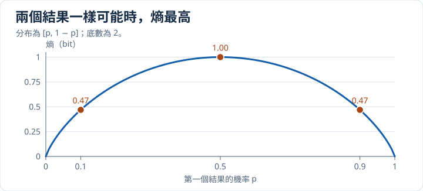
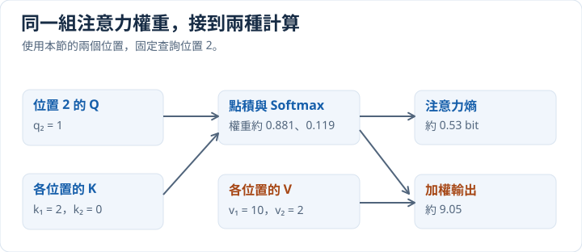

# 文字資料的統計

[在 Colab 執行](https://colab.research.google.com/github/Samuel-ncu/AI-Stastic/blob/main/notebooks/10_text_statistics.ipynb) · [GitHub Notebook](../../notebooks/10_text_statistics.ipynb)

[背景導讀：從統計到 AI 的模型設計](../statistics-to-ai.md)

## 學習目標與先備知識

同一份文字可以用詞袋比較文件，也可以保留詞序來預測下一個 token。先把文字放入一致的欄位，再從計數得到機率。理解熵之後，把同一個公式用到語言模型，並明確指出每次是對詞、候選 token，還是注意力位置在求和。

先讀機率分布與分類。本課從數詞開始理解文字如何變成向量，再介紹熵及相似度。延伸閱讀會把熵應用到語言模型的輸出與 Transformer 的注意力。

## 1. 文字怎麼變成模型輸入？

**來源摘要 [S8](https://scikit-learn.org/stable/modules/feature_extraction.html)：**詞袋表示把文字切成 token、計數並形成數值特徵。單詞詞袋不保留詞序，因此有明顯限制。

本教材自編兩句「ai helps students」與「students learn ai」。建立詞彙表 [ai,helps,learn,students] 後：

| 句子 | ai | helps | learn | students |
|---|---:|---:|---:|---:|
| ai helps students | 1 | 1 | 0 | 1 |
| students learn ai | 1 | 0 | 1 | 1 |

每列是一個文件向量，每欄固定對應一個詞。欄位順序由訓練資料建立的詞彙表決定。

### 如何用 fit 與 transform 處理新句子？

| 操作 | 在這個例子裡做什麼 |
|---|---|
| `fit` | 掃描上面兩句訓練文字，建立詞彙表及欄位對應 `[ai, helps, learn, students]` |
| `transform` | 沿用這四欄，計算輸入文字中每個已知詞出現幾次 |
| `fit_transform` | 在同一批文字上建立詞彙表，並回傳這批文字的計數矩陣 |

把新句子 `students use ai ai` 用 `transform` 轉成向量，得到 `[2, 0, 0, 1]`。`ai` 出現兩次，`students` 出現一次。`use` 未出現在訓練詞彙表，因此在這四欄沒有計數。若改用一個新的向量化器，單獨對這句執行 `fit_transform`，就會得到 `[ai, students, use]` 三欄及計數 `[2, 1, 1]`。兩組向量的第二欄分別是 `helps` 和 `students`，已訓練的分類器只能沿用原本的欄位定義。

正式評估時，先切分資料，再只用訓練集 `fit`。若先把訓練集與測試集合起來建立詞彙表，`use` 也會影響欄位設計，讓測試資料參與了前處理的擬合。驗證集、測試集和上線的新資料都沿用同一個已擬合的向量化器。

```python
from sklearn.feature_extraction.text import CountVectorizer

train_texts = ["ai helps students", "students learn ai"]
vectorizer = CountVectorizer()
X_train = vectorizer.fit_transform(train_texts)
X_new = vectorizer.transform(["students use ai ai"])

print(vectorizer.get_feature_names_out().tolist())  # ['ai', 'helps', 'learn', 'students']
print(X_new.toarray().tolist())  # [[2, 0, 0, 1]]
```

第 04 課的標準化遵循同一個流程。詞袋的 `fit` 建立欄位與詞的對應，標準化的 `fit` 則估計訓練集的平均與標準差。[第 04 課：讀懂 fit 與 transform](04-scaling-normalization.md#4-讀懂-fit-與-transform) · [scikit-learn：CountVectorizer](https://scikit-learn.org/stable/modules/generated/sklearn.feature_extraction.text.CountVectorizer.html) · [scikit-learn：資料洩漏](https://scikit-learn.org/stable/common_pitfalls.html#data-leakage)

中文不一定有空白分詞。切詞、字元 n-gram 或模型 tokenizer 是不同選擇，會影響後續頻率及向量，不能直接假設英文示範可原封不動套用。

詞袋中的格子是計數。把一份文件的各詞計數除以總詞數後，每個比例才可解讀成在該文件隨機抽到某個詞的機率。

## 2. 詞頻如何變成機率分布？

本教材自編文件「ai ai data model」，總詞數 4。p(ai)=2/4，p(data)=p(model)=1/4。三個比例加總為 1。

這個分布是「在此文件中隨機抽一個詞位置」的經驗詞頻分布，不是某個語言模型對下一個詞的預測分布。先說清楚隨機的是什麼，熵才有意義。

有了總和為 1 的比例，就可以問抽到哪一個詞有多難預測。每種結果的資訊量依出現機率加權，就是熵。

## 3. 熵：平均有多少不確定性？

**來源摘要 [SC2](https://docs.scipy.org/doc/scipy/reference/generated/scipy.stats.entropy.html)：**Shannon 熵以 $-\sum p_i\log p_i$ 定義；對數底數決定單位。SciPy 可依指定底數計算，也可計算兩個分布的相對熵。

設 $X$ 為結果，$p_i$ 為第 $i$ 種結果出現的機率。觀察到該結果時，得到的資訊量是 $-\log_2 p_i$。越少見的結果，單次出現提供的資訊量越大。**香農熵（Shannon entropy）就是把各結果的資訊量，按其出現機率取加權平均。** 使用底數 2 時，單位是 bit。

$$H(X)=-\sum_i p_i\log_2 p_i$$

本教材手算 [0.5,0.25,0.25]：

- 第一項：−0.5×(−1)=0.5。
- 另外兩項各為 −0.25×(−2)=0.5。
- 總和 H=1.5 bits。

若只有一種詞，p=1，H=0。若四種詞等比例，H=2 bits。這些值描述指定分布的不確定性，**不等於文章品質、知識價值或作者創意**。對 p=0 的項，按極限慣例記為 0，不直接計算 0×log(0)。

**兩種結果的對照。** 50%／50% 時熵為 1 bit，90%／10% 時約為 0.47 bit，100%／0% 時為 0 bit。同樣只有兩種可能結果，機率越集中，熵越低。可以用 `scipy.stats.entropy([0.9, 0.1], base=2)` 核對第二個例子。

熵能壓縮一份分布的集中程度。若兩份文件的熵恰好一樣，仍可能常用不同的詞，要比較使用方向便重新看完整向量。



橫軸每個點代表一個完整分布 $[p,1-p]$。$-\log_2 p_i$ 量度一個結果出現時帶來的資訊，乘上 $p_i$ 才能衡量它對長期平均的貢獻。這也解釋了為什麼對調兩種結果的機率不改變總熵。

## 4. 餘弦相似度是怎麼算的？

對非零向量 u、v：

$$\cos(u,v)=\frac{u\cdot v}{\|u\|\|v\|}$$

點積是對應元素相乘後加總，長度是平方和開根號。本教材自編 u=[1,1,0]、v=[1,0,1]：點積為 1，兩者長度都是 $\sqrt2$，所以相似度為 0.5。

把 $u$ 和 $v$ 各除以自己的長度，相當於把兩支箭頭縮放成單位長度。之後再做點積，分數由方向決定。同向時為 1，垂直時為 0。對詞頻而言，沒有共同非零欄位的兩個非零向量會得到 0。

它比較方向。將同一計數向量全部乘 2，相似度仍為 1，不代表文件內容完全相同。零向量的數學公式分母為 0，實作需要明確處理。

詞袋的欄位可拿來做相似度，也捨去了順序。若要根據前文預測下一個 token，模型需要在保有位置的前提下整合上下文。

## 5. 如何連到 DLI NLP？

DLI 06 的實作用 BERT。學生先用 tokenizer 把文字轉成 token ID，再從候選詞中找出最可能填進 `[MASK]` 位置的詞，最後做文本問答。讀到遮罩詞預測時，可把前面的熵用在候選 token 的機率分布上，理解模型對這個空格有多不確定。接下來的 GPT 例子延伸到根據前文預測下一個 token。[DLI 對照表與原始 Notebook](../dli-mapping.md)

詞袋可以當作輕量基準。假設分詞後的結果是「狗／追／貓」和「貓／追／狗」，兩句在詞袋裡的計數相同，每句各得到一個文件向量。Transformer 先用斷詞器（tokenizer）把文字變成有順序的 token ID，再把每個 ID 查表換成嵌入向量（embedding）。上例各有三個 token，因此每句都有三列向量，分別對應第一、第二、第三個位置。模型加入位置資訊後，自注意力便能在更新每一列時整合其他可見位置的內容。[Transformer 原論文 §3.4、§3.5](https://arxiv.org/html/1706.03762v7#S3.SS4)

### 輸出熵與交叉熵

以 GPT 類語言模型為例，每個位置會根據前文產生一組對詞彙表的分數（logits）。經過 softmax，就得到下一個 token 的預測分布 $p$。**輸出熵** $H(p)$ 衡量的是這組預測有多集中。訓練時，資料提供實際的下一個 token $y$，**交叉熵（cross-entropy）**衡量模型給它多少機率。單一正解的損失是 $-\log p_y$。[第 05 課：交叉熵通式](05-statistical-models-loss.md#3-為什麼分類會用交叉熵)

**自編對照。** 假設只有兩個候選 token A、B，且 A 是正解。以下統一用底數 2 手算，訓練損失通常以自然對數計算。

| 模型給 A、B 的機率 | 輸出熵 | 對正解 A 的交叉熵 |
|---|---:|---:|
| 90%、10% | 0.47 bit | $-\log_2(0.9)\approx0.15$ bit |
| 10%、90% | 0.47 bit | $-\log_2(0.1)\approx3.32$ bit |

兩次預測的機率集中程度相同，所以輸出熵相同。當模型給正解 A 的機率從 90% 降到 10%，交叉熵就升高。

### Q、K、V 如何從 token 向量產生？

在 Transformer 的自注意力（self-attention）中，令 $h_i$ 為位置 $i$ 送入注意力層的向量。第一層從 token 的嵌入向量（embedding）開始，位置資訊依架構加入。後續各層的向量已包含前面各層整合的資訊。同一個 $h_i$ 經由三組線性投影，產生三個用途不同的向量：

$$q_i=h_iW_Q,\qquad k_i=h_iW_K,\qquad v_i=h_iW_V.$$

| 向量 | 作用 |
|---|---|
| 查詢（Query，Q） | 表示目前位置要找什麼資訊 |
| 鍵（Key，K） | 提供特徵，供各位置的 Q 比對 |
| 值（Value，V） | 提供依注意力權重整合的內容 |

每層、每個注意力頭（attention head）都有自己的投影權重。以 GPT 類模型為例，訓練時，下一個 token 的交叉熵經反向傳播（backpropagation）產生這些權重的梯度，再由最佳化器更新 $W_Q,W_K,W_V$。推論時，權重固定，Q、K、V 由當前輸入向量算出。對照第 1 節，詞袋的 `fit` 從詞的出現情形建立欄位。Transformer 的投影權重則是為了降低預測損失，在訓練中反覆更新。[第 05 課：反向傳播手算](05-statistical-models-loss.md#補充模型怎麼從損失知道每個權重該往哪裡改) · [Transformer 原論文 §3.2](https://arxiv.org/html/1706.03762v7#S3.SS2)

### 從 Q、K、V 算出注意力權重與熵



權重向右有兩條路。上路只用權重，回答「模型把注意力集中在哪些位置」。下路還需要各位置的 V，回答「模型整合出什麼向量」。

固定一個注意力頭與一個查詢位置 $i$。將 $q_i$ 與各位置的 $k_j$ 做點積，除以 $\sqrt{d_k}$，其中 $d_k$ 是 Q、K 的向量維度。接著對可注意的位置做 softmax，取得總和為 1 的注意力權重 $a_{ij}$。GPT 類模型的因果遮罩（causal mask）允許使用當前與更早的位置。注意力輸出 $o_i$ 與注意力熵 $H_i$ 分別為

$$a_{ij}=\operatorname{softmax}_{j}\!\left(\frac{q_i\cdot k_j}{\sqrt{d_k}}\right),\qquad
o_i=\sum_j a_{ij}v_j,\qquad
H_i=-\sum_j a_{ij}\log_2 a_{ij}.$$

下標 $i$ 是正在更新的位置，$j$ 走訪所有允許被看見的位置。因果遮罩先排除未來位置，softmax 才在其餘位置間分配權重。除以 $\sqrt{d_k}$ 是為了抑制向量維度增大時點積的典型尺度，避免僅因維度較大就容易把 softmax 推向高度集中的區域。

**自編手算。** 設兩個位置的輸入向量是 $h_1=[2,0]$、$h_2=[0,1]$。為方便計算，每個投影只輸出一個數。使用欄向量 $W_Q=[0,1]^\top$、$W_K=[1,0]^\top$、$W_V=[5,2]^\top$，可以逐步算出第二個位置的注意力：

1. **算 Q、K、V。** 第二個位置的查詢是 $q_2=1$，兩個位置的鍵是 $(k_1,k_2)=(2,0)$，值是 $(v_1,v_2)=(10,2)$。
2. **比對分數並做 softmax。** $d_k=1$，所以分數為 $(1\times 2,1\times 0)=(2,0)$。將 $e^2$ 和 $e^0$ 分別除以 $e^2+e^0$，得到權重約 $(0.881,0.119)$。
3. **加權 V，再量化權重有多集中。** 注意力輸出約為 $0.881\times10+0.119\times2=9.05$。把兩個權重代入熵公式，得到約 $0.53$ bit。

**自我檢核。** 若把兩個比對分數都改成 0，權重為 $(0.5,0.5)$，熵升到 1 bit，輸出變成 6。若保留原本的 Q、K 與遮罩，只把 $v_1$ 從 10 改成 6，熵維持約 0.53 bit，輸出則變成約 5.52。

例如「小明把書放在桌上，因為他要出門」，某個注意力頭如果學到代名詞指涉，「他」的 Q 和「小明」的 K 可能得到較高的匹配分數，讓「小明」的 V 在「他」的注意力輸出中占較大比重。**輸出熵是對候選 token 算，注意力熵則是對這一層、這一頭、這個查詢位置的注意力權重算。** [Transformer 原論文 §3.2、§3.4](https://arxiv.org/html/1706.03762v7#S3.SS2) · [SciPy 熵函數](https://docs.scipy.org/doc/scipy/reference/generated/scipy.stats.entropy.html)

注意力先產生每個位置要接收的資訊。放進完整的 Transformer 子層時，更新後的內容還會和原本的表示相加。下一節接著從一個位置看這個加法怎麼運作。

## 補充｜從文字向量看懂 Transformer 的殘差連接

前面已把一段文字表示成向量。Transformer 會保留每個 token 的向量，並反覆更新它。以簡化的張量形狀 $[B,T,D]$ 為例，$B$ 是批次筆數，$T$ 是 token 數，$D$ 是每個 token 的表示維度。設 $h$ 為子層的輸入，$F(h)$ 是注意力或前饋網路算出的更新。相加前兩個張量的形狀一致。

$$h_{\rm sum}=h+F(h)$$

**自編手算。** 某個 token 原本的三維表示是 $[2,1,-1]$，前饋子層輸出 $[0.3,-0.2,0.1]$。相加得 $[2.3,0.8,-0.9]$。三個座標都是內部特徵，程式可直接相加。訓練時會以最終任務損失更新子層參數，$F(h)$ 的每個座標通常沒有教師直接提供的答案。

| 問題 | 統計迴歸的殘差 | Transformer 的殘差連接 |
|---|---|---|
| 差值或更新從哪來？ | $r_i=y_i-\hat y_i$，需有實測答案 | $F(h)$ 由子層從當前輸入算出 |
| 用在哪裡？ | 診斷預測偏差，或透過平方、絕對值等轉成損失 | 在前向運算中把內部特徵的更新加到輸入 |
| 量的單位 | 與目標 $y$ 相同，例如毫秒 | 與隱藏表示相容，例如每個 token 的 $D$ 個座標 |
| 推論時能否取得？ | 取得實測答案後才可計算 | 只要有輸入，子層就能計算並相加 |

### 兩種殘差共用「基準＋差量」的寫法

**自編對照。** 延續第 05 課的延遲例子，預測 7 ms、實測 9 ms，迴歸殘差為 $9-7=+2$ ms。它表示低估了 2 ms。把這個差量加回預測值只會還原已觀測的 9 ms。只有預測值時，還算不出這筆殘差。參見 [第 05 課迴歸殘差](05-statistical-models-loss.md)。

Transformer 保留的是原輸入表示 $h$，加上的是子層產生的更新向量 $F(h)$。如果將殘差相加點的映射記作 $H(h)=h+F(h)$，同一關係也可寫作 $F(h)=H(h)-h$。這就是「相對於基準學一段差量」的意思。在一般的端到端訓練中，資料只提供最後的任務答案，子層的更新由整體損失經反向傳播來學習。到了推論，前向運算仍可用當前輸入與已訓練的參數算出 $F(h)$。

**檢核。** 若明天才知道請求的實際延遲，今天能算出哪一種差量？今天可算 Transformer 子層對當前輸入的更新。迴歸預測的殘差要等實測延遲到手。

**為什麼有旁路？** 在相加處，梯度可同時經過直接路徑和子層，對 $h$ 的局部導數含恆等項。若相加後還有正規化，梯度仍會經過該正規化。只憑一個加號無法推斷整個模型一定收斂或保證梯度大小。

**把四種運算放回架構。** 原始 Transformer 的前饋子層用兩個線性變換，中間放 ReLU。殘差連接把子層輸出加回輸入，再做 LayerNorm，亦即 $\mathrm{LN}(h+F(h))$，常稱 Post-LN。另一種設計把 LN 放在子層入口，寫作 $h+F(\mathrm{LN}(h))$，常稱 Pre-LN。這兩式省略 Dropout。於是 ReLU 負責前饋非線性，殘差旁路負責加總，LN 調整表示的尺度，最終 token 交叉熵衡量模型給正確 token 的機率。查閱特定模型時，應以其架構或程式確認所用啟動函數和正規化位置。

**自我檢核。** 如果 $F(h)=0$，加總點的結果是什麼？若原始 Transformer 此處使用 Post-LN，整個子層的輸出呢？答案依序是 $h$ 和 $\mathrm{LN}(h)$。這也解釋了為何要區分加總點和整個子層。

[來源：ResNet 原論文](https://arxiv.org/abs/1512.03385) · [Transformer 原論文 §3.1、§3.3、§3.4](https://arxiv.org/html/1706.03762v7#S3) · [Xiong 等人對 Pre-LN 與 Post-LN 的研究](https://proceedings.mlr.press/v119/xiong20b.html)

可回到 [第 06 課比較啟動函數](06-overfitting-generalization.md)，再從模型規格確認前饋層的啟動函數與正規化位置。

### 補充｜殘差旁路如何改變反向傳播？

延續第 06 課的單變數例。在普通層 $h_{\rm out}=F(h)$，從上游傳回的梯度要乘 $F'(h)$。在殘差相加點 $h_{\rm out}=h+F(h)$，同一個梯度則乘：

$$\frac{d h_{\rm out}}{d h}=1+F'(h).$$

其中 1 來自原輸入直接走到相加點的路徑，$F'(h)$ 來自子層。反向傳播會將兩條路徑對輸入的貢獻相加。若上游梯度為 1 且 $F'(h)=0.01$，普通層向前一層傳回 0.01，殘差相加點傳回 1.01。若 $F'(h)=-1$，兩項在這一點會抵銷。這些數字是局部手算，說明旁路如何幫助傳遞梯度，也顯示效果取決於分支的導數。向量情況的對應式是 $I+J_F$，其中 $I$ 是恆等矩陣，$J_F$ 是子層對輸入的雅可比矩陣。

原始 Transformer 使用 Post-LN，整個子層是 $\mathrm{LN}(h+F(h))$，反向傳播在抵達相加點前還要經過 LayerNorm。Pre-LN 寫成 $h+F(\mathrm{LN}(h))$，直接路徑仍把 $h$ 接到加總點。這也說明**殘差是改變梯度路徑的架構設計，反向傳播是沿那些路徑算梯度的方法**。[第 06 課：梯度消失與 Sigmoid](06-overfitting-generalization.md) · [ResNet 原論文](https://arxiv.org/abs/1512.03385) · [Transformer 原論文 §3.1](https://arxiv.org/html/1706.03762v7#S3.SS1) · [Pre-LN 與 Post-LN 研究](https://proceedings.mlr.press/v119/xiong20b.html)

## 自我檢核

1. 分布 [0.5,0.5] 的熵是多少 bits？
2. u=[1,0] 與 v=[2,0] 的餘弦相似度是多少？
3. 兩句話詞袋一樣，就能斷定語意一樣嗎？
4. A 是正解。若 A、B 的預測機率從 90%／10% 變成 10%／90%，輸出熵與交叉熵各怎麼變？
5. 在同一個注意力頭固定 Q、K 與遮罩，只修改其中一個有正權重的 V，注意力熵及該查詢位置的輸出各怎麼變？

### 參考解答

1. 1 bit。
2. 1；兩者方向相同。
3. 不能。詞序、語法及語境可能不同。
4. 輸出熵維持約 0.47 bit。交叉熵由約 0.15 bit 升到 3.32 bit。
5. 注意力熵維持相同。輸出會依該位置的權重改變。

## 實作與延伸作業

請開啟上方 Notebook，逐格執行程式，對照手算與輸出。完成 Notebook 末尾的修改練習，繳交結果圖表、解讀、至少一項限制及 AI 使用驗證紀錄。

**回到學期導讀。** 現在可以沿著「文字轉成 token → 建立上下文表示 → 輸出詞彙表機率 → 用交叉熵訓練」閱讀 Transformer。若要比較兩個模型，回到第 07–09 課，先選合適的任務指標，再判讀結果的變動。[從統計到 AI 的模型設計](../statistics-to-ai.md)

## 出處與閱讀建議

- **S8**：[scikit-learn，Feature extraction（Bag of Words）](https://scikit-learn.org/stable/modules/feature_extraction.html)。
- **SC2**：[SciPy，scipy.stats.entropy](https://docs.scipy.org/doc/scipy/reference/generated/scipy.stats.entropy.html)。
- [Vaswani 等人，Attention Is All You Need，§3.2 注意力與 §3.4 嵌入和 Softmax](https://arxiv.org/html/1706.03762v7#S3.SS2)。

本課以所列來源的概念作繁體中文摘要，並加入自行編寫的情境、手算、程式及練習；不是原網站的逐段翻譯。標為「來源摘要」者為改寫，標為「自編」者為本教材教學設計；短引文另以引號及「中譯」標明。來源連結可供對照原文，查閱日期：2026-11-17。
