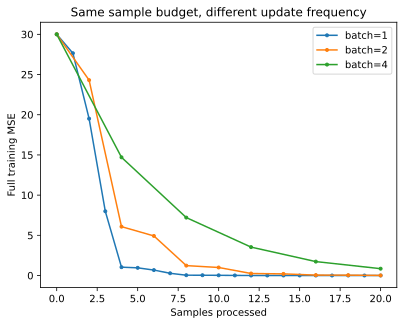

# Mini-batch 與隨機梯度

[在 Colab 執行](https://colab.research.google.com/github/Samuel-ncu/AI-Stastic/blob/main/notebooks/bridge_minibatch_gradients.ipynb) · [GitHub Notebook](../../notebooks/bridge_minibatch_gradients.ipynb)

先備閱讀　[統計模型與損失](05-statistical-models-loss.md) · [過擬合與泛化](06-overfitting-generalization.md)

第 05 課用一筆資料算梯度。實際訓練需要決定**累積幾筆梯度才更新一次**。這一批資料叫 mini-batch。一次走過所有訓練樣本是一個 epoch；每處理完一個批次並更新權重，才算一次參數更新。

## 把每筆梯度平均

用簡化的迴歸 $\hat y=wx$。第 $i$ 筆的平方損失為 $(wx_i-y_i)^2$，因此對 $w$ 的梯度是 $g_i=2(wx_i-y_i)x_i$。一個批次 $\mathcal{B}$ 有 $b$ 筆，把同一個當前權重下的梯度加總，再除以 $b$：

$$g_{\mathcal{B}}=\frac{\sum_{i\in\mathcal{B}}g_i}{b},\qquad w_{\mathrm{new}}=w-\eta g_{\mathcal{B}}.$$

$\eta$ 是學習率。以下四筆來自 $y=2x$，起點取 $w=0$，學習率取 0.02。

| $x_i$ | $y_i$ | 起點的單筆梯度 |
|---:|---:|---:|
| 1 | 2 | −4 |
| 2 | 4 | −16 |
| 3 | 6 | −36 |
| 4 | 8 | −64 |

整批一次平均得到 −30，所以走完四筆後 $w=0.6$。若每批兩筆，第一批梯度 −10，先更新到 $w=0.2$。第二批**要用新的 $w$ 重算**，平均是 −45，更新後得到 $w=1.1$。同樣讀過四筆資料，兩種做法的更新時點不同。

## 怎麼比較批次大小？

| 批次大小 | 本例每個 epoch 更新幾次？ | 梯度使用的資料 |
|---|---:|---|
| 1 | 4 | 一筆，容易受個別樣本影響 |
| 2 | 2 | 兩筆平均，隨抽到的組合而變 |
| 4 | 1 | 這四筆全用，得到當下的訓練集梯度 |

隨機性來自重排或抽樣。若均勻抽取，批次梯度在固定權重下的期望等於整個訓練集的平均梯度。實際圖表應明示橫軸是更新次數、看過的樣本數還是 epoch，並記錄學習率與切分。在 DLI 手語練習找出一批資料的位置，先辨認何時算 loss，何時做一次參數更新。閱讀 Chinchilla 時，再把「每批如何更新」與「固定總算力下看過多少資料」分開。

## 圖解與 CPU 實作

先手算整批和兩筆一批的第一輪更新，再比較同樣樣本預算下的損失曲線。 圖表使用本教材的合成資料。上方 Notebook 可在 CPU 執行，並逐步核對講義的算例。

## 自我檢核與練習

把學習率改成 0.01，先手算整批第一步。參考答案：梯度仍是 −30，權重更新到 0.3。再用固定種子重排每個 epoch，對照同一批次大小的路徑如何變動。

接續閱讀　[E1 模型規模與計算配額](e1-compute-scaling.md)

## 來源

- [DLI 02 手語分類訓練迴圈](https://github.com/NVDLI/fundamentals-of-deep-learning-zh/blob/main/course_content/tutorials/02_asl.ipynb)
- [Chinchilla 原論文](https://arxiv.org/abs/2203.15556)
