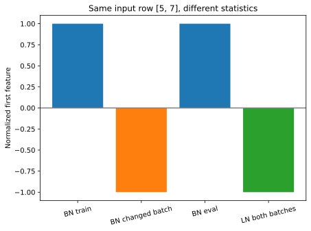

# 模型內正規化：BN、LN 與 PowerNorm

[在 Colab 執行](https://colab.research.google.com/github/Samuel-ncu/AI-Stastic/blob/main/notebooks/bridge_normalization_layers.ipynb) · [GitHub Notebook](../../notebooks/bridge_normalization_layers.ipynb)

先備閱讀　[張量與統計軸](bridge-tensor-axes.md) · [尺度與標準化](04-scaling-normalization.md)

模型內也會做中心化與縮放。延續張量課，先問**同一個數值和誰一起算平均及變異數**，再問模型在評估時使用哪組統計量。

## 用同一個張量手算 BN 與 LN

取兩筆資料各兩個特徵 $x=[[1,3],[5,7]]$。先省略可學的縮放和偏移。正規化值為 $(x-\mu)/\sqrt{v+\epsilon}$，$\epsilon$ 是分母的穩定項。

| 方法 | 在這個二維例子裡怎麼取統計量 | 忽略 $\epsilon$ 的輸出 |
|---|---|---|
| Batch Normalization（BN） | 每欄跨兩筆資料算。中心是 $[3,5]$，變異數是 $[4,4]$ | $[[-1,-1],[1,1]]$ |
| Layer Normalization（LN） | 每一列自己算。兩列的中心是 2 和 6，變異數都是 1 | $[[-1,1],[-1,1]]$ |

看第一格 1。BN 用同一特徵的 $[1,5]$ 當參考，得到 $(1-3)/2=-1$。LN 用同一筆的 $[1,3]$ 當參考，得到 $(1-2)/1=-1$。第一格恰好相同，第二格因基準不同而得到不同符號。影像用的 BatchNorm2d 則針對每個通道跨 $B,H,W$ 算；Transformer 的 LayerNorm 常沿每個 token 的最後一軸 $D$ 算。

## 為什麼同一筆資料可能變出不同結果？

固定一筆 $[5,7]$。假如 BN 的另一筆從 $[1,3]$ 改成 $[9,11]$，這筆資料由「在批次平均之上」變成「在批次平均之下」。LN 使用該筆自己的兩個數值，所以兩次都得到約 $[-1,1]$。

使用預設的 PyTorch BatchNorm2d 時，訓練前向用當前批次統計，評估時用訓練期間累積的統計；LayerNorm 在兩個階段都使用當前輸入統計。本課程式以自編、固定的均值 $[3,5]$ 和變異數 $[4,4]$ 模擬 BN 已存下來的參考值，便於把「換批次」與「換參考」分開觀察。

## PowerNorm 從哪個統計量出發？

前一課的均方把每個值相對於零的大小平方後取平均。以 $[2,4]$ 為例，均值是 3、中心化變異數是 1，均方卻是 10，RMS 是 $\sqrt{10}$。PowerNorm 論文放寬零均值要求，並使用跨批次累積的均方量。若只做教學用的指數移動平均，舊均方為 10、新批次均方為 34，給舊值 90% 權重，更新得到 $0.9(10)+0.1(34)=12.4$。此例只練習均方平滑的概念。完整方法的更新條件與近似反向傳播見論文。

## 圖解與 CPU 實作

固定同一筆資料，讀圖比較換批次與評估模式時的輸出。 圖表使用本教材的合成資料。上方 Notebook 可在 CPU 執行，並逐步核對講義的算例。

## 自我檢核與練習

把另一筆改為 $[3,5]$，先判斷固定資料的 BN 正負號，再跑程式。參考答案：BN 訓練輸出仍在平均之上，LN 的兩個值仍約為 $[-1,1]$。將移動平均的舊值權重改成 0.5，則更新值為 22。

接續閱讀　[Transformer 文字表示](10-text-statistics.md)

## 來源

- [PyTorch BatchNorm2d](https://docs.pytorch.org/docs/2.15/generated/torch.nn.BatchNorm2d.html)
- [PyTorch LayerNorm](https://docs.pytorch.org/docs/2.15/generated/torch.nn.LayerNorm.html)
- [PowerNorm 原論文](https://proceedings.mlr.press/v119/shen20e.html)
