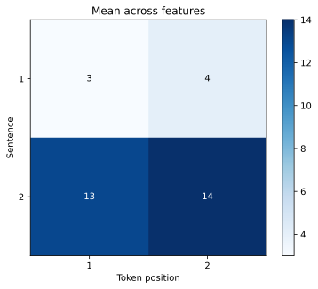

# 張量與統計軸

[在 Colab 執行](https://colab.research.google.com/github/Samuel-ncu/AI-Stastic/blob/main/notebooks/bridge_tensor_axes.ipynb) · [GitHub Notebook](../../notebooks/bridge_tensor_axes.ipynb)

先備閱讀　[尺度與標準化](04-scaling-normalization.md)

同一批文字向量可以問三種不同的問題。每個 token 的向量中心在哪裡？一句話的 token 平均表示是什麼？同一位置跨兩筆句子平均是多少？**差別在於沿哪一軸合併。**

## 先讀形狀，再選軸

文字模型常用形狀 $[B,T,D]$。$B$ 是批次中的句數，$T$ 是每句的 token 位置數，$D$ 是每個位置的特徵數。這裡有兩句、每句兩個 token、每個 token 三個特徵：

| 句子 | 第 1 個 token | 第 2 個 token |
|---|---|---|
| 1 | $[1,3,5]$ | $[2,4,6]$ |
| 2 | $[11,13,15]$ | $[12,14,16]$ |

| 沿哪一軸平均 | 合併了什麼 | 剩下的形狀 | 算例 |
|---|---|---|---|
| `axis=0`（$B$） | 同一位置與特徵，跨句子 | $[T,D]=[2,3]$ | 第一位置變成 $[6,8,10]$ |
| `axis=1`（$T$） | 同一句的兩個 token，逐特徵合併 | $[B,D]=[2,3]$ | 第一句變成 $[1.5,3.5,5.5]$ |
| `axis=-1`（$D$） | 同一 token 的三個特徵 | $[B,T]=[2,2]$ | 第一句的兩個 token 分別得到 3 和 4 |

前兩個結果的形狀碰巧都是 $[2,3]$，但一個以 token 位置為列，另一個以句子為列。**讀輸出時，形狀和軸的名字都要保留。** 若要把平均值減回張量，可用 `keepdims=True` 保留長度為 1 的該軸，讓每個平均值回到自己的位置。

## 同一列的變異數與 RMS

令 $x_d$ 是一個 token 的第 $d$ 個特徵。平均用全部 $D$ 個特徵相加再除以 $D$。變異數先減平均再平方，RMS 直接從原值平方開始：

$$m=\frac{\sum_d x_d}{D},\qquad
v=\frac{\sum_d(x_d-m)^2}{D},\qquad
\mathrm{RMS}=\sqrt{\frac{\sum_d x_d^2}{D}}.$$

例如 $[1,3,5]$ 的平均是 3，變異數是 $(4+0+4)/3=8/3$，RMS 是 $\sqrt{(1+9+25)/3}=\sqrt{35/3}$。兩個分母一樣，**參考點一個是平均、一個是零**。

在 DLI 影像例子，常見 $[B,C,H,W]$ 依序表示影像張數、通道、高、寬。沿 $H,W$ 平均會留下每張影像的各通道。文字張量若含填補位置，做句子平均時先用遮罩排除補位，再除以有效 token 數。這就是下一課比較 BN 與 LN 前要確認的事。

## 圖解與 CPU 實作

先手算三個軸的形狀，再用矩陣圖核對逐 token 平均。 圖表使用本教材的合成資料。上方 Notebook 可在 CPU 執行，並逐步核對講義的算例。

## 自我檢核與練習

把第二句的有效 token 改成兩個，先寫出該句的加總、分母和向量，再核對程式。參考答案是 $[11.5,13.5,15.5]$。另用一塊 $[B,C,H,W]$ 影像張量說明沿空間平均後還有哪些軸。

接續閱讀　[模型內正規化](bridge-normalization-layers.md)

## 來源

- [NumPy mean 與 axis](https://numpy.org/doc/stable/reference/generated/numpy.mean.html)
- [DLI 02 手語分類與影像](https://github.com/NVDLI/fundamentals-of-deep-learning-zh/blob/main/course_content/tutorials/02_asl.ipynb)
- [ViT 原論文](https://arxiv.org/abs/2010.11929)
