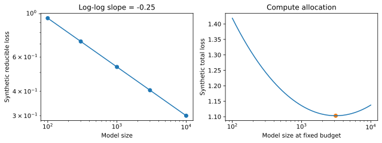

# 模型規模與計算配額

[在 Colab 執行](https://colab.research.google.com/github/Samuel-ncu/AI-Stastic/blob/main/notebooks/e1_compute_scaling.ipynb) · [GitHub Notebook](../../notebooks/e1_compute_scaling.ipynb)

先備閱讀　[Mini-batch 與隨機梯度](bridge-minibatch-gradients.md)

固定訓練資源時，大模型可以看較少 token，小模型可以看較多 token。這一課用合成數據練習兩件事：從 log-log 圖讀出變化速度，以及在同一預算下公平比較配置。

## 用對數座標讀冪律

假設可降低的損失為 $G(N)=3N^{-0.25}$，$N$ 表示模型大小。兩邊取自然對數，就得到 $\ln G=\ln3-0.25\ln N$。橫軸量的是模型大小的倍率，斜率 −0.25 表示模型大小每翻倍，這部分的損失會乘上 $2^{-0.25}\approx0.841$。這個數字描述合成例的冪律。若原始損失含常數底限，要先說清楚畫的是總損失還是扣除底限後的差。

## 固定預算，比較模型和資料的分配

用 $N$ 代表相對模型大小、$D$ 代表相對 token 數。以 $ND=10^6$ 作為簡化配額，並假設教學損失為：

$$L(N,D)=0.3+3N^{-0.25}+1.7D^{-0.25}.$$

| $N$ | $D$ | 配額 $ND$ | 合成損失（約） |
|---:|---:|---:|---:|
| 100 | 10,000 | $10^6$ | 1.419 |
| 1,000 | 1,000 | $10^6$ | 1.136 |
| 10,000 | 100 | $10^6$ | 1.138 |

由第一列到第二列，模型大小增加，模型項的損失下降，但 token 項上升。**應以兩項合計比較同一配額下的結果。** 程式再掃更多候選，找出這個合成公式的最低點。閱讀 Chinchilla 時，查作者如何從真實的模型訓練擬合趨勢。本課的係數、損失與預算單位皆為自編，模型外推與實際硬體成本需要另外驗證。

## 圖解與 CPU 實作

比較 log-log 斜率與固定配額下的損失最低點。 圖表使用本教材的合成資料。上方 Notebook 可在 CPU 執行，並逐步核對講義的算例。

## 自我檢核與練習

把 token 項係數從 1.7 改成 3。先預測較好的分配會往哪裡移，再核對圖表。兩項對稱的情況下，最低點會靠近 $N=D=1000$。

接續閱讀　[論文閱讀導引](../paper-reading-guide.md)

## 來源

- [Chinchilla 原論文](https://arxiv.org/abs/2203.15556)
