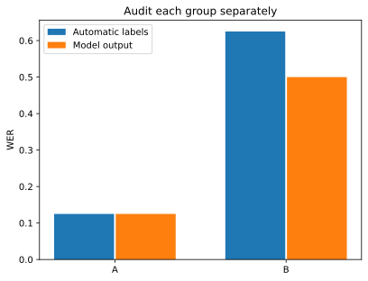

# 弱監督與語音評估

[在 Colab 執行](https://colab.research.google.com/github/Samuel-ncu/AI-Stastic/blob/main/notebooks/e2_weak_supervision_wer.ipynb) · [GitHub Notebook](../../notebooks/e2_weak_supervision_wer.ipynb)

先備閱讀　[分類模型評估](07-classification-evaluation.md)

弱監督可以用來源較廣、品質參差的標籤訓練模型。例如音訊旁的文字可能是字幕、摘要或自動轉錄。這類資料可增加覆蓋範圍，但要抽查標籤錯誤是否集中在特定語言或口音，再用獨立的人工參考轉錄評估。

## 一句話要改幾個詞？

字詞錯誤率（WER）先將模型輸出和參考文字逐詞對齊，再找最少要做多少次替換 $S$、刪除 $D$、插入 $I$。分母是參考文字的詞數 $N$：

$$\mathrm{WER}=\frac{S+D+I}{N}.$$

例如參考是 \`please open the door\`，模型輸出 \`please close door\`。把 \`open\` 換成 \`close\`，刪掉 \`the\`，需要 2 次編輯，WER 為 $2/4=50\%$。參考只有一詞而輸出多出兩詞時，插入數可以超過分母，因此 WER 可能高於 100%。中文等情境要先定義分詞口徑，也可以另報字元錯誤率（CER）。

## 先按組算，再解讀整體 WER

以下是自編範例。A、B 可代表不同錄音條件或不同口音組，參考文字都由教師提供。

| 群組 | 錯誤數 | 參考詞數 | WER |
|---|---:|---:|---:|
| A | 1 | 8 | 12.5% |
| B | 4 | 8 | 50% |
| 合計 | 5 | 16 | 31.25% |

整體 WER 用全部錯誤數除以全部參考詞數。這個例子給兩組相同詞數；若詞數不同，整體分數會較受長音訊群組影響。Notebook 另外算自動標籤相對人工參考的 WER，示範如何檢查訓練標籤與最終評估的品質。群組差距也可能來自麥克風、噪聲或文本難度，要先控制或分層再談原因。

## 圖解與 CPU 實作

先手算替換、刪除和插入，再按組比較模型與自動標籤的 WER。 圖表使用本教材的合成資料。上方 Notebook 可在 CPU 執行，並逐步核對講義的算例。

## 自我檢核與練習

把其中一組加入一筆長句，重算各組和整體 WER。解釋為什麼整體 WER 要加總錯誤與參考詞數，以及群組差距還需要哪些資料才能解釋。

接續閱讀　[實驗設計與重現](09-experimental-design.md)

## 來源

- [Whisper 原論文](https://arxiv.org/abs/2212.04356)
- [NIST 語音評估工具](https://www.nist.gov/itl/iad/mig/tools)
