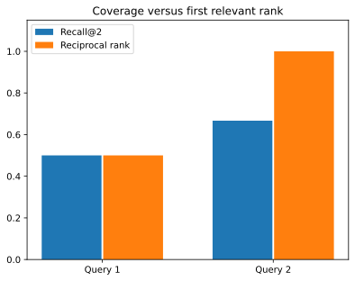

# 檢索排序與機率融合

[在 Colab 執行](https://colab.research.google.com/github/Samuel-ncu/AI-Stastic/blob/main/notebooks/e3_retrieval_probability.ipynb) · [GitHub Notebook](../../notebooks/e3_retrieval_probability.ipynb)

先備閱讀　[機率與期望值](02-probability-classification.md) · [文字資料的統計](10-text-statistics.md)

本課對照兩篇原文。**Lewis 等人的 RAG** 把文件當作潛在變數，研究怎麼把「檢索給的權重」和「生成器給的機率」合在一起。**LLM-Embedder v2** 研究怎麼用不同任務的例子與大型語言模型的回饋，學出適合多種檢索工作的向量。

## 原版 RAG 從檢索到生成的三步

1. **找文件（§2.2）**。DPR 用查詢向量 $q(x)$ 和文件向量 $d(z)$ 的內積排序，做最大內積搜尋（MIPS），留下前 $K$ 個片段。若兩種向量都先做單位長度正規化，內積與餘弦相似度相同。未正規化時，向量長度也會影響排序。例 $q=[1,0]$、$A=[2,2]$、$B=[1,0]$，用內積選 A，用餘弦選 B。
2. **形成配分**。用 $p_\eta(z\mid x)$ 表示檢索器給文件的權重。教學例會對保留的候選做 softmax，方便把權重當作加總為 1 的分布。若檢索不到支持答案的文件，高權重仍只說明候選間的相對取向。
3. **依文件生成（§2.1）**。令 $g_i(z)=p_\theta(y_i\mid x,z,y_{<i})$，表示給定問題、片段與已生成前文時，第 $i$ 個答案 token 的條件機率。設 $Z_K(x)$ 為查詢保留的前 $K$ 份文件。

RAG-Sequence 先算每份文件下的**整段機率**，再對文件加權：

$$p_{\mathrm{seq}}(y\mid x)\approx\sum_{z\in Z_K(x)}p_\eta(z\mid x)\prod_i g_i(z).$$

RAG-Token 對每個 token **先混合文件條件**，再把各步機率相乘：

$$p_{\mathrm{tok}}(y\mid x)\approx\prod_i\left[\sum_{z\in Z_K(x)}p_\eta(z\mid x)g_i(z)\right].$$

兩式的差別是求和與相乘的次序。給同一組前 $K$ 份候選，RAG-Token 可在不同位置借重不同文件的資訊。兩式算出的數字都是指定答案序列的機率。

| 教學候選 | 檢索權重 | 第 1 個指定 token 機率 | 第 2 個指定 token 機率（已知第 1 個） |
|---|---:|---:|---:|
| A | 0.6 | 0.9 | 0.2 |
| B | 0.4 | 0.2 | 0.9 |

Sequence 是 $0.6(0.9\times0.2)+0.4(0.2\times0.9)=0.18$。Token 是 $(0.6\times0.9+0.4\times0.2)(0.6\times0.2+0.4\times0.9)=0.2976$。本例兩份文件各擅長一段，因此逐位置混合較高；實際表現需在任務資料上評估。[Lewis 等人，§2.1–2.2](https://arxiv.org/html/2005.11401v4#S2)

## LLM-Embedder v2 把問題拉回「怎麼學好檢索」

| 原文設計 | 在訓練中處理什麼問題 | 本課怎麼對照 |
|---|---|---|
| 多任務與明確指令 | 同一向量模型要服務不同檢索需求，例如找回答依據或找可作為示範的例子 | 以不同任務前綴讀同一個短句，再比較哪類文件應排前面 |
| LLM 回饋與蒸餾 | 候選對下游作答的幫助程度，可以提供比單一正例更細的排序訊號 | 用教學用的候選權重對照只有 0／1 的標記 |
| 同質批內負樣本 | 從同一任務的其他例子借用候選，讓模型學會區分較相似的錯誤答案 | 比較「兩份同主題但答錯的文件」與「完全無關資料」作為負例的難度 |

所以讀完 Lewis 的邊際化後，接著看 LLM-Embedder 怎麼學候選排序。本課 Notebook 的向量、文件權重與生成機率是小型算例。v2 在這裡用來對照方法，評估結果與資料集請以該版本原文為準。[LLM-Embedder v2](https://arxiv.org/abs/2310.07554v2)

## 合成暖身與手算

## 從餘弦相似度到 Recall@k 與 MRR

沿用第 10 課的餘弦相似度。查詢 $q=[1,0]$，三份文件向量分別是 $D_1=[1,0]$、$D_2=[1,1]$、$D_3=[0,1]$。與查詢的餘弦相似度為 1、$1/\sqrt2$、0，排序為 $D_1,D_2,D_3$。假設人工標記的相關文件是 $D_2,D_3$。

| 指標 | 回答的問題 | 本例 |
|---|---|---|
| Recall@2 | 全部相關文件中，有多少出現在前兩名？ | 找到 $D_2$，為 $1/2=0.5$ |
| Reciprocal Rank（RR） | 第一份相關文件排第幾？ | $D_2$ 排第 2，為 $1/2=0.5$ |

MRR 是多個查詢的 RR 平均。假設第二個查詢三份文件都相關，前兩名找到兩份，Recall@2 為 $2/3$。第一份相關文件排第 1，所以第二題的 RR 為 1，兩個查詢的 MRR 就是 $(0.5+1)/2=0.75$。第二題也說明，第一名就命中時，仍可能有部分相關文件沒進入前兩名。本練習把無命中的 RR 記為 0，且每個查詢都有至少一份已標註的相關文件。

## 如何把文件權重帶進答案機率？

為了理解 RAG 的邊際化，假設兩份文件已有歸一化權重 0.6、0.4。它們各自讓某答案成立的條件機率為 0.2、0.9。用文件權重加權後，答案機率是

$$0.6\times0.2+0.4\times0.9=0.48.$$

這個運算沿用期望值的加權平均。上節餘弦分數用來排序；這節的權重已事先指定為總和 1 的機率。評估時再問「拿到相關文件後，答案有沒有答對」，因為文件的排名和最終答案各需要一套判準。

## 暖身圖解與原文對照實作

讀出兩個查詢的覆蓋率與第一份相關文件的名次，再核對機率融合。 這張圖使用合成資料。上方 Notebook 有獨立的「原文對照」程式與圖表，會標明哪些數字來自論文，哪些是教學用例子。

## 自我檢核與練習

**對照原文。** 寫出原論文兩式中 $z$ 在哪一層被加總。接著將 B 對第 2 個 token 的機率從 0.9 改為 0.5，重算兩式。答案約為 Sequence 0.148、Token 0.1984。最後用一個實際問題各寫一個較難負例和一個過於容易的負例。

把第一題的 $k$ 改為 3。預測 Recall@k 和 RR 各怎麼變。參考答案：Recall@3 變成 1，第一份相關文件仍在第 2 名，所以 RR 維持 0.5。

接續閱讀　[E4 RAG 消融](e4-rag-ablation.md)

## 來源

- [RAG 原論文](https://arxiv.org/abs/2005.11401)
- [LLM-Embedder 原論文](https://arxiv.org/abs/2310.07554v2)
