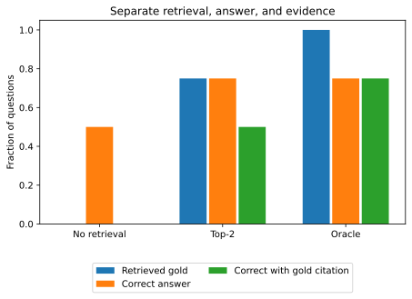

# RAG 消融與來源評估

[在 Colab 執行](https://colab.research.google.com/github/Samuel-ncu/AI-Stastic/blob/main/notebooks/e4_rag_ablation.ipynb) · [GitHub Notebook](../../notebooks/e4_rag_ablation.ipynb)

先備閱讀　[實驗設計與重現](09-experimental-design.md) · [E3 檢索排序](e3-retrieval-probability.md)

這課用 Lewis 等人的 **RAG 原論文 Table 6** 練習讀真正的消融結果，再用 Gao 等人的 **RAG Survey §6** 設計分開量測檢索與生成的評估。最後實作一個可在 CPU 執行的重排開關，練習從差異回查是哪一題、哪一步變了。

## 原論文 Table 6 實際移除了什麼？

Lewis 等人在開發集比較可微調的稠密檢索器、凍結檢索器，以及換成以文字重疊為基礎的 BM25。下表用 RAG-Token 的三列，並保留兩種任務各自的評分。

| Table 6 檢索條件 | 改了哪一步？ | Natural Questions 開發集 EM | FEVER-3 開發集類別準確率 |
|---|---|---:|---:|
| RAG-Token | 檢索可隨任務調整 | 43.5% | 74.5% |
| RAG-Token-Frozen | 停止在訓練中微調檢索 | 37.8% | 72.9% |
| RAG-Token-BM25 | 用固定 BM25 取代稠密檢索 | 29.7% | 75.1% |

Natural Questions 的 EM（Exact Match）判斷答案字串是否符合參考答案；FEVER-3 判斷事實驗證標籤。對 NQ，完整模型相比 Frozen 高 5.7 個百分點；FEVER-3 上，表中 BM25 則比完整模型高 0.6 個百分點。**先確定任務、資料切分和指標，再解讀消融。** 這個表不能用來報檢索命中率。若要找原論文的檢索指標，可對照 §4.4 的 FEVER 證據分析，作者另外計算前 1 與前 10 篇是否含標註證據文章，報告約 71% 與 90%。[Lewis 等人，Table 6 與 §4.4](https://arxiv.org/html/2005.11401v4#S4)

## 用 RAG Survey §6 展開量測

| 原文討論的評估面向 | 本課如何測量 |
|---|---|
| **Context relevance**（上下文相關性） | 檢查前 $K$ 份片段中有多少與問題相關，並記錄正解證據有沒有進入實際交給生成器的上下文 |
| **Answer faithfulness**（答案受來源支持的程度） | 將答案拆成主張，逐一比對片段是否支持；引用命中且答對是本課的簡化檢查 |
| **Answer relevance**（回答是否切題） | 判斷回答是否對準問題；另用 EM 比對答案正確性，讓兩個面向各自回報 |
| **Noise robustness**（抗噪性）與 **negative rejection**（遇到缺乏證據時能否拒答） | 分別加進看似相關的錯誤片段、移除所有支持片段，以同一題配對觀察 |

Survey 在進階 RAG 中也討論檢索後重排。Notebook 固定題目、候選池、$K=2$、簡化讀取規則與評分，**只改排序用的分數**，觀察重排前後三個指標與逐題差異。這個 CPU 練習用預設分數和單步讀取規則模擬設計，對應的是 Survey 的重排與分項評估。若換成真實系統，記錄檢索、重排和生成各自耗時，另外量多次端到端延遲再報中位數及 P95。[RAG Survey v5，§II-B、§VI](https://arxiv.org/html/2312.10997v5)

## 合成暖身：先手算三種評估量

以四道自編題讀混合錯誤。上面的原論文對照和下方練習使用不同條件，目的是練習如何拆開量測。

| 條件 | 生成器拿到什麼？ | 想理解的問題 |
|---|---|---|
| 無檢索 | 沒有提供文件 | 模型單獨作答的基準 |
| Top-2 檢索 | 檢索結果最前面的兩份 | 一般檢索和生成合作時的表現 |
| 人工提供正確文件（oracle） | 人工確認的證據文件 | 已知有證據時，生成端還會出哪些錯誤？ |

## 同一題可能答對、也可能缺少證據

每題先標一份正解文件，再分開記錄三件事。**檢索命中**看輸入給模型的文件裡是否有正解來源。**答案正確**由答案與標準答案比對。**答對且引用命中**要求答案正確、引用正解文件，而且該文件確實有提供給模型。這是教學版引用核對，正式評估還要檢查被引用段落能否支撐回答的具體敘述。

自編四題的結果如下，分母都是四題。延遲是預先填入的示例毫秒數。

| 條件 | 檢索命中 | 答案正確 | 答對且引用命中 | 延遲中位數 |
|---|---:|---:|---:|---:|
| 無檢索 | 0/4 | 2/4 | 0/4 | 32.5 ms |
| Top-2 | 3/4 | 3/4 | 2/4 | 100 ms |
| 人工文件 | 4/4 | 3/4 | 3/4 | 60 ms |

Top-2 和人工文件的答對率同為 3/4，但兩者的來源指標不同。人工已提供正確文件時仍有一題答錯，值得回看生成器怎麼使用證據；Top-2 中也有一題答對但沒取到正解文件。沿用第 09 課，把同一題配對比較，才能具體指出是哪種情況。

## 暖身圖解與原文對照實作

用同一組題目比較三種條件，逐題找出檢索、答案與引用的差異。 這張圖使用合成資料。上方 Notebook 有獨立的「原文對照」程式與圖表，會標明哪些數字來自論文，哪些是教學用例子。

## 自我檢核與練習

**對照原文。** 說明為什麼「凍結檢索器」和「拿掉重排器」回答不同問題。看 Table 6 的 NQ 和 FEVER-3 各寫一條可以由表支持的結論。最後在 CPU 練習把第二組排序改成在某一題將錯誤證據排首位，逐題檢查是檢索命中、答案正確性還是引用改變。

把 Top-2 第三題補入正解文件並引用它，再重算三項指標。答案已正確，所以準確率仍為 3/4；檢索命中升為 4/4，答對且引用命中升為 3/4。再說明如何在真實實驗用重複量測記錄延遲。

接續閱讀　[論文閱讀導引](../paper-reading-guide.md)

## 來源

- [RAG 原論文](https://arxiv.org/abs/2005.11401)
- [RAG 綜述](https://arxiv.org/abs/2312.10997v5)
